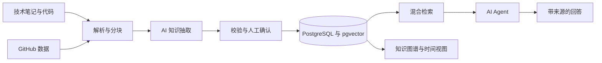

# Knowledge Atlas

面向个人开发者的时序知识图谱与可追溯 AI 问答平台。

Knowledge Atlas 将技术笔记、代码、项目文档和 Git 记录组织成带有来源、时间和上下文的知识网络，帮助开发者重新找到历史方案、理解技术决策，并基于真实证据回答问题。

> 当前进度：Markdown 导入、DeepSeek 候选抽取/审核、PostgreSQL 正式图谱、关键词/语义向量/一跳图关系融合检索，以及同步证据问答已经实现。真实问答质量、代表性关系数据与 PostgreSQL 并发验收仍待完成。


## 项目要解决的问题

- 技术笔记、代码和 Git 记录分散，项目上下文难以完整恢复。
- 代码保留了最终实现，但候选方案、约束和选择理由容易丢失。
- 开发者记得处理过类似问题，却难以定位当时的方案和证据。
- 技术结论会随版本演进，普通笔记难以表达知识何时生效或失效。
- 通用 AI 问答缺少来源，生成结果难以核验。

## 核心能力

| 能力 | 说明 | 当前状态 |
| --- | --- | --- |
| 资料导入 | 导入 Markdown、文本、代码及 GitHub 数据 | Markdown 上传、解析和分块查询已完成 |
| 知识抽取与审核 | 提取带原文证据的实体、关系候选，并逐项确认或拒绝 | DeepSeek 接口、审核页面及确认后写入正式图谱已实现，真实调用待验收 |
| 实体消歧 | 合并别名和重复实体，保留人工确认流程 | 规划中 |
| 知识图谱 | 浏览节点、关系、项目归属和来源证据 | 项目图谱已接入真实数据；演示图谱仍为 Mock |
| 关键词检索 | 搜索正式实体名称、摘要和原文证据，打开详情与邻域 | 已接入真实项目接口 |
| 语义检索 | 使用显式构建的 1024 维正式实体索引进行相似度检索 | 已接入真实项目接口，真实服务冒烟通过 |
| 混合检索 | 按固定权重融合关键词、向量和一跳图关系，并解释组成得分 | 已接入真实项目接口 |
| 证据问答 | 基于检索证据回答并返回原始来源 | 真实同步接口与前端已接入；历史/多轮仍规划中 |
| 时序知识 | 保存知识的生效、失效和替代关系 | 正式记录保存 `valid_from`/`valid_to` 与状态；历史定年和自动替代仍规划中 |
| 知识治理 | 检测冲突、重复、孤立节点和证据缺失 | 后续阶段 |

## 当前前端

使用真实搜索：从资料页进入“查看项目图谱”，在“搜索项目知识”中切换关键词或语义向量模式。关键词按字面匹配；语义模式需先配置嵌入服务并点击“更新语义索引”。两种结果都可打开知识详情与邻域，并展示文件名、原文和行号。

前端位于 [`frontend`](frontend)，使用 Vue 3、TypeScript、Vite 和 Element Plus 实现。默认打开可独立运行的 Mock 图谱；项目、资料、审核、项目图谱和“证据问答”连接真实后端。问答展示当前回答、检索统计、引用原文和实体跳转，但暂不保存历史；演示图谱中的节点追问仍是 Mock。

已实现的交互包括：

- 搜索并定位知识节点。
- 点击节点查看描述、可信度、所属项目和来源证据。
- 展开证据片段并在关联节点之间跳转。
- 按知识类型筛选图谱。
- 通过时间轴回放不同阶段的知识状态。
- 基于当前节点生成模拟证据回答。
- 桌面端与移动端响应式布局。
- 真实项目列表与创建、项目资料列表、Markdown 上传和文件校验。
- 显式开始/重试解析、原文预览、标题层级与行号分块查询。
- 候选知识确认/拒绝、名称摘要修正和旧确认补写入图谱。
- 真实项目图谱浏览、类型筛选、一跳/二跳邻域、实体/关系详情与原文证据。
- 真实证据问答、证据不足状态、检索统计、引用行号和图谱实体跳转。
- 加载、空数据、错误、重试与分页状态。

## 当前后端

后端位于 `backend`，已实现以下能力：

- FastAPI 应用、CORS、请求 ID 和统一错误结构。
- 项目创建、分页查询和详情接口。
- UTF-8 Markdown 上传、大小与类型校验、内容哈希和原文保存。
- 上传后创建 `queued` 处理任务，支持显式执行解析和资料、任务、分块查询。
- 独立 Worker 自动消费排队任务，通过执行租约恢复中断任务，并阻止旧进程覆盖新结果。
- 解析标题、段落、列表和围栏代码块，保存原文、标题路径及行号；相同项目重复上传相同字节会复用来源与任务。
- 项目、资料、任务、候选知识和正式图谱的 SQLAlchemy 模型与 Alembic 迁移。
- PostgreSQL/pgvector、API 和 Worker 的 Docker Compose 配置。
- 显式 DeepSeek 候选知识提取、类型/端点/原文引用校验、候选分页及确认/拒绝/名称摘要修正，保留审核前后记录。
- 确认候选在同一事务内写入正式实体、关系和证据，支持稳定 UUID、幂等重放和旧确认补写；提供只读项目图谱、实体和关系详情接口。
- 同步证据问答：有界混合检索、严格模型输出、引用 UUID 校验，以及无证据时不调用回答模型的确定性拒答。
- 使用 SQLite 隔离数据库及模拟模型响应的后端接口测试。

## 快速开始

### 前端

环境要求：Node.js 20 或更高版本，npm 10 或更高版本。

```bash
cd frontend
npm install
npm run dev
```

浏览器访问 `http://localhost:5173`。

如需使用真实项目、资料和问答，启动后端后点击相应导航。前端 `.env.example` 中的 `VITE_API_BASE_URL` 可配置后端地址；`VITE_DATA_SOURCE=api` 会默认打开资料页，`mock` 则默认打开演示图谱。修改环境变量后需要重启前端。证据问答还要求后端配置嵌入服务、显式更新项目语义索引，并配置 DeepSeek。

生产构建：

```bash
cd frontend
npm run build
```

本地预览构建结果：

```bash
npm run preview
```

### 后端

环境要求：Python 3.12 或更高版本。复制环境文件后安装依赖：

```bash
cd backend
python -m venv .venv
# Windows: .venv\Scripts\activate
# macOS/Linux: source .venv/bin/activate
python -m pip install -e ".[dev]"
```

然后将 `backend/.env.example` 复制为 `backend/.env`。默认使用本机已安装的 PostgreSQL（含 pgvector），在环境文件中填写实际连接地址、数据库名、账号和密码；不要提交 `.env`。

启动本机 PostgreSQL，创建项目专用数据库 `knowledge_atlas`，确认 PostgreSQL 已安装 pgvector 扩展文件。初始迁移会执行 `CREATE EXTENSION IF NOT EXISTS vector`，需要当前账号具备权限，或提前由管理员在该数据库启用扩展。然后从后端目录运行：

```bash
alembic upgrade head
uvicorn app.main:app --reload
```

候选提取和语义索引需要先应用最新迁移（`20261018_0006`）。候选提取在后端 `.env` 设置 `DEEPSEEK_API_KEY`；语义检索需另外配置 `EMBEDDING_API_KEY`、`EMBEDDING_BASE_URL` 和 `EMBEDDING_MODEL`，当前固定 1024 维。两类外部调用都由用户显式触发。详细设置见 [后端说明](backend/README.zh-CN.md)。

接口文档地址为 `http://localhost:8000/docs`，存活检查地址为 `http://localhost:8000/api/v1/health/live`。

在另一个已激活后端环境的终端中，从 `backend/` 运行 `python -m app.worker`，即可自动处理上传任务。也可以不启动 Worker，在页面点击“开始解析”或调用 `POST /api/v1/tasks/{task_id}/run` 手动执行。通过“刷新状态”或 `GET /api/v1/sources/{source_id}/chunks` 查看结果；具体配置与恢复规则见 [后端说明](backend/README.zh-CN.md)。Docker Compose 保留为可选方案，不是开发或验收前提。

## 目标技术架构



| 层次 | 目标技术 | 主要职责 |
| --- | --- | --- |
| 前端 | Vue 3、TypeScript、Vite、Element Plus | 图谱、证据、问答和时间视图 |
| 后端 | FastAPI | 用户、项目、资料、知识和查询接口 |
| 任务处理 | Python Worker | 文档解析、向量生成和知识抽取 |
| Agent | LangGraph | 问题分类、检索规划、证据核验和回答 |
| 业务、图谱与向量 | PostgreSQL、pgvector | 原文、分块、任务、审核、实体、关系与证据；规划中的历史演化和向量索引 |
| 运行环境 | 本机 PostgreSQL 与 Python/Node.js 进程；可选 Docker Compose | 本地开发与毕业设计演示环境 |

当前不需要 Neo4j。节点、关系和证据已存储在 PostgreSQL；只有实际查询需求证明有必要时再评估独立图数据库，见 [ADR 0005](docs/adr/0005-postgresql-only-storage.zh-CN.md)。

架构边界和数据流详见 [系统架构](docs/ARCHITECTURE.md)。

## 项目结构

```text
knowledge-atlas/
├─ .github/                 # Issue 与 Pull Request 模板
├─ .agents/skills/          # 仓库级代理技能与任务流程
├─ backend/                 # FastAPI、数据模型、迁移与接口测试
│  ├─ app/                  # API、服务、配置、模型及 worker.py 消费入口
│  ├─ migrations/           # Alembic 数据库迁移
│  ├─ README.md             # 后端运行与验证说明
│  └─ tests/                # SQLite 隔离接口测试
├─ frontend/                 # Vue 演示图谱、真实项目/资料/审核工作台与项目图谱
│  ├─ src/api/              # 后端接口客户端与类型
│  ├─ src/components/       # 搜索、图谱、侧栏和时间轴组件
│  ├─ src/mock/             # 本地演示数据
│  └─ src/types.ts          # 前端领域类型
├─ docs/
│  ├─ adr/                  # 重要技术决策记录
│  ├─ ARCHITECTURE.md       # 目标架构与关键数据流
│  ├─ DEVELOPMENT_SETUP.md  # 本地环境与开发流程
│  ├─ FRONTEND.md           # 前端结构和交互说明
│  ├─ KNOWLEDGE_MODEL.md    # 实体、关系、证据和时序模型
│  ├─ API_CONTRACT.md       # 前后端接口草案
│  └─ ROADMAP.md            # 开发阶段和验收标准
├─ AGENTS.md                # Codex/AI 编码代理的仓库级约束
├─ PLANS.md                 # 当前实施重点与阶段计划
├─ CONTRIBUTING.md          # 分支、提交和评审规范
├─ CHANGELOG.md             # 版本变化记录
├─ SECURITY.md              # 敏感数据与漏洞报告约定
├─ compose.yaml             # PostgreSQL、API 和 Worker 本地环境
└─ README.md
```

当前 Worker 复用后端代码，通过独立进程运行；后续工程计划增加 `prompts` 和实验测试数据目录。

## 文档索引

以下默认指向中文版；已有英文文档使用 `.zh-CN.md` 文件并列提供中文版本，页面顶部可以切换语言。

- [系统架构](docs/ARCHITECTURE.md)
- [本地开发与环境初始化](docs/DEVELOPMENT_SETUP.zh-CN.md) · [English](docs/DEVELOPMENT_SETUP.md)
- [后端开发说明](backend/README.zh-CN.md) · [English](backend/README.md)
- [前端开发说明](docs/FRONTEND.md)
- [开发者知识模型](docs/KNOWLEDGE_MODEL.md)
- [前后端接口草案](docs/API_CONTRACT.md)
- [开发路线与验收标准](docs/ROADMAP.md)
- [当前实施计划](PLANS.zh-CN.md) · [English](PLANS.md)
- [贡献与协作规范](CONTRIBUTING.zh-CN.md) · [English](CONTRIBUTING.md)
- [版本变化记录](CHANGELOG.zh-CN.md) · [English](CHANGELOG.md)
- [安全说明](SECURITY.zh-CN.md) · [English](SECURITY.md)
- [技术决策记录](docs/adr/README.zh-CN.md) · [English](docs/adr/README.md)
- [AI 编码代理说明](AGENTS.zh-CN.md) · [English](AGENTS.md)

## 最小闭环

第一阶段只实现一条可验证的端到端流程：

1. 用户创建项目并上传一篇 Markdown 技术笔记。
2. 系统保留标题结构、段落、来源位置和内容哈希。
3. 模型抽取问题、方案、技术决策和证据，并输出固定 JSON。
4. 用户确认候选实体和关系。
5. 系统将确认后的知识写入正式图谱，并通过显式操作更新语义索引。
6. 用户提出问题，系统融合关键词、向量和一跳图关系检索。
7. 回答必须返回原文证据；证据不足时明确说明缺失信息。
8. 至少支持一组新旧结论的替代关系和历史查询。

完成该闭环后，再扩展代码解析、GitHub 导入、多跳查询和知识治理。

## 设计原则

- 来源优先：实体、关系和回答都必须能够追溯到原始资料。
- 人工可控：模型只生成候选知识，低置信度结果必须等待确认。
- 时间保真：新结论不覆盖旧结论，通过状态和替代关系保留演化历史。
- 单用户优先：毕业设计第一版不引入团队协作和复杂权限。
- 先闭环后扩展：先完成 Markdown 端到端流程，再增加数据源和高级能力。

## 项目状态说明

本仓库目前处于“第一版证据问答”阶段。项目、资料、候选审核、项目图谱、三路混合检索和同步证据问答均已接入真实接口；演示图谱中的追问仍是 Mock。问答只使用检索到的正式证据并校验引用，当前不保存历史，也未引入 LangGraph。实体消歧、多轮 Agent、代表性真实问答质量、含非零关系得分的数据、PostgreSQL 并发/租约故障注入仍待专项验收。验收不依赖 Docker。
