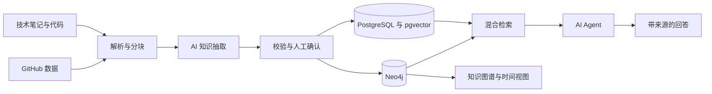

# Knowledge Atlas

面向个人开发者的时序知识图谱与可追溯 AI 问答平台。

Knowledge Atlas 将技术笔记、代码、项目文档和 Git 记录组织成带有来源、时间和上下文的知识网络，帮助开发者重新找到历史方案、理解技术决策，并基于真实证据回答问题。

> 当前进度：可交互 Mock 前端和 FastAPI 基础接口已经完成；知识解析、抽取、图谱投影和真实检索尚未接入。


## 项目要解决的问题

- 技术笔记、代码和 Git 记录分散，项目上下文难以完整恢复。
- 代码保留了最终实现，但候选方案、约束和选择理由容易丢失。
- 开发者记得处理过类似问题，却难以定位当时的方案和证据。
- 技术结论会随版本演进，普通笔记难以表达知识何时生效或失效。
- 通用 AI 问答缺少来源，生成结果难以核验。

## 核心能力

| 能力 | 说明 | 当前状态 |
| --- | --- | --- |
| 资料导入 | 导入 Markdown、文本、代码及 GitHub 数据 | Markdown 上传接口已完成 |
| 知识抽取 | 提取项目、技术、问题、方案、决策和证据 | 规划中 |
| 实体消歧 | 合并别名和重复实体，保留人工确认流程 | 规划中 |
| 知识图谱 | 浏览节点、关系、项目归属和来源证据 | Mock 已完成 |
| 混合检索 | 融合关键词、向量和图关系检索 | 规划中 |
| 证据问答 | 基于检索证据回答并返回原始来源 | Mock 已完成 |
| 时序知识 | 保存知识的生效、失效和替代关系 | Mock 已完成 |
| 知识治理 | 检测冲突、重复、孤立节点和证据缺失 | 后续阶段 |

## 当前前端

前端位于 [`frontend`](frontend)，使用 Vue 3、TypeScript、Vite 和 Element Plus 实现。当前数据全部来自本地 Mock，可以独立运行和演示。

已实现的交互包括：

- 搜索并定位知识节点。
- 点击节点查看描述、可信度、所属项目和来源证据。
- 展开证据片段并在关联节点之间跳转。
- 按知识类型筛选图谱。
- 通过时间轴回放不同阶段的知识状态。
- 基于当前节点生成模拟证据回答。
- 桌面端与移动端响应式布局。

## 当前后端

后端位于 `backend`，已经实现第一阶段的可测试基础能力：

- FastAPI 应用、CORS、请求 ID 和统一错误结构。
- 项目创建、分页查询和详情接口。
- UTF-8 Markdown 上传、大小与类型校验、内容哈希和原文保存。
- 上传后创建 `queued` 处理任务，并提供资料与任务查询接口。
- 项目、资料、任务和候选知识的 SQLAlchemy 模型与 Alembic 初始迁移。
- PostgreSQL/pgvector、Neo4j 和 API 的 Docker Compose 配置。
- 使用 SQLite 隔离数据库的后端接口测试。

## 快速开始

### 前端

环境要求：Node.js 20 或更高版本，npm 10 或更高版本。

```bash
cd frontend
npm install
npm run dev
```

浏览器访问 `http://localhost:5173`。

生产构建：

```bash
cd frontend
npm run build
```

本地预览构建结果：

```bash
npm run preview
```

### 后端

环境要求：Python 3.12 或更高版本。复制环境文件后安装依赖：

```bash
cd backend
python -m venv .venv
# Windows: .venv\Scripts\activate
# macOS/Linux: source .venv/bin/activate
python -m pip install -e ".[dev]"
```

然后将 `backend/.env.example` 复制为 `backend/.env`。

启动本地数据库并运行迁移：

```bash
docker compose up -d postgres neo4j
cd backend
alembic upgrade head
uvicorn app.main:app --reload
```

接口文档地址为 `http://localhost:8000/docs`，存活检查地址为 `http://localhost:8000/api/v1/health/live`。

## 目标技术架构



| 层次 | 目标技术 | 主要职责 |
| --- | --- | --- |
| 前端 | Vue 3、TypeScript、Vite、Element Plus | 图谱、证据、问答和时间视图 |
| 后端 | FastAPI | 用户、项目、资料、知识和查询接口 |
| 任务处理 | Python Worker | 文档解析、向量生成和知识抽取 |
| Agent | LangGraph | 问题分类、检索规划、证据核验和回答 |
| 业务与向量 | PostgreSQL、pgvector | 原文、分块、任务、审核和向量索引 |
| 图数据库 | Neo4j | 知识实体、语义关系和历史演化 |
| 部署 | Docker Compose | 本地开发与毕业设计演示环境 |

架构边界和数据流详见 [系统架构](docs/ARCHITECTURE.md)。

## 项目结构

```text
knowledge-atlas/
├─ .github/                 # Issue 与 Pull Request 模板
├─ backend/                 # FastAPI、数据模型、迁移与接口测试
│  ├─ app/                  # API、服务、配置和 SQLAlchemy 模型
│  ├─ migrations/           # Alembic 数据库迁移
│  ├─ README.md             # 后端运行与验证说明
│  └─ tests/                # SQLite 隔离接口测试
├─ frontend/                 # 当前已实现的 Vue Mock 前端
│  ├─ src/api/              # 后端接口客户端与类型
│  ├─ src/components/       # 搜索、图谱、侧栏和时间轴组件
│  ├─ src/mock/             # 本地演示数据
│  └─ src/types.ts          # 前端领域类型
├─ docs/
│  ├─ adr/                  # 重要技术决策记录
│  ├─ ARCHITECTURE.md       # 目标架构与关键数据流
│  ├─ DEVELOPMENT_SETUP.md  # 本地环境与开发流程
│  ├─ FRONTEND.md           # 前端结构和交互说明
│  ├─ KNOWLEDGE_MODEL.md    # 实体、关系、证据和时序模型
│  ├─ API_CONTRACT.md       # 前后端接口草案
│  └─ ROADMAP.md            # 开发阶段和验收标准
├─ AGENTS.md                # Codex/AI 编码代理的仓库级约束
├─ PLANS.md                 # 当前实施重点与阶段计划
├─ CONTRIBUTING.md          # 分支、提交和评审规范
├─ CHANGELOG.md             # 版本变化记录
├─ SECURITY.md              # 敏感数据与漏洞报告约定
├─ compose.yaml             # PostgreSQL、Neo4j 和 API 本地环境
└─ README.md
```

后续工程计划增加独立的 `worker`、`prompts` 和实验测试数据目录。

## 文档索引

- [系统架构](docs/ARCHITECTURE.md)
- [本地开发与环境初始化](docs/DEVELOPMENT_SETUP.md)
- [后端开发说明](backend/README.md)
- [前端开发说明](docs/FRONTEND.md)
- [开发者知识模型](docs/KNOWLEDGE_MODEL.md)
- [前后端接口草案](docs/API_CONTRACT.md)
- [开发路线与验收标准](docs/ROADMAP.md)
- [当前实施计划](PLANS.md)
- [贡献与协作规范](CONTRIBUTING.md)
- [版本变化记录](CHANGELOG.md)
- [安全说明](SECURITY.md)
- [技术决策记录](docs/adr/README.md)
- [AI 编码代理说明](AGENTS.md)

## 最小闭环

第一阶段只实现一条可验证的端到端流程：

1. 用户创建项目并上传一篇 Markdown 技术笔记。
2. 系统保留标题结构、段落、来源位置和内容哈希。
3. 模型抽取问题、方案、技术决策和证据，并输出固定 JSON。
4. 用户确认候选实体和关系。
5. 系统写入知识图谱并生成向量索引。
6. 用户提出问题，系统融合关键词、向量和一跳图关系检索。
7. 回答必须返回原文证据；证据不足时明确说明缺失信息。
8. 至少支持一组新旧结论的替代关系和历史查询。

完成该闭环后，再扩展代码解析、GitHub 导入、多跳查询和知识治理。

## 设计原则

- 来源优先：实体、关系和回答都必须能够追溯到原始资料。
- 人工可控：模型只生成候选知识，低置信度结果必须等待确认。
- 时间保真：新结论不覆盖旧结论，通过状态和替代关系保留演化历史。
- 单用户优先：毕业设计第一版不引入团队协作和复杂权限。
- 先闭环后扩展：先完成 Markdown 端到端流程，再增加数据源和高级能力。

## 项目状态说明

本仓库目前处于后端基础和 Markdown 导入闭环阶段。README 中标记为“规划中”或“后续阶段”的能力属于目标设计，不代表已经完成。前端仍使用 Mock 数据；后端当前只保存原文并创建排队任务，尚未执行解析、知识抽取或图谱写入。
