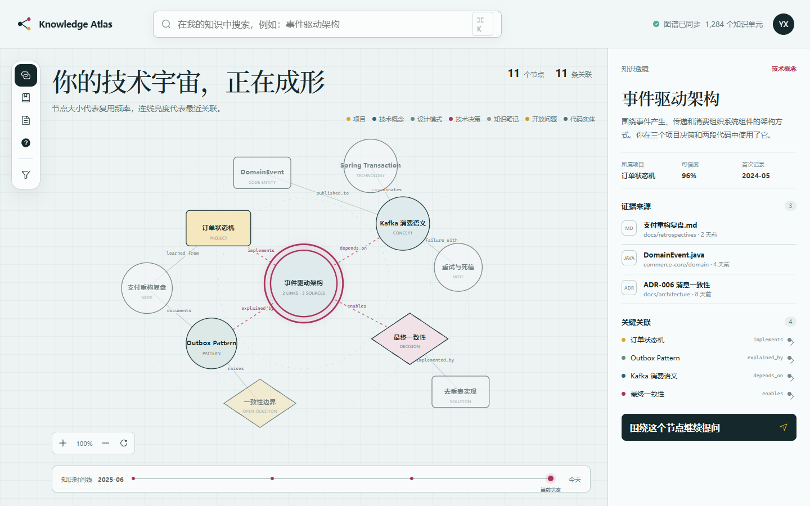
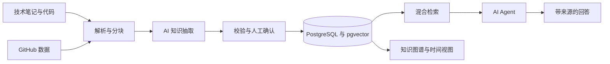

# Knowledge Atlas

毕业补强清单第 3—8 项已落地：10 种语言/50 题跨文件金标集、可选只读工具 Agent、112 次真实 DeepSeek 验收、5 组可复现图表、双语交付说明，以及前端测试/CI/完整本地启动环境。真实结果与限制见[实验报告](evaluation/results/2026-10-24-models/REPORT.zh-CN.md)，启动见[演示说明](docs/DEMO.zh-CN.md)。人工盲评仍待真实评审；Docker 构建与远端 CI 未在本机执行，不计作已验收。

多语言解析 V1 已将原 Markdown/多语言代码导入链路扩展到 Python、JavaScript/JSX、TypeScript/TSX、Go、C、C++、C#，贯通单文件/文件夹、GitHub 文件、Worker、精确原文分块、大纲及符号检索。默认解析不调用模型；用户可在源码结构区显式运行受限 Agent，从同仓库静态候选中分析多语言跨文件调用。结果带原文行证据且不持久化、不自动入图。见[语言范围与限制](docs/MULTILANGUAGE_PARSING.zh-CN.md)及 [ADR 0041](docs/adr/0041-bounded-multilanguage-agent-call-analysis.zh-CN.md)。

面向个人开发者的时序知识图谱与可追溯 AI 问答平台。

阶段六现可通过独立命令重放版本化的合成审核夹具，自动建立隔离实验项目并执行关键词/向量/混合三组纯检索。初始化保留普通证据与审核服务，记录语料、标注、实际图谱和索引指纹。数据集已修订为 `1.0.1`，详见[实验运行说明](evaluation/README.zh-CN.md)与 [ADR 0042](docs/adr/0042-reproducible-curated-evaluation-projects.zh-CN.md)。真实嵌入实验结果不代表真实答案或自动抽取质量。

Knowledge Atlas 将技术笔记、代码、项目文档和 Git 记录组织成带有来源、时间和上下文的知识网络，帮助开发者重新找到历史方案、理解技术决策，并基于真实证据回答问题。

> 当前进度：Markdown 与 Java 的本地单文件/仓库文件夹导入（含仓库内相对路径持久化）、规范化 GitHub remote 身份、显式有界快照及 Commit 元数据持久化/增量同步、从快照派生的不可变 GitHub 文件/行号证据链接、显式有界 Issue/PR 与 PR Review 活动版本导入、DeepSeek 候选抽取/审核、PostgreSQL 正式图谱、关键词/语义向量/一跳图关系融合检索，以及同步证据问答已经实现。GitHub 文件同步当前只处理单个 ref 中最多 50 份支持文件；工作项导入最多读取最近更新的 20 项、每项 20 条普通评论，以及每个 PR 各 20 条 Review、行级 Review Comment 与 GraphQL Review thread 当前状态。删除保留为历史快照，不自动失效既有知识。Java 支持有界跨文件类型，以及显式声明类型、构造器初始化 `var` 和返回类型唯一的类型限定静态工厂 `var` 接收者调用（V1 支持词法作用域、循环/资源变量、继承候选和参数数量筛选，详见 [能力与验收边界](docs/JAVA_ANALYSIS_V1.zh-CN.md)），但不代表完整 AST 或调用图已经完成。



## 项目要解决的问题

- 技术笔记、代码和 Git 记录分散，项目上下文难以完整恢复。
- 代码保留了最终实现，但候选方案、约束和选择理由容易丢失。
- 开发者记得处理过类似问题，却难以定位当时的方案和证据。
- 技术结论会随版本演进，普通笔记难以表达知识何时生效或失效。
- 通用 AI 问答缺少来源，生成结果难以核验。

## 核心能力

| 能力 | 说明 | 当前状态 |
| --- | --- | --- |
| 资料导入 | 导入 Markdown、文本、代码及 GitHub 数据 | Markdown/多语言代码 本地上传、有界 GitHub ref 快照、Commit 元数据、增量 blob 复用、不可变文件/行号链接及有界 Issue/PR/Review 版本导入已完成；自动同步待开发 |
| 知识抽取与审核 | 提取带原文证据的实体、关系候选，并逐项确认或拒绝 | DeepSeek 接口、审核页面及确认后写入正式图谱已实现，真实调用待验收 |
| 实体消歧 | 合并别名和重复实体，保留人工确认流程 | 规划中 |
| 知识图谱 | 浏览节点、关系、项目归属和来源证据 | 项目图谱已接入真实数据；演示图谱仍为 Mock |
| 关键词检索 | 搜索正式实体名称、摘要和原文证据，打开详情与邻域 | 已接入真实项目接口 |
| 语义检索 | 使用显式构建的 1024 维正式实体索引进行相似度检索 | 已接入真实项目接口，真实服务冒烟通过 |
| 混合检索 | 按固定权重融合关键词、向量和一跳图关系，并解释组成得分 | 已接入真实项目接口 |
| 证据问答 | 基于检索证据回答并返回原始来源 | 真实同步接口与前端已接入；历史/多轮仍规划中 |
| 时序知识 | 保存知识的生效、失效和替代关系 | 人工提出/审核跨来源替代、当前/历史查询、替代链及原文跳转已实现；不自动定年或替代 |
| 知识治理 | 检测冲突、重复、孤立节点和证据缺失 | 当前知识的有界只读规则检查已实现，仅给建议，不自动修改 |

## 当前前端

本轮核心功能的实际检查、真实公开仓库固定提交、原生/SQLite/浏览器结果与暂缓项目见[核心功能验收记录](docs/CORE_ACCEPTANCE.zh-CN.md)。

项目图谱新增历史时间查询与“知识演化与治理”：选择旧知识和同类型新知识，填写理由并保存建议，再核对原文、单独确认替代/补充/冲突。替代后旧知识从当前图谱/检索退出，仍可沿替代链查看历史和双方原文。历史视图不能修改知识。先应用迁移 `20261023_0015`；跨来源演化与普通语义关系分别保存，见 [ADR 0039](docs/adr/0039-reviewed-knowledge-evolution.zh-CN.md)。

使用真实搜索：从资料页进入“查看项目图谱”，在“搜索项目知识”中切换关键词或语义向量模式。关键词按字面匹配；语义模式需先配置嵌入服务并点击“更新语义索引”。两种结果都可打开知识详情与邻域，并展示文件名、原文和行号。

前端位于 [`frontend`](frontend)，使用 Vue 3、TypeScript、Vite 和 Element Plus 实现。默认打开可独立运行的 Mock 图谱；项目、资料、审核、项目图谱和“证据问答”连接真实后端。问答展示当前回答、检索统计、引用原文和实体跳转，但暂不保存历史；演示图谱中的节点追问仍是 Mock。

已实现的交互包括：

- 搜索并定位知识节点。
- 点击节点查看描述、可信度、所属项目和来源证据。
- 展开证据片段并在关联节点之间跳转。
- 按知识类型筛选图谱。
- 通过时间轴回放不同阶段的知识状态。
- 基于当前节点生成模拟证据回答。
- 桌面端与移动端响应式布局。
- 真实项目列表与创建、项目资料列表，以及 Markdown/多语言代码 的桌面端单文件上传或本地仓库文件夹导入（最多 50 份支持文件，保存仓库身份和仓库内相对路径）。
- 来源仓库清单、GitHub HTTPS/SSH remote 规范化登记、稳定 provider ID、关联已有本地仓库，以及从默认分支或指定 ref 显式增量同步最多 50 份 Markdown/多语言代码 文件并保存 Commit 快照。
- GitHub 导入资料的固定 Commit 文件入口，以及图谱、搜索和问答证据中固定到精确行号的 GitHub 原文入口。
- 最近更新的 GitHub Issue/PR 显式导入，正文、普通评论以及 PR Review/行级 Review Comment/有界 thread 当前状态分别形成不可变 Markdown 来源版本，并从资料和证据打开规范会话。
- 显式开始/重试解析、原文预览、标题或代码结构与行号分块查询。
- Java 类型、字段、方法、有界同文件调用，以及按包/导入解析的跨文件继承/实现和显式类型、构造器初始化或返回类型唯一的类型限定静态工厂局部接收者调用（V1 支持词法作用域、循环/资源变量、继承候选和参数数量筛选，详见 [能力与验收边界](docs/JAVA_ANALYSIS_V1.zh-CN.md)）展示，明确与已审核正式图谱分离。
- 候选知识确认/拒绝、名称摘要修正和旧确认补写入图谱。
- 真实项目图谱浏览、类型筛选、一跳/二跳邻域、实体/关系详情与原文证据。
- 真实证据问答、证据不足状态、检索统计、引用行号和图谱实体跳转。
- 加载、空数据、错误、重试与分页状态。

## 当前后端

后端位于 `backend`，已实现以下能力：

- FastAPI 应用、CORS、请求 ID 和统一错误结构。
- 项目创建、分页查询和详情接口。
- UTF-8 Markdown/多语言代码 上传、大小与类型校验、内容哈希、原文及可空仓库身份保存；支持项目范围内规范化 GitHub remote 身份与有界快照导入。
- 上传后创建 `queued` 处理任务，支持显式执行解析和资料、任务、分块查询。
- 独立 Worker 自动消费排队任务，通过执行租约恢复中断任务，并阻止旧进程覆盖新结果。
- Markdown 解析标题、段落、列表和围栏代码块；Java 解析顶层类型与常规直接成员方法。两者保存精确原文、结构路径及行号，并按项目、可空仓库、来源类型和内容哈希复用来源与任务。
- 从已解析 Java 原文按需派生类型、常规字段、未限定/`this.` 同文件调用，以及同仓库已解析来源中的 `extends`/`implements` 目标，不写入正式知识图谱；未归属仓库的旧来源仅在同项目未归属集合内解析。
- Java 静态导入支持把 `import static Type.method` / `Type.*` 的未限定调用链接到同仓库已解析来源中的可访问静态方法，保留成员名称优先和歧义；边界见 [ADR 0030](docs/adr/0030-java-static-import-calls.zh-CN.md)。
- 方法体及受支持传统 for/资源 try 头部的 `var x = create(...)` 可经当前/继承静态成员或静态导入推断一致的仓库内返回类型，再定位 `x.method()`；成员优先、声明顺序、类型名遮蔽及未知/冲突返回均保守处理，见 [ADR 0037](docs/adr/0037-unqualified-java-factory-receivers.zh-CN.md) 与 [ADR 0038](docs/adr/0038-java-header-factory-receivers.zh-CN.md)。
- 资料工作台可按名称/文件路径检索已解析多语言代码符号，支持仓库和类型筛选、截断提示，并跳到声明所在原文分块；GitHub 文件提供固定 Commit/行号链接，见 [ADR 0032](docs/adr/0032-bounded-code-symbol-search.zh-CN.md)。
- 仓库卡片可分页查看已保存的同步快照，显式把提交说明保存为 Markdown 资料并打开解析任务；相同提交跨 ref/仓库改名可复用，资料与证据打开规范 Commit 页面。此操作不访问 GitHub，不导入 diff 或自动创建正式知识，见 [ADR 0033](docs/adr/0033-saved-commit-evidence-sources.zh-CN.md)。
- 每份快照可分页展开已保存的逐文件状态、blob、原路径与跳过原因，并打开对应资料；文件外链固定到所选快照，删除项仅打开本地保留资料而不伪造删除后文件链接，见 [ADR 0034](docs/adr/0034-snapshot-file-provenance.zh-CN.md)。
- GitHub 同步可在 Commit 未变化时重试截断/超限快照，复用已成功文件；Markdown/多语言代码 之间按来源类型隔离 blob 复用，截断文件集合不推断重命名，见 [ADR 0031](docs/adr/0031-recoverable-typed-github-snapshots.zh-CN.md)。
- 项目、资料、任务、候选知识和正式图谱的 SQLAlchemy 模型与 Alembic 迁移。
- PostgreSQL/pgvector、API 和 Worker 的 Docker Compose 配置。
- 显式 DeepSeek 候选知识提取、类型/端点/原文引用校验、候选分页及确认/拒绝/名称摘要修正，保留审核前后记录。
- 确认候选在同一事务内写入正式实体、关系和证据，支持稳定 UUID、幂等重放和旧确认补写；提供只读项目图谱、实体和关系详情接口。
- 图谱详情、知识搜索与问答引用可直接“查看原文分块”：按项目范围内的来源/分块 UUID 自动翻页、聚焦并高亮，不依赖文件名或引用文本匹配；失败可重试或取消，见 [ADR 0035](docs/adr/0035-exact-evidence-source-navigation.zh-CN.md)。
- 同步证据问答：有界混合检索、严格模型输出、引用 UUID 校验，以及无证据时不调用回答模型的确定性拒答。
- 使用 SQLite 隔离数据库及模拟模型响应的后端接口测试。

## 快速开始

### 前端

环境要求：Node.js 22.12 或更高版本（建议 24 LTS），npm 10 或更高版本。

```bash
cd frontend
npm install
npm run dev
```

浏览器访问 `http://localhost:5173`。

如需使用真实项目、资料和问答，启动后端后点击相应导航。前端 `.env.example` 中的 `VITE_API_BASE_URL` 可配置后端地址；`VITE_DATA_SOURCE=api` 会默认打开资料页，`mock` 则默认打开演示图谱。修改环境变量后需要重启前端。证据问答还要求后端配置嵌入服务、显式更新项目语义索引，并配置 DeepSeek。

生产构建：

```bash
cd frontend
npm run build
```

本地预览构建结果：

```bash
npm run preview
```

### 后端

环境要求：Python 3.12 或更高版本。复制环境文件后安装依赖：

```bash
cd backend
python -m venv .venv
# Windows: .venv\Scripts\activate
# macOS/Linux: source .venv/bin/activate
python -m pip install -e ".[dev]"
```

然后将 `backend/.env.example` 复制为 `backend/.env`。默认使用本机已安装的 PostgreSQL（含 pgvector），在环境文件中填写实际连接地址、数据库名、账号和密码；不要提交 `.env`。

启动本机 PostgreSQL，创建项目专用数据库 `knowledge_atlas`，确认 PostgreSQL 已安装 pgvector 扩展文件。初始迁移会执行 `CREATE EXTENSION IF NOT EXISTS vector`，需要当前账号具备权限，或提前由管理员在该数据库启用扩展。然后从后端目录运行：

```bash
alembic upgrade head
uvicorn app.main:app --reload
```

候选提取、语义索引、GitHub Commit 快照、工作项与 PR Review 版本需要先应用最新迁移（`20261022_0014`）。候选提取在后端 `.env` 设置 `DEEPSEEK_API_KEY`；语义检索需另外配置 `EMBEDDING_API_KEY`、`EMBEDDING_BASE_URL` 和 `EMBEDDING_MODEL`，当前固定 1024 维。外部调用都由用户显式触发。GitHub 公开 REST 读取无需令牌；私有仓库与 Review thread 状态可在后端设置具备 Contents、Issues 与 Pull requests 只读权限的 `GITHUB_TOKEN`。详细设置见 [后端说明](backend/README.zh-CN.md)。

接口文档地址为 `http://localhost:8000/docs`，存活检查地址为 `http://localhost:8000/api/v1/health/live`。

在另一个已激活后端环境的终端中，从 `backend/` 运行 `python -m app.worker`，即可自动处理上传任务。也可以不启动 Worker，在页面点击“开始解析”或调用 `POST /api/v1/tasks/{task_id}/run` 手动执行。通过“刷新状态”或 `GET /api/v1/sources/{source_id}/chunks` 查看结果；具体配置与恢复规则见 [后端说明](backend/README.zh-CN.md)。Docker Compose 保留为可选方案，不是开发或验收前提。

## 目标技术架构



| 层次 | 目标技术 | 主要职责 |
| --- | --- | --- |
| 前端 | Vue 3、TypeScript、Vite、Element Plus | 图谱、证据、问答和时间视图 |
| 后端 | FastAPI | 用户、项目、资料、知识和查询接口 |
| 任务处理 | Python Worker | Markdown/代码语法解析与精确分块；模型与索引由独立显式操作触发 |
| Agent | Python 有界 function-calling 循环 | 已授权快照上的只读工具调查与跨文件候选判定；不引入 LangGraph |
| 业务、图谱与向量 | PostgreSQL、pgvector | 原文、任务、审核、实体、关系、证据、历史演化与显式向量索引均已实现 |
| 运行环境 | 本机 PostgreSQL 与 Python/Node.js 进程；可选 Docker Compose | 本地开发与毕业设计演示环境 |

当前不需要 Neo4j。节点、关系和证据已存储在 PostgreSQL；只有实际查询需求证明有必要时再评估独立图数据库，见 [ADR 0005](docs/adr/0005-postgresql-only-storage.zh-CN.md)。

架构边界和数据流详见 [系统架构](docs/ARCHITECTURE.md)。

## 项目结构

```text
knowledge-atlas/
├─ .github/                 # Issue 与 Pull Request 模板
├─ .agents/skills/          # 仓库级代理技能与任务流程
├─ backend/                 # FastAPI、数据模型、迁移与接口测试
│  ├─ app/                  # API、服务、配置、模型及 worker.py 消费入口
│  ├─ migrations/           # Alembic 数据库迁移
│  ├─ README.md             # 后端运行与验证说明
│  └─ tests/                # SQLite 隔离接口测试
├─ frontend/                 # Vue 演示图谱、真实项目/资料/审核工作台与项目图谱
│  ├─ src/api/              # 后端接口客户端与类型
│  ├─ src/components/       # 搜索、图谱、侧栏和时间轴组件
│  ├─ src/mock/             # 本地演示数据
│  └─ src/types.ts          # 前端领域类型
├─ evaluation/               # 阶段六冻结语料、金标准问题/证据/答案及评分说明
├─ docs/
│  ├─ adr/                  # 重要技术决策记录
│  ├─ ARCHITECTURE.md       # 目标架构与关键数据流
│  ├─ DEVELOPMENT_SETUP.md  # 本地环境与开发流程
│  ├─ FRONTEND.md           # 前端结构和交互说明
│  ├─ KNOWLEDGE_MODEL.md    # 实体、关系、证据和时序模型
│  ├─ API_CONTRACT.md       # 前后端接口草案
│  └─ ROADMAP.md            # 开发阶段和验收标准
├─ AGENTS.md                # Codex/AI 编码代理的仓库级约束
├─ PLANS.md                 # 当前实施重点与阶段计划
├─ CONTRIBUTING.md          # 分支、提交和评审规范
├─ CHANGELOG.md             # 版本变化记录
├─ SECURITY.md              # 敏感数据与漏洞报告约定
├─ compose.yaml             # PostgreSQL、API 和 Worker 本地环境
└─ README.md
```

当前 Worker 复用后端代码，通过独立进程运行；后续工程计划增加 `prompts` 和实验测试数据目录。

## 文档索引

以下默认指向中文版；已有英文文档使用 `.zh-CN.md` 文件并列提供中文版本，页面顶部可以切换语言。

- [系统架构](docs/ARCHITECTURE.md)
- [本地开发与环境初始化](docs/DEVELOPMENT_SETUP.zh-CN.md) · [English](docs/DEVELOPMENT_SETUP.md)
- [后端开发说明](backend/README.zh-CN.md) · [English](backend/README.md)
- [前端开发说明](docs/FRONTEND.md)
- [开发者知识模型](docs/KNOWLEDGE_MODEL.md)
- [前后端接口草案](docs/API_CONTRACT.md)
- [开发路线与验收标准](docs/ROADMAP.md)
- [阶段六测评集与实验运行](evaluation/README.zh-CN.md) · [English](evaluation/README.md)
- [当前实施计划](PLANS.zh-CN.md) · [English](PLANS.md)
- [贡献与协作规范](CONTRIBUTING.zh-CN.md) · [English](CONTRIBUTING.md)
- [版本变化记录](CHANGELOG.zh-CN.md) · [English](CHANGELOG.md)
- [安全说明](SECURITY.zh-CN.md) · [English](SECURITY.md)
- [技术决策记录](docs/adr/README.zh-CN.md) · [English](docs/adr/README.md)
- [AI 编码代理说明](AGENTS.zh-CN.md) · [English](AGENTS.md)

## 最小闭环

第一阶段只实现一条可验证的端到端流程：

1. 用户创建项目并上传一篇 Markdown 技术笔记。
2. 系统保留标题结构、段落、来源位置和内容哈希。
3. 模型抽取问题、方案、技术决策和证据，并输出固定 JSON。
4. 用户确认候选实体和关系。
5. 系统将确认后的知识写入正式图谱，并通过显式操作更新语义索引。
6. 用户提出问题，系统融合关键词、向量和一跳图关系检索。
7. 回答必须返回原文证据；证据不足时明确说明缺失信息。
8. 至少支持一组新旧结论的替代关系和历史查询。

该闭环的当前实现已继续扩展到本地 Java、有界 GitHub Commit 快照、增量 blob 同步、不可变 Git 行链接，以及有界 Issue/PR、Review 摘要、行级 Review Comment 与 Review thread 当前状态版本导入；权威 thread 事件时间、多跳查询和知识治理仍按路线逐步推进。

## 设计原则

- 来源优先：实体、关系和回答都必须能够追溯到原始资料。
- 人工可控：模型只生成候选知识，低置信度结果必须等待确认。
- 时间保真：新结论不覆盖旧结论，通过状态和替代关系保留演化历史。
- 单用户优先：毕业设计第一版不引入团队协作和复杂权限。
- 先闭环后扩展：先完成 Markdown 端到端流程，再增加数据源和高级能力。

## 项目状态说明

本仓库处于毕业设计实验与交付阶段。项目、资料、审核、时序图谱、三路检索、同步证据问答和可选只读工具 Agent 已实现；演示图谱追问仍是 Mock。合成语料真实嵌入、冻结证据真实回答、跨语言 Agent 对比及原生 PostgreSQL 竞争/租约验收有独立记录。人工评分、代表性真实仓库模型质量、完整编译语义、实体消歧和多轮会话记忆尚未完成；不引入 LangGraph，不依赖 Docker 验收。
