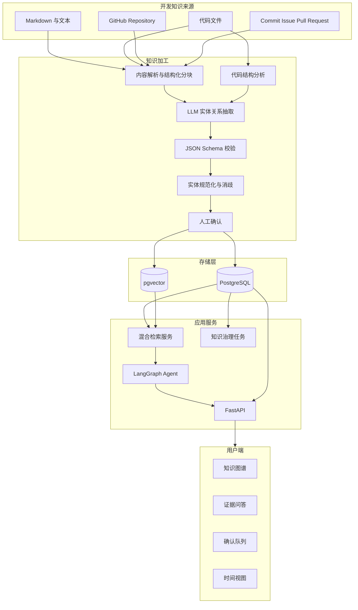
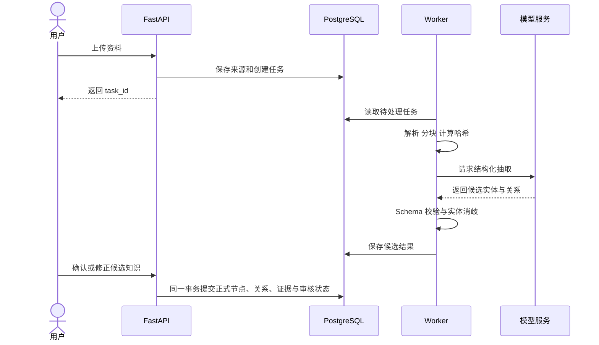

# Knowledge Atlas 系统架构

本文描述 Knowledge Atlas 的目标架构、组件边界和关键数据流。当前仓库已实现 Mock 图谱、真实项目/资料工作台、FastAPI 基础接口、手动与 Worker Markdown 解析、执行租约与中断恢复、PostgreSQL 数据模型与迁移以及可选容器配置；抽取、图谱持久化、检索和 Agent 仍属于后续阶段。当前只使用 PostgreSQL/pgvector，暂缓引入 Neo4j，见 [ADR 0005](adr/0005-postgresql-only-storage.zh-CN.md)。

## 架构目标

系统需要同时满足四个要求：

- 保存原始资料，任何知识都能回到具体文件、代码位置或 Git 记录。
- 支持代码标识符精确匹配、自然语言语义召回和图关系查询。
- 保留知识的当前状态和历史状态，不用新结论覆盖旧结论。
- 将大模型限制在候选生成和答案组织环节，正式数据写入由后端校验。

## 总体架构

## 组件职责

### 前端

前端负责展示和用户交互，不在浏览器中执行知识抽取或拼接数据库查询。

- 图谱节点和关系浏览。
- 原始证据预览与位置跳转。
- 抽取结果确认、合并和修正。
- 自然语言问答及检索过程状态展示。
- 当前知识和历史知识切换。

### FastAPI 后端

后端作为系统唯一业务入口，负责身份、项目隔离、数据校验和权限边界。

- 用户、项目、资料和知识条目的增删改查。
- 文件上传、任务创建和任务状态查询。
- 统一调用 PostgreSQL 和检索服务。
- 校验模型输出，不允许模型直接写入数据库。
- 将证据位置转换为前端可消费的统一格式。

当前已实现项目、Markdown 来源、处理任务和原文分块接口。上传事务保存原文及其 SHA-256 并创建 `queued` 任务；相同用户项目中的相同字节复用来源和任务，PostgreSQL 项目行锁串行化上传去重。手动解析接口与独立 Worker 共享执行服务：原子认领任务并保存执行 UUID/租约后，在事务中保存分块及最终状态。成功任务重复执行返回原结果，普通失败任务等待手动重试。设计依据见 [ADR 0003](adr/0003-markdown-parsing-execution.md) 与 [ADR 0004](adr/0004-database-backed-parsing-worker.md)。

### Worker

耗时任务与 API 请求解耦执行。

- 文本解析、代码结构提取和内容分块。
- 内容哈希与增量更新判断。
- 向量生成和索引更新。
- LLM 抽取、实体消歧和治理检测。

当前实现为 `backend/app/worker.py` 独立进程，轮询数据库中的 Markdown 任务，不引入消息代理。查询限定用户及有效项目，并校验来源的用户/项目边界。租约过期后可重新认领，成功与失败写入都必须匹配当前执行 UUID，因此旧进程无法覆盖新执行结果。过期任务达到尝试次数上限后转为失败。租约固定、尚无心跳；超长任务可能计算重叠，但持久化结果有执行标识保护。向量、代码和模型抽取等 Worker 能力仍属于目标设计。

### PostgreSQL 与 pgvector

PostgreSQL 是业务数据和原始证据的事实来源。

- 用户、项目、资料和内容分块。
- 任务状态、审核记录和错误信息。
- 规划中的实体、关系、证据、审核状态及版本元数据。
- 文本向量和相似度检索。

### 图谱存储与查询（规划中）

后续优先在 PostgreSQL 中实现节点表、关系表和证据关联，保持现有知识模型与前端图谱接口语义：

- 实体节点和语义关系。
- 项目、问题、方案、决策与证据之间的路径。
- `SUPERSEDES` 等历史演化关系。
- 一跳、多跳和限定关系类型的查询。

一跳关系使用关联查询，限定深度的多跳关系可采用递归查询。查询需要用户/项目与时间过滤、循环保护、深度及结果量限制，并基于实际查询添加索引和验证性能。当前尚未创建正式节点、关系和证据关联表，也未实现这些查询。

Neo4j 不参与当前运行环境或验收。如果实测查询复杂度、性能或图算法需求需要专用图数据库，再通过新 ADR 决定；届时 PostgreSQL 继续作为事实来源，业务 UUID 保持稳定。

## 资料导入流程

## 证据问答流程

1. 对问题进行分类，识别项目、技术、代码标识符和时间范围。
2. 根据问题类型选择关键词、向量、图关系和时间过滤工具。
3. 合并多路结果，保留每条结果的组成得分和来源。
4. 判断证据是否足够；不足时返回需要补充的资料。
5. 模型只能依据已选证据生成回答。
6. 返回答案、知识实体、证据片段、来源位置和可信度。

第一版可以使用固定权重：关键词 `0.3`、向量 `0.4`、图关系 `0.3`。权重需要通过实验数据调整，不能作为最终结论直接写入论文。

## 数据一致性

- 所有业务对象使用稳定 UUID，不通过 API 暴露数据库内部 ID。
- 正式节点、关系、证据及审核状态计划在同一 PostgreSQL 事务中提交。
- 知识写入和重复执行必须幂等，不要求当前实现跨数据库同步或 Outbox。
- 删除默认采用软删除；图查询必须过滤 `archived` 状态并保留历史证据。
- 资料重复导入通过内容哈希判断；当前文件变化会创建独立来源，只重新处理变化分块属于后续增量更新目标。

## 安全与隔离

毕业设计第一版为单用户系统，但数据模型仍保留 `user_id` 和 `project_id`，避免后续迁移困难。

- 上传文件限制类型和大小。
- GitHub Token 只保存在后端环境变量或密钥存储中。
- 提示词和日志不得记录访问令牌或完整敏感源码。
- 所有数据库查询必须包含用户和项目边界。
- 前端只展示答案依据，不展示模型内部推理文本。

## 第一版非目标

- 团队空间、成员邀请和复杂角色权限。
- 完整 GitHub 双向同步。
- IDE 插件和多端离线同步。
- 自动修改正式知识而不经过用户确认。
- 面向生产环境的大规模多租户部署。

## 待确认的架构决策

- 后续长耗时抽取任务的心跳、取消和队列扩展策略（当前数据库轮询 Worker 见 ADR 0004）。
- 代码解析使用 Tree-sitter 还是按语言分别实现。
- 在线模型与 Ollama 的统一适配接口。
- PostgreSQL 图关系表的索引、递归查询与实际数据下的性能边界。
- 混合检索的归一化和排序策略。
