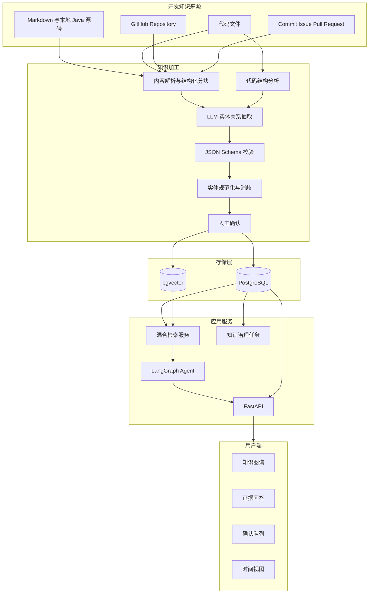
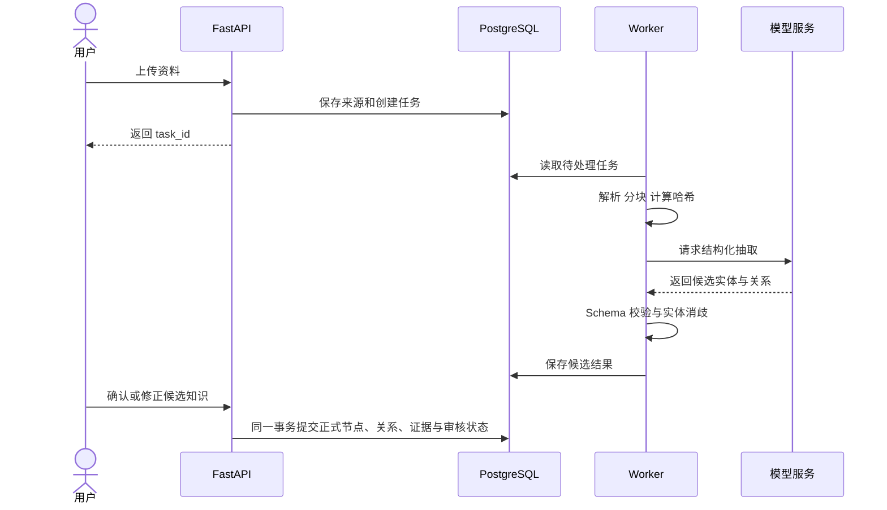

# Knowledge Atlas 系统架构

本文描述 Knowledge Atlas 的目标架构、组件边界和关键数据流。当前仓库已实现 Markdown 与本地 Java 源码导入、DeepSeek 候选抽取/审核、PostgreSQL 正式图谱、项目图谱、关键词/显式索引语义向量/一跳图关系混合检索，以及同步、非持久化的证据问答；实体消歧、完整代码语义和多轮 Agent 仍属于后续阶段。当前只使用 PostgreSQL/pgvector，暂缓引入 Neo4j，见 [ADR 0005](adr/0005-postgresql-only-storage.zh-CN.md)。

## 架构目标

系统需要同时满足四个要求：

- 保存原始资料，任何知识都能回到具体文件、代码位置或 Git 记录。
- 支持代码标识符精确匹配、自然语言语义召回和图关系查询。
- 保留知识的当前状态和历史状态，不用新结论覆盖旧结论。
- 将大模型限制在候选生成和答案组织环节，正式数据写入由后端校验。

## 总体架构

## 组件职责

### 前端

前端负责展示和用户交互，不在浏览器中执行知识抽取或拼接数据库查询。

- 图谱节点和关系浏览。
- 原始证据预览与位置跳转。
- 抽取结果确认、合并和修正。
- 自然语言问答及检索过程状态展示。
- 当前知识和历史知识切换。

### FastAPI 后端

后端作为系统唯一业务入口，负责身份、项目隔离、数据校验和权限边界。

- 用户、项目、资料和知识条目的增删改查。
- 文件上传、任务创建和任务状态查询。
- 统一调用 PostgreSQL 和检索服务。
- 校验模型输出，不允许模型直接写入数据库。
- 将证据位置转换为前端可消费的统一格式。

当前已实现项目、来源仓库、Markdown/Java 来源、处理任务和原文分块接口。文件夹上传先按项目、类型与根目录名幂等解析仓库 UUID；仓库还可登记规范化 GitHub HTTPS/SSH remote，或把该身份显式关联到已有本地仓库。登记本身不联网；用户可随后显式请求 GitHub ref 快照，后端经 GitHub REST 读取 commit/tree/blob，并把最多 50 份、累计 20 MiB 的支持文件逐份送入同一导入服务。成功同步会保存稳定 provider ID、Commit/tree 元数据和逐文件 blob 映射；同一 ref 的上一快照作为增量基线，未变化或可复用 blob 不再下载，完整 tree 才报告重命名与删除。远端删除只写入历史快照，不物理删除既有来源和证据。另一条显式链路读取最近更新的最多 20 个 Issue/Pull Request 及每项最多 20 条评论，渲染为确定性 Markdown，并在 `github_work_item_versions` 中按 provider item ID 与 `updated_at` 保存不可变版本映射；相同版本复用来源/任务，更新版本新建来源。资料与正式证据读取时，仓库文件从最近一次非删除快照派生固定 Commit 的文件/行号 URL，工作项则返回规范会话 URL，两者都保留 `project://` 应用内定位。上传事务保存原文、SHA-256、可空仓库身份及规范化仓库内相对路径，并创建 `queued` 任务。同一用户、项目、仓库和来源类型中的相同字节复用来源和任务；PostgreSQL 项目行锁串行化仓库解析与上传去重。Markdown 使用 `markdown_parsing`，Java 使用 `code_parsing`；手动解析接口与独立 Worker 共享执行服务。Java 解析保存精确行片段，并可从不可变原文按需派生类型/字段/方法、有界同文件调用，以及同仓库最多 100 份已解析 Java 来源内按包与导入解析的跨文件继承/实现关系和显式声明类型的直接类型、字段、方法参数及直属局部变量接收者调用；未归属仓库的旧来源继续在未归属集合内解析。派生结果不持久化、不进入正式图谱，也不承诺完整 AST 或完整调用图。候选确认时，审核状态、审计事件、正式实体/关系/证据在同一事务写入。设计依据见 ADR 0003、0004、0006、0007、0012、[ADR 0013](adr/0013-derived-java-source-structure.zh-CN.md)、[ADR 0014](adr/0014-bounded-cross-file-java-types.zh-CN.md)、[ADR 0015](adr/0015-local-folder-repository-identity.zh-CN.md)、[ADR 0016](adr/0016-normalized-github-remote-identity.zh-CN.md)、[ADR 0017](adr/0017-bounded-cross-file-java-method-calls.zh-CN.md)、[ADR 0018](adr/0018-bounded-github-snapshot-import.zh-CN.md)、[ADR 0019](adr/0019-incremental-github-commit-snapshots.zh-CN.md)、[ADR 0020](adr/0020-derived-immutable-github-evidence-links.zh-CN.md)、[ADR 0021](adr/0021-versioned-github-work-items.zh-CN.md) 与 [ADR 0022](adr/0022-bounded-java-declared-receiver-calls.zh-CN.md)。

PR Review 活动与基础工作项分开版本化。显式活动导入为每个入选 PR 读取各最多 20 条 Review 和行级 Review Comment；配置令牌时，再通过 GraphQL 读取最多 20 个 Review thread 及每个 thread 20 个评论标识，保存当前解决状态、解决者、位置与过期状态。结果渲染成独立 Markdown，并在 `github_pull_review_versions` 中以 provider PR ID 与内容 SHA-256 保存映射，同时记录 thread 数量、已解决数量、是否纳入和截断元数据。这样 Review 内容或 thread 状态变化无需依赖 PR `updated_at`；行级评论的 `in_reply_to_id` 与有界 thread 成员关系会保留，但查询快照不声称拥有权威解决事件时间。Review 来源继续复用相同解析、证据和规范 PR URL 流程，见 [ADR 0023](adr/0023-versioned-github-pull-reviews.zh-CN.md) 与 [ADR 0024](adr/0024-bounded-github-review-thread-state.zh-CN.md)。

### Worker

耗时任务与 API 请求解耦执行。

- 文本解析、代码结构提取和内容分块。
- 内容哈希与增量更新判断。
- 向量生成和索引更新。
- LLM 抽取、实体消歧和治理检测。

当前实现为 `backend/app/worker.py` 独立进程，轮询数据库中的 Markdown 与 Java 解析任务，不引入消息代理。查询限定用户及有效项目，并校验来源的用户/项目边界。租约过期后可重新认领，成功与失败写入都必须匹配当前执行 UUID，因此旧进程无法覆盖新执行结果。过期任务达到尝试次数上限后转为失败。租约固定、尚无心跳；超长任务可能计算重叠，但持久化结果有执行标识保护。向量和模型抽取不由解析 Worker 消费。

### PostgreSQL 与 pgvector

PostgreSQL 是业务数据和原始证据的事实来源。

- 用户、项目、资料和内容分块。
- 任务状态、审核记录和错误信息。
- 实体、关系、证据、审核状态及版本元数据。
- 正式实体的 1024 维语义向量和相似度检索。

### 图谱存储与查询（已实现）

正式图谱使用 PostgreSQL 表实现，保持现有知识模型与前端图谱接口语义：

- `knowledge_entities`、`knowledge_relationships`、`knowledge_evidence` 保存实体、语义关系和原文证据。
- 关系端点和证据归属使用 `(id, user_id, project_id)` 组合外键，查询始终带用户和项目边界。
- 候选确认时幂等提升：稳定 `uuid5` 标识、`candidate_id` 唯一约束、旧确认可重放补写。
- 项目、问题、方案、决策与证据之间的路径，以及 `SUPERSEDES` 等历史演化关系。
- 一跳/二跳邻域和限定实体类型的查询。

查询使用关联查询和双向邻域扩展，带 `valid_from`/`valid_to` 时间过滤、循环保护、深度 1–2、节点上限 100、边上限 500；任意深度递归查询和真实数据下的性能验证仍待后续补充。画布坐标由前端计算，不由后端返回。

Neo4j 不参与当前运行环境或验收。如果实测查询复杂度、性能或图算法需求需要专用图数据库，再通过新 ADR 决定；届时 PostgreSQL 继续作为事实来源，业务 UUID 保持稳定。

### 关键词、语义向量与图关系混合检索（已实现三路基线）

`GET /api/v1/projects/{project_id}/search` 支持 `keyword`、`vector` 与 `hybrid`。关键词模式只读匹配正式实体的名称、摘要和作用域内证据；语义模式通过配置的 OpenAI-compatible 服务生成查询向量，并在 `knowledge_embeddings` 中用 pgvector 余弦距离精确排序。混合模式从关键词/向量候选出发扩展可见一跳关系，以固定 `0.3/0.4/0.3` 权重融合三路信号，并返回归一化分量、最终得分及具体关系解释。用户通过显式重建接口生成实体向量，内容哈希与模型未变化时复用；知识确认事务不依赖嵌入服务。三种模式都沿用项目、类型、有效时间和归档过滤，并返回原文证据。同步证据问答复用混合模式。检索决策见 [ADR 0008](adr/0008-project-keyword-search.zh-CN.md)、[ADR 0009](adr/0009-explicit-semantic-index.zh-CN.md) 与 [ADR 0010](adr/0010-explainable-hybrid-graph-retrieval.zh-CN.md)。

### 候选提取与审核（已实现接口）

资料解析完成后，用户可显式请求 DeepSeek 提取。后端以来源 UUID 与提示版本生成稳定任务 UUID，使用 `knowledge_candidates` 类型，与历史只解析的 `knowledge_extraction` 类型区分。短事务认领来源后释放锁再调用模型，完成时以执行 UUID 防止旧结果覆盖。成功任务直接复用，普通失败等待手动重试，中断后可在租约到期时再次请求；解析 Worker 不调用模型。

模型仅获得所选资料分块；后端校验固定类型、关系端点和逐字引用后，原子保存整批 `pending` 候选与成功任务状态。审核使用项目锁与条件更新，保存 `review_events` 前后记录。确认关系前要求两端实体已确认。确认成功后，正式节点、关系、证据与审核状态、审计事件在同一事务写入；已确认但未入图的旧候选可重放补写。实体消歧和 Agent 仍属于目标设计，语义索引由独立显式操作维护。决策见 [ADR 0006](adr/0006-deepseek-candidate-review.zh-CN.md) 与 [ADR 0007](adr/0007-confirmed-postgresql-graph.zh-CN.md)。

## 资料导入流程

下图是目标流程。当前解析 Worker 不调用模型：候选提取由用户在已解析资料上显式触发，确认时在同一事务内写入正式图谱。

## 证据问答流程（已实现第一版）

1. `POST /api/v1/projects/{project_id}/questions` 校验项目边界、问题长度和可选有效时间。
2. 服务固定执行三路混合检索，最多保留 5 个实体和 12 条正式证据；不允许模型自行访问数据库或工具。
3. 没有证据时直接返回证据不足，不调用回答模型。
4. 有证据时只把问题与选定证据发送给 DeepSeek，要求严格 JSON；支持性回答必须引用证据，不支持回答必须列出缺失信息。
5. 后端再次校验每个引用 UUID 属于本次检索集合，只返回实际引用的实体、原文、文件和行号。
6. 前端展示当前回答、检索组成和引用，并可跳转到实体详情；问答历史当前不保存。

这是一条有界的同步线性流程，暂不引入 LangGraph、流式响应、多轮记忆或问题表。固定权重仍为关键词 `0.3`、向量 `0.4`、图关系 `0.3`，需通过实验数据继续调整。见 [ADR 0011](adr/0011-synchronous-evidence-grounded-questions.zh-CN.md)。

## 数据一致性

- 所有业务对象使用稳定 UUID，不通过 API 暴露数据库内部 ID。
- 正式节点、关系、证据、审核状态与审计事件在同一 PostgreSQL 事务中提交。
- 知识写入和重复执行必须幂等，不要求当前实现跨数据库同步或 Outbox。
- 删除默认采用软删除；图查询过滤 `archived` 状态并保留历史证据；正式证据会阻止删除被引用分块。
- 资料重复导入通过内容哈希判断；当前文件变化会创建独立来源，只重新处理变化分块属于后续增量更新目标。

## 安全与隔离

毕业设计第一版为单用户系统，但数据模型仍保留 `user_id` 和 `project_id`，避免后续迁移困难。

- 上传文件限制类型和大小。
- GitHub Token 只保存在后端环境变量或密钥存储中。
- 提示词和日志不得记录访问令牌或完整敏感源码。
- 所有数据库查询必须包含用户和项目边界。
- 前端只展示答案依据，不展示模型内部推理文本。

## 第一版非目标

- 团队空间、成员邀请和复杂角色权限。
- 完整 GitHub 双向同步。
- IDE 插件和多端离线同步。
- 自动修改正式知识而不经过用户确认。
- 面向生产环境的大规模多租户部署。

## 待确认的架构决策

- 后续长耗时抽取任务的心跳、取消和队列扩展策略（当前数据库轮询 Worker 见 ADR 0004）。
- 代码解析使用 Tree-sitter 还是按语言分别实现。
- 在线模型与 Ollama 的统一适配接口。
- PostgreSQL 图关系表的索引、递归查询与实际数据下的性能边界。
- 混合检索固定权重的实验评估与调优策略。
