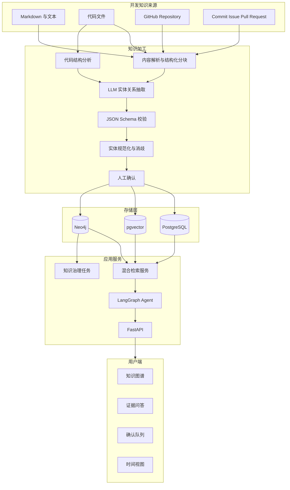
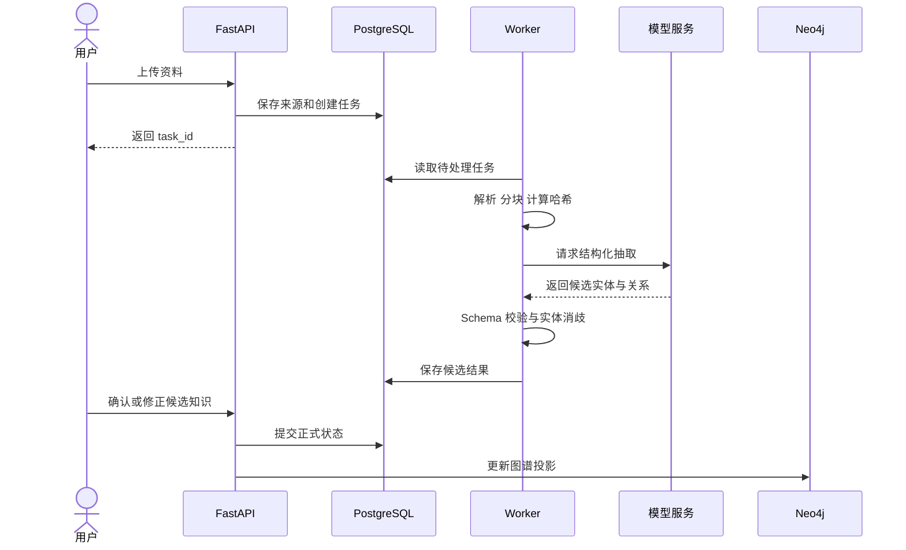

# Knowledge Atlas 系统架构

本文描述 Knowledge Atlas 的目标架构、组件边界和关键数据流。当前仓库已实现 Mock 前端、FastAPI 基础接口、PostgreSQL 数据模型与迁移以及本地容器配置；解析、抽取、Neo4j 投影、检索和 Agent 仍属于后续阶段。

## 架构目标

系统需要同时满足四个要求：

- 保存原始资料，任何知识都能回到具体文件、代码位置或 Git 记录。
- 支持代码标识符精确匹配、自然语言语义召回和图关系查询。
- 保留知识的当前状态和历史状态，不用新结论覆盖旧结论。
- 将大模型限制在候选生成和答案组织环节，正式数据写入由后端校验。

## 总体架构

## 组件职责

### 前端

前端负责展示和用户交互，不在浏览器中执行知识抽取或拼接数据库查询。

- 图谱节点和关系浏览。
- 原始证据预览与位置跳转。
- 抽取结果确认、合并和修正。
- 自然语言问答及检索过程状态展示。
- 当前知识和历史知识切换。

### FastAPI 后端

后端作为系统唯一业务入口，负责身份、项目隔离、数据校验和权限边界。

- 用户、项目、资料和知识条目的增删改查。
- 文件上传、任务创建和任务状态查询。
- 统一调用 PostgreSQL、Neo4j 和检索服务。
- 校验模型输出，不允许模型直接写入数据库。
- 将证据位置转换为前端可消费的统一格式。

当前已实现项目、Markdown 来源和处理任务接口。上传事务会同时保存原文及其 SHA-256，并创建 `queued` 任务；尚未启动独立 Worker 消费任务。

### Worker

耗时任务与 API 请求解耦执行。

- 文本解析、代码结构提取和内容分块。
- 内容哈希与增量更新判断。
- 向量生成和索引更新。
- LLM 抽取、实体消歧和治理检测。

第一版可以使用 FastAPI 后台任务或简单任务队列；任务量增长后再引入 Celery、RQ 或其他队列。

### PostgreSQL 与 pgvector

PostgreSQL 是业务数据和原始证据的事实来源。

- 用户、项目、资料和内容分块。
- 任务状态、审核记录和错误信息。
- 实体与关系的业务标识及版本元数据。
- 文本向量和相似度检索。

### Neo4j

Neo4j 保存适合图遍历的知识投影。

- 实体节点和语义关系。
- 项目、问题、方案、决策与证据之间的路径。
- `SUPERSEDES` 等历史演化关系。
- 一跳、多跳和限定关系类型的查询。

建议由 PostgreSQL 保存权威业务状态，通过可靠事件或 Outbox 同步 Neo4j，避免两个数据库同时成为可写事实来源。

## 资料导入流程

## 证据问答流程

1. 对问题进行分类，识别项目、技术、代码标识符和时间范围。
2. 根据问题类型选择关键词、向量、图关系和时间过滤工具。
3. 合并多路结果，保留每条结果的组成得分和来源。
4. 判断证据是否足够；不足时返回需要补充的资料。
5. 模型只能依据已选证据生成回答。
6. 返回答案、知识实体、证据片段、来源位置和可信度。

第一版可以使用固定权重：关键词 `0.3`、向量 `0.4`、图关系 `0.3`。权重需要通过实验数据调整，不能作为最终结论直接写入论文。

## 数据一致性

- 所有业务对象使用稳定 UUID，不使用数据库内部 ID 作为跨库标识。
- PostgreSQL 事务提交后再异步更新 Neo4j 投影。
- 同步事件保存幂等键、重试次数和最后错误。
- 删除默认采用软删除，并在图数据库中同步 `archived` 状态。
- 资料重复导入通过内容哈希判断；文件变化时只重新处理变化分块。

## 安全与隔离

毕业设计第一版为单用户系统，但数据模型仍保留 `user_id` 和 `project_id`，避免后续迁移困难。

- 上传文件限制类型和大小。
- GitHub Token 只保存在后端环境变量或密钥存储中。
- 提示词和日志不得记录访问令牌或完整敏感源码。
- 所有数据库查询必须包含用户和项目边界。
- 前端只展示答案依据，不展示模型内部推理文本。

## 第一版非目标

- 团队空间、成员邀请和复杂角色权限。
- 完整 GitHub 双向同步。
- IDE 插件和多端离线同步。
- 自动修改正式知识而不经过用户确认。
- 面向生产环境的大规模多租户部署。

## 待确认的架构决策

- 后台任务第一版使用哪一种执行方式。
- 代码解析使用 Tree-sitter 还是按语言分别实现。
- 在线模型与 Ollama 的统一适配接口。
- Neo4j 投影同步采用同步写入、Outbox 还是消息队列。
- 混合检索的归一化和排序策略。
