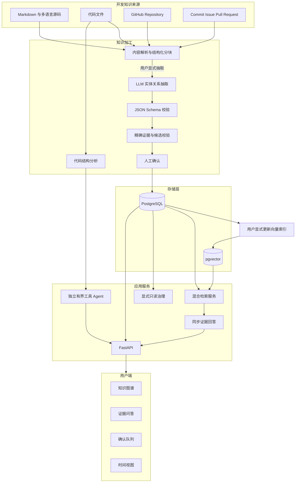
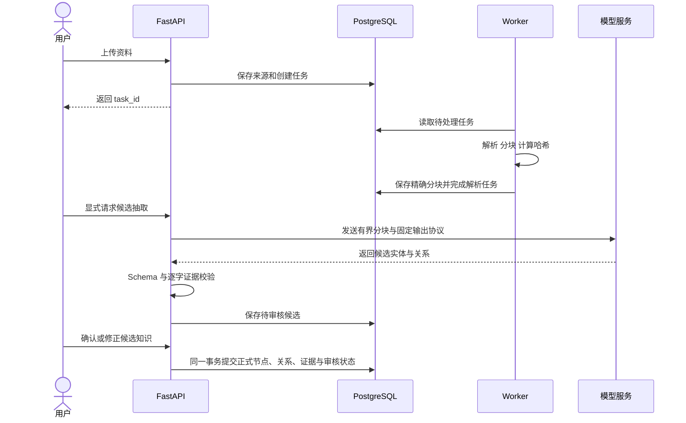

# Knowledge Atlas 系统架构

项目助手 M1 新增独立 `assistant_tasks`、同步任务 API、`project_assistant` 协调角色及只读工具网关（ADR0076，已通过本地替身/原生/桌面验证）。旧 AgentRun/工作流/正式知识写入边界保持；源码 head `20261031_0020`，不自动迁移业务库。模型只接收后端固定版本和工具结果，不接收数据库会话。队列、runner、笔记、写入及受控继续仍待 M2–M5。见[实现说明](PROJECT_ASSISTANT_M1.zh-CN.md)。

[ADR0074](adr/0074-evaluation-output-error-isolation.zh-CN.md)新增显式离线执行协议v4：单题无效输出保留失败，不自动重试；基础设施异常仍停止。可显式复用一条输入/范围完全相同的诊断答案；裁判排除清单带覆盖率和哈希。业务API、线上Schema及正式知识写入边界不变。

[ADR0073](adr/0073-openrouter-jev-evaluation.zh-CN.md)：离线评审新增 OpenRouter Jev Decisions API，复用匿名包/落盘预留，显式供应商授权；校验发布/日期快照并在批内模型漂移时停止，记录实际模型/用量/费用。保留环境代理、禁用重试及回退，不进入业务 API/Worker 或正式写入路径。

[ADR0072](adr/0072-cloudflare-judge-adapter.zh-CN.md)：离线评审选择 Jev 或 Cloudflare Workers AI，后者区分 Clef 的 state/questions 与文本模型的 messages/JSON Schema。共用匿名包、落盘预留和零调用预演；chat 不生成概率，记录模型版本边界，不进入 API/Worker 或正式写入路径。

[ADR0071](adr/0071-bounded-read-caches-and-summaries.zh-CN.md)：符号搜索在作用域校验后使用有界进程内元数据缓存；列表可选 summary=true，只读必要列，详情按需获取；共用解析记录移到 analysis/structures.py，旧导入保留。离线 [Jev评审](JEV_EVALUATION.zh-CN.md) 不进入 API/Worker，不写正式知识或人工分数。

[ADR 0069](adr/0069-answer-claim-evidence.zh-CN.md)：真实单轮供应商和工具循环共用严格 ClaimAnswerDraft，每条结论绑定证据或声明不足；由服务生成平铺回答及引用并校验当前检索池 UUID。历史读取使用可空新字段，不回放模型，不新增迁移。结构和归属校验不判定语义蕴含。

当前说明见本轮验收与 ADR 0060–0063；迁移 head `20261029_0019`。旧日期检查点已归档，不再叠加在当前说明顶部。 [验收 / Acceptance](OPTIMIZATION_20261029.zh-CN.md)

## 单项目 Agent 边界（ADR 0064–0065）

协作列表不再逐条调用详情查询：当前页任务直接复用统一响应投影，候选审核状态只读取 ID/来源/任务/状态并按精确子集批量计数。有效用户/项目先校验，SQL 保留用户/项目范围，来源/任务/候选归属逐条匹配；既有 ORM 对象在分页读取时刷新。分页排序、原有详情/恢复检查与只读租约判定保持，列表单页最多4次 SELECT。实现、回归和测量边界见[协作读取说明](MULTI_AGENT.zh-CN.md#协作列表批量读取)。

ADR 0068 在既有任务请求上接通检索/时间/代码版本范围，并从存量 `AgentRun.request` 白名单投影 `scope`，不新增表或返回原始请求。前端 `useCodeContextSelection` 只读加载和校验版本选择；新草稿与已保存范围分开，历史时间清除当前代码。最终源码范围仍由既有 `code_context` 在编译器/供应商调用前固定，见[范围契约](adr/0068-explicit-workflow-scope.zh-CN.md)。

过程持久化的后续边界见 [ADR 0067](adr/0067-durable-agent-progress.zh-CN.md)：`services/agent_progress.py` 在无待提交业务写入的事务边界保存事件、预留用量和校验后的步骤结果，以用户/项目/执行 UUID/有效租约防护更新。Agent 只收到回调，不持有数据库 Session；保存失败会阻止后续调用。每个事件提交独立于后续业务事务，最终失败保留部分结果。同步执行、人工正式写入、同 UUID 不自动付费重放和 schema0019 均保持。

`agents` 负责角色与有界 LangGraph 工具循环，`workflows` 显式连接依赖，`tools` 提供只读仓库/原文/证据访问；`llm` 集中供应商、提示词和用量，`analysis` 保留确定性解析。`services/agent_workflows.py` 验证用户/项目范围、固定源码、管理任务事务。Agent 不接收数据库 Session。旧模块别名维持兼容。详见[实际目录与持久化边界](MULTI_AGENT.zh-CN.md)。

## 当前模块边界（ADR 0060–0063）

词法读取的后续变更见 [ADR 0066](adr/0066-batched-global-lexical-retrieval.zh-CN.md)：BM25/来源位置 BM25/RRF 词法路按名称与 UUID 分批读取投影，每批 200 实体，最多 5 万条；所有批次共用文档数、平均长度与词项文档频率。只保留命中实体的查询词计数，不保留全量正文；每实体独立读取最多 32 条排序证据并报告省略。最终 Top K 才加载正式实体与原文证据。协议升至 v2，历史 v1 实验保持原样。

就绪检查区分连接和结构，检查实际 schema 版本/关键结构，不自动升级。已有库升级先备份并隔离恢复核验。

代码分析通过 `services/code_context.py` 在任何编译器/供应商调用前固定提交或本地单版本路径。元数据先于有界正文；快照原路径只构造只读视图，不改写来源。结构解析和正式图谱仍分开。

前端 `useWorkspaceRoute` 恢复 ID/时间/任务区；`useEvidenceNavigation`、`useRepositorySnapshots`、`useKnowledgeEvolution` 分别管理原文、提交文件、时序与治理状态。App 连接上下文/写锁，模块卸载或切上下文使迟到请求失效。

索引规划每批 500 实体读证据，只读已有嵌入的模型/维度/哈希；待更新项使用 UUID 而非跨提交过期的 ORM 对象。原始归属文本保留历史向量语义。1k/10k 原生合成测量与冻结文档测试集分别归档，均不冒充真实人工答案评分。

## 架构目标

阶段五新增跨来源人工演化审核 `knowledge_changes`：图谱服务原子保存替代有效期/状态及审核前后快照，不放松普通候选提升。历史链独立于时间可见语义图谱和一跳检索。治理是有界只读规则检查，不自动生成或确认业务写入，见 [ADR 0039](adr/0039-reviewed-knowledge-evolution.zh-CN.md)。

系统需要同时满足四个要求：

- 保存原始资料，任何知识都能回到具体文件、代码位置或 Git 记录。
- 支持代码标识符精确匹配、自然语言语义召回和图关系查询。
- 保留知识的当前状态和历史状态，不用新结论覆盖旧结论。
- 将大模型限制在候选生成和答案组织环节，正式数据写入由后端校验。

## 总体架构

## 组件职责

### 前端

前端负责展示和用户交互，不在浏览器中执行知识抽取或拼接数据库查询。

- 图谱节点和关系浏览。
- 原始证据预览与位置跳转。
- 抽取结果确认、合并和修正。
- 自然语言问答及检索过程状态展示。
- 当前知识和历史知识切换。

### FastAPI 后端

后端作为系统唯一业务入口，负责身份、项目隔离、数据校验和权限边界。

- 用户、项目、资料和知识条目的增删改查。
- 文件上传、任务创建和任务状态查询。
- 统一调用 PostgreSQL 和检索服务。
- 校验模型输出，不允许模型直接写入数据库。
- 将证据位置转换为前端可消费的统一格式。

当前已实现项目、来源仓库、Markdown/Java 来源、处理任务和原文分块接口。文件夹上传先按项目、类型与根目录名幂等解析仓库 UUID；仓库还可登记规范化 GitHub HTTPS/SSH remote，或把该身份显式关联到已有本地仓库。登记本身不联网；用户可随后显式请求 GitHub ref 快照，后端经 GitHub REST 读取 commit/tree/blob，并把每步最多 50 份、累计 20 MiB 的支持文件逐份送入同一导入服务，可继续固定提交的清单和目录队列。成功同步会保存稳定 provider ID、Commit/tree 元数据和逐文件 blob 映射；同一 ref 的上一快照作为增量基线，未变化或可复用 blob 不再下载，完整 tree 才报告重命名与删除。远端删除只写入历史快照，不物理删除既有来源和证据。另一条显式链路读取最近更新的最多 20 个 Issue/Pull Request 及每项最多 20 条评论，渲染为确定性 Markdown，并在 `github_work_item_versions` 中按 provider item ID 与 `updated_at` 保存不可变版本映射；相同版本复用来源/任务，更新版本新建来源。资料与正式证据读取时，仓库文件从最近一次非删除快照派生固定 Commit 的文件/行号 URL，工作项则返回规范会话 URL，两者都保留 `project://` 应用内定位。上传事务保存原文、SHA-256、可空仓库身份及规范化仓库内相对路径，并创建 `queued` 任务。同一用户、项目、仓库和来源类型中的相同字节复用来源和任务；PostgreSQL 项目行锁串行化仓库解析与上传去重。Markdown 使用 `markdown_parsing`，Java 使用 `code_parsing`；手动解析接口与独立 Worker 共享执行服务。Java 解析保存精确行片段，并可从不可变原文按需派生类型/字段/方法、有界同文件调用，以及同仓库最多 100 份已解析 Java 来源内按包与导入解析的跨文件继承/实现关系和显式声明类型的直接类型、字段、方法参数及直属局部变量接收者调用；未归属仓库的旧来源继续在未归属集合内解析。派生结果不持久化、不进入正式图谱，也不承诺完整 AST 或完整调用图。候选确认时，审核状态、审计事件、正式实体/关系/证据在同一事务写入。设计依据见 ADR 0003、0004、0006、0007、0012、[ADR 0013](adr/0013-derived-java-source-structure.zh-CN.md)、[ADR 0014](adr/0014-bounded-cross-file-java-types.zh-CN.md)、[ADR 0015](adr/0015-local-folder-repository-identity.zh-CN.md)、[ADR 0016](adr/0016-normalized-github-remote-identity.zh-CN.md)、[ADR 0017](adr/0017-bounded-cross-file-java-method-calls.zh-CN.md)、[ADR 0018](adr/0018-bounded-github-snapshot-import.zh-CN.md)、[ADR 0019](adr/0019-incremental-github-commit-snapshots.zh-CN.md)、[ADR 0020](adr/0020-derived-immutable-github-evidence-links.zh-CN.md)、[ADR 0021](adr/0021-versioned-github-work-items.zh-CN.md) 与 [ADR 0022](adr/0022-bounded-java-declared-receiver-calls.zh-CN.md)。

PR Review 活动与基础工作项分开版本化。显式活动导入为每个入选 PR 读取各最多 20 条 Review 和行级 Review Comment；配置令牌时，再通过 GraphQL 读取最多 20 个 Review thread 及每个 thread 20 个评论标识，保存当前解决状态、解决者、位置与过期状态。结果渲染成独立 Markdown，并在 `github_pull_review_versions` 中以 provider PR ID 与内容 SHA-256 保存映射，同时记录 thread 数量、已解决数量、是否纳入和截断元数据。这样 Review 内容或 thread 状态变化无需依赖 PR `updated_at`；行级评论的 `in_reply_to_id` 与有界 thread 成员关系会保留，但查询快照不声称拥有权威解决事件时间。Review 来源继续复用相同解析、证据和规范 PR URL 流程，见 [ADR 0023](adr/0023-versioned-github-pull-reviews.zh-CN.md) 与 [ADR 0024](adr/0024-bounded-github-review-thread-state.zh-CN.md)。

Java 结构/调用分析 V1 在既有原文上按需派生，不引入新库、持久化表或正式知识。接收者词法范围统一覆盖普通块、分支/while、异常、带花括号的 for 与资源 try；头部调用省略，仅把声明绑定送入主体。方法候选共用参数数量/可变参数筛选及有界继承查找，保留覆盖签名、菱形去重、重复版本歧义与原方法 ID。继承环/单次 256 状态预算会报告截断，而不是无限遍历。`resolved` 是唯一静态候选，不是运行时分派保证；外部 classpath、完整 AST/类型检查及动态推断仍不属于 V1，详见 [能力与验收边界](JAVA_ANALYSIS_V1.zh-CN.md) 和 [ADR 0029](adr/0029-java-analysis-v1.zh-CN.md)。

多语言 Agent 调用分析是独立的显式同步操作，不属于解析 Worker。后端先从当前来源提取调用点，只在同仓库兼容语言族的 ready 来源中按名称建立有界声明候选，再把稳定 ID、路径和精确源码行交给模型分类。模型不能搜索数据库或生成候选外目标；后端拒绝缺项、伪造 ID 和结构矛盾结果。返回值不持久化、不进入正式图谱，也不代表编译器或运行时分派结论，见 [ADR 0041](adr/0041-bounded-multilanguage-agent-call-analysis.zh-CN.md)。

代码符号搜索为 API 的只读派生查询，不由 Worker 消费：按项目及可选仓库读取最多 100 份 ready Java 来源、20 MiB 原文，复用与单文件大纲相同的符号生成函数，每份最多 200 符号；按名称/路径字面匹配并保留版本、原 ID/行号与分块位置。前端据此跳转原文，不持久化第二套索引或绕过知识审核，见 [ADR 0032](adr/0032-bounded-code-symbol-search.zh-CN.md)。

已保存的同步快照可显式转成提交说明资料：服务只读本地 SHA、UTC 时间及提交说明，生成不含 ref/同步统计/可变远端坐标的确定性 Markdown，复用普通仓库范围去重与解析任务。迁移 `20261022_0014` 仅为快照添加两个可空来源/任务外键及来源索引；补充映射不改变提交与文件事实。API 不启动解析、模型或正式图谱写入，Worker 可按原规则消费新增解析任务。提交资料/证据的 GitHub URL 指向规范 Commit 页面，不追加本地 Markdown 行号。此来源不含 patch，也不是提交正确性的证明；见 [ADR 0033](adr/0033-saved-commit-evidence-sources.zh-CN.md)。

快照逐文件查询由 `repository_history` 只读既有表提供，按路径分页，保留删除/跳过记录并在外连接中校验来源和任务作用域，不加载原文或任务结果。文件链接使用所选快照，而不是来源的最近出现记录；删除后 Commit 不伪造文件链接，本地原文保留。前端文件面板与原文读取继续由 `App.vue` 编排，不新增数据库表、索引、供应商请求或正式知识，见 [ADR 0034](adr/0034-snapshot-file-provenance.zh-CN.md)。

证据原文导航通过项目范围的单分块 UUID 查询读取既有 `SourceChunk`，校验项目归档状态及来源/分块作用域；前端只据 `position` 加载既有分页，聚焦原分块。它不建立第二份证据、不按引用文本猜目标、不要求解析任务存活，也不改变正式图谱或模型边界。失败/取消/上下文切换由独立请求序号处理，见 [ADR 0035](adr/0035-exact-evidence-source-navigation.zh-CN.md)。

### Worker

当前 Worker 仅执行排队的 Markdown/代码语法解析和原文分块。向量索引、LLM 抽取、只读治理和工具 Agent 均由独立显式 API 操作触发，不由解析 Worker 消费。实体消歧尚未实现。

当前实现为 `backend/app/worker.py` 独立进程，轮询数据库中的 Markdown 与 Java 解析任务，不引入消息代理。查询限定用户及有效项目，并校验来源的用户/项目边界。租约过期后可重新认领，成功与失败写入都必须匹配当前执行 UUID，因此旧进程无法覆盖新执行结果。过期任务达到尝试次数上限后转为失败。租约固定、尚无心跳；超长任务可能计算重叠，但持久化结果有执行标识保护。向量和模型抽取不由解析 Worker 消费。

### PostgreSQL 与 pgvector

PostgreSQL 是业务数据和原始证据的事实来源。

- 用户、项目、资料和内容分块。
- 任务状态、审核记录和错误信息。
- 实体、关系、证据、审核状态及版本元数据。
- 正式实体的 1024 维语义向量和相似度检索。

### 图谱存储与查询（已实现）

正式图谱使用 PostgreSQL 表实现，保持现有知识模型与前端图谱接口语义：

- `knowledge_entities`、`knowledge_relationships`、`knowledge_evidence` 保存实体、语义关系和原文证据。
- 关系端点和证据归属使用 `(id, user_id, project_id)` 组合外键，查询始终带用户和项目边界。
- 候选确认时幂等提升：稳定 `uuid5` 标识、`candidate_id` 唯一约束、旧确认可重放补写。
- 项目、问题、方案、决策与证据之间的路径，以及 `SUPERSEDES` 等历史演化关系。
- 一跳/二跳邻域和限定实体类型的查询。

查询使用关联查询和双向邻域扩展，带 `valid_from`/`valid_to` 时间过滤、循环保护、深度 1–2、节点上限 100、边上限 500；任意深度递归查询和真实数据下的性能验证仍待后续补充。画布坐标由前端计算，不由后端返回。

Neo4j 不参与当前运行环境或验收。如果实测查询复杂度、性能或图算法需求需要专用图数据库，再通过新 ADR 决定；届时 PostgreSQL 继续作为事实来源，业务 UUID 保持稳定。

### 关键词、语义向量与图关系混合检索（已实现三路基线）

`GET /api/v1/projects/{project_id}/search` 支持 `keyword`、`vector` 与 `hybrid`。关键词模式只读匹配正式实体的名称、摘要和作用域内证据；语义模式通过配置的 OpenAI-compatible 服务生成查询向量，并在 `knowledge_embeddings` 中用 pgvector 余弦距离精确排序。混合模式从关键词/向量候选出发扩展可见一跳关系，以固定 `0.3/0.4/0.3` 权重融合三路信号，并返回归一化分量、最终得分及具体关系解释。用户通过显式重建接口生成实体向量，内容哈希与模型未变化时复用；知识确认事务不依赖嵌入服务。三种模式都沿用项目、类型、有效时间和归档过滤，并返回原文证据。同步证据问答复用混合模式。检索决策见 [ADR 0008](adr/0008-project-keyword-search.zh-CN.md)、[ADR 0009](adr/0009-explicit-semantic-index.zh-CN.md) 与 [ADR 0010](adr/0010-explainable-hybrid-graph-retrieval.zh-CN.md)。

### 候选提取与审核（已实现接口）

资料解析完成后，用户可显式请求 DeepSeek 提取。后端以来源 UUID 与提示版本生成稳定任务 UUID，使用 `knowledge_candidates` 类型，与历史只解析的 `knowledge_extraction` 类型区分。短事务认领来源后释放锁再调用模型，完成时以执行 UUID 防止旧结果覆盖。成功任务直接复用，普通失败等待手动重试，中断后可在租约到期时再次请求；解析 Worker 不调用模型。

模型仅获得所选资料分块；后端校验固定类型、关系端点和逐字引用后，原子保存整批 `pending` 候选与成功任务状态。审核使用项目锁与条件更新，保存 `review_events` 前后记录。确认关系前要求两端实体已确认。确认成功后，正式节点、关系、证据与审核状态、审计事件在同一事务写入；已确认但未入图的旧候选可重放补写。实体消歧和 Agent 仍属于目标设计，语义索引由独立显式操作维护。决策见 [ADR 0006](adr/0006-deepseek-candidate-review.zh-CN.md) 与 [ADR 0007](adr/0007-confirmed-postgresql-graph.zh-CN.md)。

## 资料导入流程

下图是目标流程。当前解析 Worker 不调用模型：候选提取由用户在已解析资料上显式触发，确认时在同一事务内写入正式图谱。

## 证据问答流程（已实现第一版）

1. `POST /api/v1/projects/{project_id}/questions` 校验项目边界、问题长度和可选有效时间。
2. 服务固定执行三路混合检索，最多保留 5 个实体和 12 条正式证据；不允许模型自行访问数据库或工具。
3. 没有证据时直接返回证据不足，不调用回答模型。
4. 有证据时只把问题与选定证据发送给 DeepSeek，要求严格 JSON；支持性回答必须引用证据，不支持回答必须列出缺失信息。
5. 后端再次校验每个引用 UUID 属于本次检索集合，只返回实际引用的实体、原文、文件和行号。
6. 前端展示当前回答、检索组成和引用，并可跳转到实体详情；问答历史当前不保存。

这是一条有界的同步线性流程，暂不引入 LangGraph、流式响应、多轮记忆或问题表。固定权重仍为关键词 `0.3`、向量 `0.4`、图关系 `0.3`，需通过实验数据继续调整。见 [ADR 0011](adr/0011-synchronous-evidence-grounded-questions.zh-CN.md)。

## 数据一致性

阶段六使用独立 CLI `scripts.prepare_evaluation` 重放仅由合成语料整理的标注；正常导入/解析、待审核候选确认与演化审核仍由既有服务完成。独立进程中的合成提升时钟用于重现历史查询，没有生产回填 API。外层事务和保存点包裹服务提交，初始化失败整批回滚，只接受全新项目。`scripts.run_baselines` 显式建索引再跑三组纯检索；实际图谱/证据/演化与索引分别计算指纹，运行期间改变即失败。报告不把合成标注当作模型抽取或真实人工审核质量，见 [ADR 0042](adr/0042-reproducible-curated-evaluation-projects.zh-CN.md)。

GitHub 快照缓存按来源类型与兼容解析任务复用，校验快照、来源和任务的用户/项目/仓库归属及任务来源关联。连续相同 Commit 只有完整且引用有效的快照可以短路；截断/大小跳过或引用缺失、不兼容时，下一次显式同步重新尝试并保存独立快照，保留已成功来源与历史。tree/文件集合不完整时不猜测重命名，Markdown/Java 类型变化不共享错误解析任务。该调整不增加自动轮询、破坏性来源失效或迁移，见 [ADR 0031](adr/0031-recoverable-typed-github-snapshots.zh-CN.md)。

- 所有业务对象使用稳定 UUID，不通过 API 暴露数据库内部 ID。
- 正式节点、关系、证据、审核状态与审计事件在同一 PostgreSQL 事务中提交。
- 知识写入和重复执行必须幂等，不要求当前实现跨数据库同步或 Outbox。
- 删除默认采用软删除；图查询过滤 `archived` 状态并保留历史证据；正式证据会阻止删除被引用分块。
- 资料重复导入通过内容哈希判断；当前文件变化会创建独立来源，只重新处理变化分块属于后续增量更新目标。

## 安全与隔离

毕业设计第一版为单用户系统，但数据模型仍保留 `user_id` 和 `project_id`，避免后续迁移困难。

- 上传文件限制类型和大小。
- GitHub Token 只保存在后端环境变量或密钥存储中。
- 提示词和日志不得记录访问令牌或完整敏感源码。
- 所有数据库查询必须包含用户和项目边界。
- 前端只展示答案依据，不展示模型内部推理文本。

## 第一版非目标

- 团队空间、成员邀请和复杂角色权限。
- 完整 GitHub 双向同步。
- IDE 插件和多端离线同步。
- 自动修改正式知识而不经过用户确认。
- 面向生产环境的大规模多租户部署。

## 待确认的架构决策

- 后续长耗时抽取任务的心跳、取消和队列扩展策略（当前数据库轮询 Worker 见 ADR 0004）。
- 已选定 Java 保守专用分析与其他语言 Tree-sitter 语法解析；后续是否引入构建上下文/语言服务另做决策。
- 在线模型与 Ollama 的统一适配接口。
- PostgreSQL 图关系表的索引、递归查询与实际数据下的性能边界。
- 混合检索固定权重的实验评估与调优策略。
