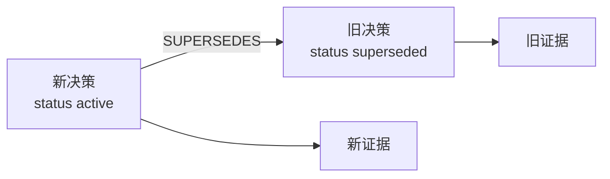

# Knowledge Atlas 开发者知识模型

当前迁移 head 为 `20261029_0019`，增加 Agent 协作执行记录，正式知识类型和人工确认边界不变；见[协作审计](#agent-协作审计)。以下日期段落保留原有知识模型演进记录。

2026-10-26 当前模型（ADR 0056）：实体身份与时序操作采用新增表，正式知识类型/关系类型不变。EntityAlias 为同项目/类型规范化别名；EntityMerge 是带生效间隔的原实体→保留实体映射；KnowledgePeriod 保存重新启用前的已闭合生效区间；KnowledgeOperation 保存请求、理由、前后快照。合并不移动原证据、不改写边端点，按查询时间投影。分组演化明确生成 new→SUPERSEDES→old 的完整新旧组关系，最多两组各 10 项，并检查循环。撤回关闭当前区间；启用建立新当前区间、保留中间失效空档。独立线性替代可显式撤销，有后续替代/身份依赖则拒绝。

Conversation/ConversationTurn 保存项目隔离历史；历史回答快照不是正式知识，也不能替代当前证据。2026-10-26 检查点 head 为 `20261026_0018`；[当时验收](FUNCTIONAL_COMPLETION_20261026.zh-CN.md)。

2026-10-26（ADR 0054）：新增 `knowledge_retirements` 审计记录，带用户/项目及实体或关系的作用域组合外键、纠错/过期类别、人工理由、服务端生效时间和不可变前后快照。`graph.apply_retirement` 是项目锁内新增的显式有效期修改边界，只关闭 `valid_to`，不改原确认/`status`/证据/向量，不创建新语义实体。停用端点使关联边退出当前查询；历史按原区间可读。硬归档仍屏蔽历史，不用于本流程。无实体合并、撤销原确认、回溯定年或重新启用。降级移除审计表，不重新打开区间，需先备份保留审计。

`embedding_jobs` 仅保存每项目最近的索引操作归属和结果，不属于正式知识或问答历史；更新 lease/状态不允许绕过审核写入知识。bm25_source 的 provenance 只来自已审核正式证据对应的文件名/相对路径/标题，是位置上下文，不是额外语义事实；规范证据 ID、去重与引用约束不变。

关系审核列表的 `endpoints` 仅为同用户/项目/资料/成功抽取任务内实体候选的读取快照，不持久化、不代表依赖已锁定；后端审核仍重读端点并校验，禁止自动补选或改变已拒绝实体。详见 [ADR 0048](adr/0048-review-endpoint-visibility.zh-CN.md)。

同一问答片段的 related_entities 仅来自本次检索中引用该精确位置的实体，用于临时归属展示；主要归属和规范 evidence UUID 不变，不合并正式实体或证据。双实体核对读取原有详情，两个来源的内容和位置保持独立。

显式批量审核只扩展事务编排，不改变候选/正式知识语义：同项目同来源的所选候选按实体、关系处理，依赖不满足则整批回滚；已处理候选不支持改判。索引状态检查不修改实体、证据、审核记录或有效期。

在线问答去重只影响临时上下文：按 `(source_id, chunk_id, start_line, end_line, quote)` 合并相同原文，保留首个选中正式证据 ID/实体归属；不同来源或版本不合并，不改正式证据。治理按同类型、规范化名称及摘要分别分组，能识别同名后续摘要组中的重复；仅提供核对建议，尚无实体合并或撤销。

知识模型用于约束大模型抽取结果、数据库结构和图谱查询。第一版应保持类型数量有限，只有真实查询需要时才增加新类型。

当前使用 PostgreSQL 保存节点、关系、证据、语义向量与时序状态，不要求独立图数据库，见 ADR 0005。正式图谱和语义索引已实现（当前迁移 head `20261026_0018`；图谱与向量分别见 ADR 0007、0009）；下文的关系箭头表示领域方向，与具体数据库查询语言无关。

## Agent 协作审计

迁移 `20261029_0019` 新增 `agent_runs` 保存用户/项目/资料范围、请求指纹、执行 UUID/租约、最终结果/固定词汇事件/尝试用量。这是协作执行记录，不新增正式实体或关系类型。抽取仍只保存带精确原文的候选；正式实体/关系/证据只由既有人工审核事务提升。恢复核对同资料哈希、抽取任务与全部候选人工决定；派生代码结果只作提示。历史问答不得混入当前源码提示。见[ADR 0065](adr/0065-durable-reviewed-workflows.zh-CN.md)。

## 建模原则

- 实体表示可独立识别和复用的对象，不能把整段原文直接当作实体。
- 关系表达实体之间可查询的语义，时间和置信度通常作为属性保存。
- 所有 AI 生成知识都必须关联原始证据。
- 同一个事实可以有多个证据，证据之间保留来源和时间差异。
- 新结论不覆盖旧结论，通过状态和 `SUPERSEDES` 关系保留历史。

## 核心实体

| 类别 | 实体 | 说明 | 第一版 |
| --- | --- | --- | --- |
| 项目 | `Project` | 个人开发项目或学习主题 | 必须 |
| 项目 | `Repository` | Git 仓库 | GitHub 阶段 |
| 代码 | `Module` | 模块或包 | 代码阶段 |
| 代码 | `CodeFile` | 代码文件 | 必须 |
| 代码 | `CodeEntity` | 类、接口、函数、方法等 | 必须 |
| 技术 | `Technology` | 框架、语言、中间件和工具 | 必须 |
| 技术 | `Concept` | 架构概念、原则和模式 | 必须 |
| 资料 | `Note` | 笔记或结构化知识条目 | 可选 |
| 问题 | `Problem` | 故障、需求或待解决问题 | 必须 |
| 问题 | `Incident` | 有明确时间和影响的故障事件 | 后续 |
| 方案 | `Solution` | 问题的解决方法 | 必须 |
| 决策 | `Decision` | 已经做出的技术选择 | 必须 |
| 决策 | `Alternative` | 被比较或放弃的候选方案 | 必须 |
| 决策 | `Constraint` | 影响选择的业务或技术约束 | 必须 |
| 证据 | `Evidence` | 原文片段、代码位置或 Git 记录 | 必须 |
| Git | `Commit` | 代码提交 | GitHub 阶段 |
| Git | `Issue` | 问题记录 | GitHub 阶段 |
| Git | `PullRequest` | 变更评审记录 | GitHub 阶段 |

第一版 Markdown 闭环只需要 `Project`、`CodeFile`、`CodeEntity`、`Technology`、`Concept`、`Problem`、`Solution`、`Decision`、`Alternative`、`Constraint` 和 `Evidence`。

## 核心关系

| 类别 | 关系 | 示例 |
| --- | --- | --- |
| 归属 | `BELONGS_TO` | `CodeFile BELONGS_TO Project` |
| 结构 | `CONTAINS` | `Module CONTAINS CodeEntity` |
| 依赖 | `DEPENDS_ON` | `Project DEPENDS_ON Technology` |
| 调用 | `CALLS` | `CodeEntity CALLS CodeEntity` |
| 使用 | `USES` | `Project USES Technology` |
| 问题 | `SOLVES` | `Solution SOLVES Problem` |
| 原因 | `CAUSED_BY` | `Problem CAUSED_BY CodeEntity` |
| 影响 | `AFFECTS` | `Problem AFFECTS Module` |
| 决策 | `DECIDED_IN` | `Solution DECIDED_IN Decision` |
| 比较 | `CHOSEN_OVER` | `Decision CHOSEN_OVER Alternative` |
| 约束 | `CONSTRAINED_BY` | `Decision CONSTRAINED_BY Constraint` |
| 实现 | `IMPLEMENTED_BY` | `Decision IMPLEMENTED_BY CodeEntity` |
| 证据 | `EVIDENCED_BY` | `Decision EVIDENCED_BY Evidence` |
| 来源 | `EXTRACTED_FROM` | `Concept EXTRACTED_FROM Evidence` |
| 经验 | `LEARNED_FROM` | `Solution LEARNED_FROM Incident` |
| 演化 | `SUPERSEDES` | `Decision SUPERSEDES Decision` |

`valid_from` 和 `valid_to` 是节点或关系属性，不作为普通关系类型。只有新旧知识之间的替代语义使用 `SUPERSEDES`。

## 通用字段

实体和关系至少保存以下字段：

| 字段 | 类型 | 说明 |
| --- | --- | --- |
| `id` | UUID | 跨数据库稳定业务标识 |
| `user_id` | UUID | 数据所属用户 |
| `project_id` | UUID | 数据所属项目 |
| `name` | string | 规范化名称 |
| `summary` | string | 简短描述 |
| `confidence` | number | 抽取或判断置信度，范围 0 到 1 |
| `review_status` | enum | `pending`、`confirmed`、`rejected` |
| `status` | enum | `active`、`superseded`、`conflicted`、`archived` |
| `valid_from` | datetime | 知识开始适用的时间 |
| `valid_to` | datetime 或 null | 知识结束适用的时间 |
| `created_at` | datetime | 系统首次记录时间 |
| `updated_at` | datetime | 系统最后修改时间 |

关系还应保存 `source_id`、`target_id`、关系类型和证据列表。

## 证据模型

证据不是简单 URL，而是能够稳定回到原文位置的记录。

```json
{
  "id": "evidence-uuid",
  "source_id": "source-uuid",
  "source_type": "markdown",
  "title": "支付重构复盘.md",
  "uri": "project://docs/支付重构复盘.md",
  "locator": {
    "heading": "消息一致性",
    "start_line": 42,
    "end_line": 48
  },
  "excerpt": "订单状态变化必须与领域事件记录处于同一事务边界。",
  "content_hash": "sha256:...",
  "captured_at": "2026-10-17T14:00:00+08:00"
}
```

不同数据源可以使用不同定位字段，但 API 应统一返回 `title`、`uri`、`locator` 和 `excerpt`。当前正式证据 API 始终保留应用内 `project://` URI；GitHub 快照来源还从最近一次非删除的逐文件快照派生可空 `git_url`，固定到 Commit 和精确行号。该外部链接不持久化，本地来源返回 `null`；远端删除后回退到文件最后一次存在的快照。见 [ADR 0020](adr/0020-derived-immutable-github-evidence-links.zh-CN.md)。

## 当前原文分块

已保存的 GitHub Commit 快照可显式转成普通 Markdown 来源（SHA、UTC 时间、提交说明和来源边界），用快照的可空来源/任务外键建立导入映射；原有提交/文件事实不变。此处不新增正式 `Commit` 类型或自动关系，仍须解析、显式抽取与人工确认。提交说明不是 patch，也不是变更正确性的证据。正式证据保留本地精确引用/行号与 `project://`，派生的 GitHub URL 打开规范 Commit 页面而不追加伪造的 `#L`。见 [ADR 0033](adr/0033-saved-commit-evidence-sources.zh-CN.md)。

后端已保存 `SourceChunk` 作为原文证据的基础记录；确认候选时会生成 `KnowledgeEvidence` 并引用分块。每个分块带有稳定 UUID、`user_id`、`project_id`、`source_id`、从 0 开始的顺序、块类型、结构路径、原文、SHA-256 及从 1 开始且包含两端的行号。Markdown 使用标题/段落/列表/代码类型与标题路径；Java 使用代码/注释/类型/方法类型，路径为 `[类型]` 或 `[类型, 方法]`。类型前连续注解归类型，方法外的纯注释行单独成块。分块保留来源换行符。相同来源、位置边界、块类型和内容产生相同 UUID；不同来源的分块不会共享 UUID。

来源在当前阶段保持不可变：同一项目、同一可空仓库、来源类型中的相同文件字节复用来源，修改字节或切换仓库则创建独立来源。本地文件夹仓库以稳定 UUID 标识，来源可保存 `repository_id` 和规范化的仓库内 `relative_path`；重复内容仍复用该仓库中的首次来源并保留首次路径。旧来源的 `repository_id` 为 `null`，继续在未归属集合中保持原有去重语义。这不表示新旧来源之间已经建立版本或 `SUPERSEDES` 关系。Java 类型和方法分块也不是自动创建的正式 `CodeEntity`；`ready` 仅表示来源解析完成，不表示知识已抽取或确认。决策见 [ADR 0003](adr/0003-markdown-parsing-execution.md)、[ADR 0012](adr/0012-bounded-java-source-ingestion.md) 与 [ADR 0015](adr/0015-local-folder-repository-identity.zh-CN.md)。

仓库可额外保存规范化 GitHub 身份：`provider=github`、小写 `remote_owner` / `remote_name` 和不含凭据的规范 `remote_url`。身份既可关联已有 `local_folder`，也可先作为 `git_remote` 独立登记；登记不会访问 GitHub，也不代表已导入分支、Commit 或文件。首次成功同步保存稳定 provider ID，后续可在 GitHub 返回 owner/name 变化时更新规范坐标；边界见 [ADR 0016](adr/0016-normalized-github-remote-identity.zh-CN.md) 与 [ADR 0019](adr/0019-incremental-github-commit-snapshots.zh-CN.md)。

Java 来源结构接口按需派生 V1 类型/字段/方法、词法/头部作用域调用、仓库内继承目标/方法候选及参数数量筛选结果，使用稳定来源内 UUID 和精确原文行号。这些不是 `KnowledgeEntity` / `KnowledgeRelationship`，不参与正式图谱检索，也不能绕过候选提取和人工确认；重复不可变版本保留歧义，仓库隔离保持不变。`resolved` 只是有界静态分析内唯一候选，完整边界见 [Java 分析 V1](JAVA_ANALYSIS_V1.zh-CN.md) 与 [ADR 0029](adr/0029-java-analysis-v1.zh-CN.md)。

## 当前候选与审核

显式 DeepSeek 提取生成实体和关系候选；当前模型输出只允许上文第一版实体类型，关系类型沿用本知识模型。每项使用批内唯一 `local_id`、名称（关系名称由两端派生）、摘要、0–1 置信度及 1–5 条原文引用。引用必须指向本用户、本项目、本来源的分块，摘录必须逐字存在于该块；展示行号由后端根据原文计算。模型不能设置审核状态，整批校验失败不会保存部分候选。

候选以稳定业务 UUID 保存于已有 `candidate_knowledge`，关系引用同批实体候选 UUID。`review_status` 初始为 `pending`，用户可确认、拒绝或修正名称与摘要后确认；原始证据、类型和端点保持不变。每次首次处理保存操作者、时间和前后值。确认关系要求两端实体先确认。当前不支持改判、撤销或合并。见 [ADR 0006](adr/0006-deepseek-candidate-review.zh-CN.md)。

## 正式图谱

确认候选时，在同一事务内写入 `knowledge_entities`、`knowledge_relationships` 和 `knowledge_evidence`。正式记录保留候选来源、类型、名称、摘要、置信度、`status`、`valid_from`/`valid_to`；关系保存 `source_id`/`target_id`。

- 标识：实体和关系使用 `uuid5(candidate_id, "formal-entity-v1" / "formal-relationship-v1")`，`candidate_id` 唯一约束保证重复确认幂等。
- 证据：使用 `uuid5(formal_id, chunk_id + sha256(quote))` 并去重；保存来源、分块、逐字引用、起止行和标题路径。
- 作用域：`user_id`、`project_id` 贯穿三张表；关系端点和证据归属使用 `(id, user_id, project_id)` 组合外键。
- 约束：正式证据阻止删除被引用的分块；关系端点删除受 `RESTRICT` 保护。
- 查询：只读，过滤 `archived`，按 `valid_at` 判断 `valid_from <= at` 且 `valid_to` 为空或晚于 `at`；项目图谱限制节点/边数量，详情最多返回 100 条直接关系。
- 旧确认重放：已确认但没有正式记录的候选可再次确认补写，不重复模型调用或审计事件。

正式实体可按名称、摘要和同作用域证据进行关键词检索，也可将类型、名称、摘要和证据摘录合成为带内容哈希的 1024 维向量。向量独立保存在 `knowledge_embeddings`，通过 `(entity_id, user_id, project_id)` 作用域外键归属正式实体；重建索引不会修改正式知识语义。混合检索从关键词/向量种子扩展正式可见关系，以固定权重融合归一化信号；它只读取关系，不新增或修改知识语义。三种模式均沿用归档与有效时间过滤。同步证据问答只读取这些正式对象和证据，兼容的 /questions 保持非持久化；/conversations 单独保存问题、答案、证据快照与轮次，六轮历史仅作提示。人工别名/合并与生命周期操作见 ADR 0056。

## 时序模型



统一规定关系方向：`新知识 -[:SUPERSEDES]-> 旧知识`。当前与历史查询以有效区间及非归档条件为准；演化历史通过专门接口沿已确认替代双向遍历，并展示新到旧方向。

显式跨来源演化审核已实现，见 [ADR 0039](adr/0039-reviewed-knowledge-evolution.zh-CN.md)。`knowledge_changes` 保存同项目两个同类型正式实体的 `SUPERSEDES/SUPPLEMENTS/CONFLICTS_WITH` 建议、正式证据、理由、生效时间、审核结果和不可变前后快照；不放松原抽取关系的同任务/来源约束，仅已确认演化记录具有权威演化语义，不混入一跳语义检索。

确认替代时在项目锁内原子设置 `old.status=superseded`、`old.valid_to=new.valid_from=effective_at`，保留双方原文及 UUID。有效区间为 `[valid_from,valid_to)`；历史查询不能简单排除当前状态为 `superseded` 的实体。时间须不早于双方当前有效起点、不晚于当前时刻；不从文本定年、不回溯提升前、不定时生效；分叉/合并通过独立的显式分组 API（ADR 0056），不放宽此单条建议接口。补充/冲突仅记录分类，不改有效期或自动判断真假。抽取的 `SUPERSEDES` 语义关系本身不会迁移端点有效期。

治理只读扫描当前知识，给出证据缺失、规范化同名同摘要重复/不同摘要可能冲突、孤立节点建议，不自动建候选、修改状态、删除或合并。同名不同摘要不等于语义矛盾。

规划中的自动辅助流程（当前 V1 为人工提出，治理仅生成规则建议）：

1. 系统发现同一主题下的新候选结论。
2. 比较新旧内容、项目范围和适用时间。
3. 模型给出“补充、冲突或替代”的候选判断。
4. 用户确认判断。
5. 新节点设为 `active`，旧节点设为 `superseded` 并填写 `valid_to`。
6. 建立 `新节点 -[:SUPERSEDES]-> 旧节点`，保留双方证据。

## 实体消歧

第一版使用分层策略，不直接依赖一次模型判断：

1. 同项目、同类型、规范化名称完全一致时直接生成合并候选。
2. 别名表命中时生成高置信度候选。
3. 名称不同但向量相似时，结合上下文和所属项目判断。
4. 代码实体同时比较命名空间、文件路径和符号类型。
5. 影响范围较大或置信度低于阈值时进入人工确认。

实体合并必须保留原始名称、来源和操作记录，支持撤销错误合并。

## 第一版约束

- 单次抽取不得创造 Schema 之外的新实体类型和关系类型。
- 没有证据的候选知识不能自动变为已确认状态。
- 关系两端必须引用同一用户空间中的有效实体。
- `confidence` 只表达抽取可信度，不能替代证据质量评价。
- 删除实体前必须处理关联关系，默认使用软删除。
