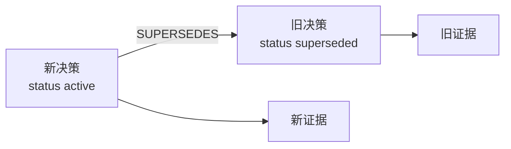

# Knowledge Atlas 开发者知识模型

知识模型用于约束大模型抽取结果、数据库结构和图谱查询。第一版应保持类型数量有限，只有真实查询需要时才增加新类型。

当前使用 PostgreSQL 保存节点、关系、证据与时序状态，不要求独立图数据库，见 [ADR 0005](adr/0005-postgresql-only-storage.zh-CN.md)。正式图谱表与查询已实现（迁移 `20261017_0005`，见 [ADR 0007](adr/0007-confirmed-postgresql-graph.zh-CN.md)）；下文的关系箭头表示领域方向，与具体数据库查询语言无关。

## 建模原则

- 实体表示可独立识别和复用的对象，不能把整段原文直接当作实体。
- 关系表达实体之间可查询的语义，时间和置信度通常作为属性保存。
- 所有 AI 生成知识都必须关联原始证据。
- 同一个事实可以有多个证据，证据之间保留来源和时间差异。
- 新结论不覆盖旧结论，通过状态和 `SUPERSEDES` 关系保留历史。

## 核心实体

| 类别 | 实体 | 说明 | 第一版 |
| --- | --- | --- | --- |
| 项目 | `Project` | 个人开发项目或学习主题 | 必须 |
| 项目 | `Repository` | Git 仓库 | GitHub 阶段 |
| 代码 | `Module` | 模块或包 | 代码阶段 |
| 代码 | `CodeFile` | 代码文件 | 必须 |
| 代码 | `CodeEntity` | 类、接口、函数、方法等 | 必须 |
| 技术 | `Technology` | 框架、语言、中间件和工具 | 必须 |
| 技术 | `Concept` | 架构概念、原则和模式 | 必须 |
| 资料 | `Note` | 笔记或结构化知识条目 | 可选 |
| 问题 | `Problem` | 故障、需求或待解决问题 | 必须 |
| 问题 | `Incident` | 有明确时间和影响的故障事件 | 后续 |
| 方案 | `Solution` | 问题的解决方法 | 必须 |
| 决策 | `Decision` | 已经做出的技术选择 | 必须 |
| 决策 | `Alternative` | 被比较或放弃的候选方案 | 必须 |
| 决策 | `Constraint` | 影响选择的业务或技术约束 | 必须 |
| 证据 | `Evidence` | 原文片段、代码位置或 Git 记录 | 必须 |
| Git | `Commit` | 代码提交 | GitHub 阶段 |
| Git | `Issue` | 问题记录 | GitHub 阶段 |
| Git | `PullRequest` | 变更评审记录 | GitHub 阶段 |

第一版 Markdown 闭环只需要 `Project`、`CodeFile`、`CodeEntity`、`Technology`、`Concept`、`Problem`、`Solution`、`Decision`、`Alternative`、`Constraint` 和 `Evidence`。

## 核心关系

| 类别 | 关系 | 示例 |
| --- | --- | --- |
| 归属 | `BELONGS_TO` | `CodeFile BELONGS_TO Project` |
| 结构 | `CONTAINS` | `Module CONTAINS CodeEntity` |
| 依赖 | `DEPENDS_ON` | `Project DEPENDS_ON Technology` |
| 调用 | `CALLS` | `CodeEntity CALLS CodeEntity` |
| 使用 | `USES` | `Project USES Technology` |
| 问题 | `SOLVES` | `Solution SOLVES Problem` |
| 原因 | `CAUSED_BY` | `Problem CAUSED_BY CodeEntity` |
| 影响 | `AFFECTS` | `Problem AFFECTS Module` |
| 决策 | `DECIDED_IN` | `Solution DECIDED_IN Decision` |
| 比较 | `CHOSEN_OVER` | `Decision CHOSEN_OVER Alternative` |
| 约束 | `CONSTRAINED_BY` | `Decision CONSTRAINED_BY Constraint` |
| 实现 | `IMPLEMENTED_BY` | `Decision IMPLEMENTED_BY CodeEntity` |
| 证据 | `EVIDENCED_BY` | `Decision EVIDENCED_BY Evidence` |
| 来源 | `EXTRACTED_FROM` | `Concept EXTRACTED_FROM Evidence` |
| 经验 | `LEARNED_FROM` | `Solution LEARNED_FROM Incident` |
| 演化 | `SUPERSEDES` | `Decision SUPERSEDES Decision` |

`valid_from` 和 `valid_to` 是节点或关系属性，不作为普通关系类型。只有新旧知识之间的替代语义使用 `SUPERSEDES`。

## 通用字段

实体和关系至少保存以下字段：

| 字段 | 类型 | 说明 |
| --- | --- | --- |
| `id` | UUID | 跨数据库稳定业务标识 |
| `user_id` | UUID | 数据所属用户 |
| `project_id` | UUID | 数据所属项目 |
| `name` | string | 规范化名称 |
| `summary` | string | 简短描述 |
| `confidence` | number | 抽取或判断置信度，范围 0 到 1 |
| `review_status` | enum | `pending`、`confirmed`、`rejected` |
| `status` | enum | `active`、`superseded`、`conflicted`、`archived` |
| `valid_from` | datetime | 知识开始适用的时间 |
| `valid_to` | datetime 或 null | 知识结束适用的时间 |
| `created_at` | datetime | 系统首次记录时间 |
| `updated_at` | datetime | 系统最后修改时间 |

关系还应保存 `source_id`、`target_id`、关系类型和证据列表。

## 证据模型

证据不是简单 URL，而是能够稳定回到原文位置的记录。

```json
{
  "id": "evidence-uuid",
  "source_id": "source-uuid",
  "source_type": "markdown",
  "title": "支付重构复盘.md",
  "uri": "project://docs/支付重构复盘.md",
  "locator": {
    "heading": "消息一致性",
    "start_line": 42,
    "end_line": 48
  },
  "excerpt": "订单状态变化必须与领域事件记录处于同一事务边界。",
  "content_hash": "sha256:...",
  "captured_at": "2026-10-17T14:00:00+08:00"
}
```

不同数据源可以使用不同定位字段，但 API 应统一返回 `title`、`uri`、`locator` 和 `excerpt`。

## 当前 Markdown 原文分块

后端已保存 `SourceChunk` 作为原文证据的基础记录；确认候选时会生成 `KnowledgeEvidence` 并引用分块。每个分块带有稳定 UUID、`user_id`、`project_id`、`source_id`、从 0 开始的顺序、块类型、标题路径、原文、SHA-256 及从 1 开始且包含两端的行号。分块原文保留来源中的换行符，标题路径包含当前标题。相同来源、位置边界、块类型和内容产生相同 UUID；不同来源的分块不会共享 UUID。

来源在当前阶段保持不可变：相同项目中的相同文件字节复用来源，修改字节则创建独立来源。这不表示新旧来源之间已经建立版本或 `SUPERSEDES` 关系。`ready` 仅表示来源解析完成，不表示知识已抽取或确认。决策见 [ADR 0003](adr/0003-markdown-parsing-execution.md)。

## 当前候选与审核

显式 DeepSeek 提取生成实体和关系候选；当前模型输出只允许上文第一版实体类型，关系类型沿用本知识模型。每项使用批内唯一 `local_id`、名称（关系名称由两端派生）、摘要、0–1 置信度及 1–5 条原文引用。引用必须指向本用户、本项目、本来源的分块，摘录必须逐字存在于该块；展示行号由后端根据原文计算。模型不能设置审核状态，整批校验失败不会保存部分候选。

候选以稳定业务 UUID 保存于已有 `candidate_knowledge`，关系引用同批实体候选 UUID。`review_status` 初始为 `pending`，用户可确认、拒绝或修正名称与摘要后确认；原始证据、类型和端点保持不变。每次首次处理保存操作者、时间和前后值。确认关系要求两端实体先确认。当前不支持改判、撤销或合并。见 [ADR 0006](adr/0006-deepseek-candidate-review.zh-CN.md)。

## 正式图谱

确认候选时，在同一事务内写入 `knowledge_entities`、`knowledge_relationships` 和 `knowledge_evidence`。正式记录保留候选来源、类型、名称、摘要、置信度、`status`、`valid_from`/`valid_to`；关系保存 `source_id`/`target_id`。

- 标识：实体和关系使用 `uuid5(candidate_id, "formal-entity-v1" / "formal-relationship-v1")`，`candidate_id` 唯一约束保证重复确认幂等。
- 证据：使用 `uuid5(formal_id, chunk_id + sha256(quote))` 并去重；保存来源、分块、逐字引用、起止行和标题路径。
- 作用域：`user_id`、`project_id` 贯穿三张表；关系端点和证据归属使用 `(id, user_id, project_id)` 组合外键。
- 约束：正式证据阻止删除被引用的分块；关系端点删除受 `RESTRICT` 保护。
- 查询：只读，过滤 `archived`，按 `valid_at` 判断 `valid_from <= at` 且 `valid_to` 为空或晚于 `at`；项目图谱限制节点/边数量，详情最多返回 100 条直接关系。
- 旧确认重放：已确认但没有正式记录的候选可再次确认补写，不重复模型调用或审计事件。

实体消歧、合并、检索和问答仍未实现。

## 时序模型



统一规定关系方向：`新知识 -[:SUPERSEDES]-> 旧知识`。查询当前结论时选择 `status = active`；查询演化历史时沿 `SUPERSEDES` 向旧知识遍历。

当前实现只在正式写入时设置 `valid_from`，`valid_to` 为空；历史语义定年、自动 `superseded` 状态切换和 `SUPERSEDES` 自动迁移仍待开发。

最小更新流程：

1. 系统发现同一主题下的新候选结论。
2. 比较新旧内容、项目范围和适用时间。
3. 模型给出“补充、冲突或替代”的候选判断。
4. 用户确认判断。
5. 新节点设为 `active`，旧节点设为 `superseded` 并填写 `valid_to`。
6. 建立 `新节点 -[:SUPERSEDES]-> 旧节点`，保留双方证据。

## 实体消歧

第一版使用分层策略，不直接依赖一次模型判断：

1. 同项目、同类型、规范化名称完全一致时直接生成合并候选。
2. 别名表命中时生成高置信度候选。
3. 名称不同但向量相似时，结合上下文和所属项目判断。
4. 代码实体同时比较命名空间、文件路径和符号类型。
5. 影响范围较大或置信度低于阈值时进入人工确认。

实体合并必须保留原始名称、来源和操作记录，支持撤销错误合并。

## 第一版约束

- 单次抽取不得创造 Schema 之外的新实体类型和关系类型。
- 没有证据的候选知识不能自动变为已确认状态。
- 关系两端必须引用同一用户空间中的有效实体。
- `confidence` 只表达抽取可信度，不能替代证据质量评价。
- 删除实体前必须处理关联关系，默认使用软删除。
