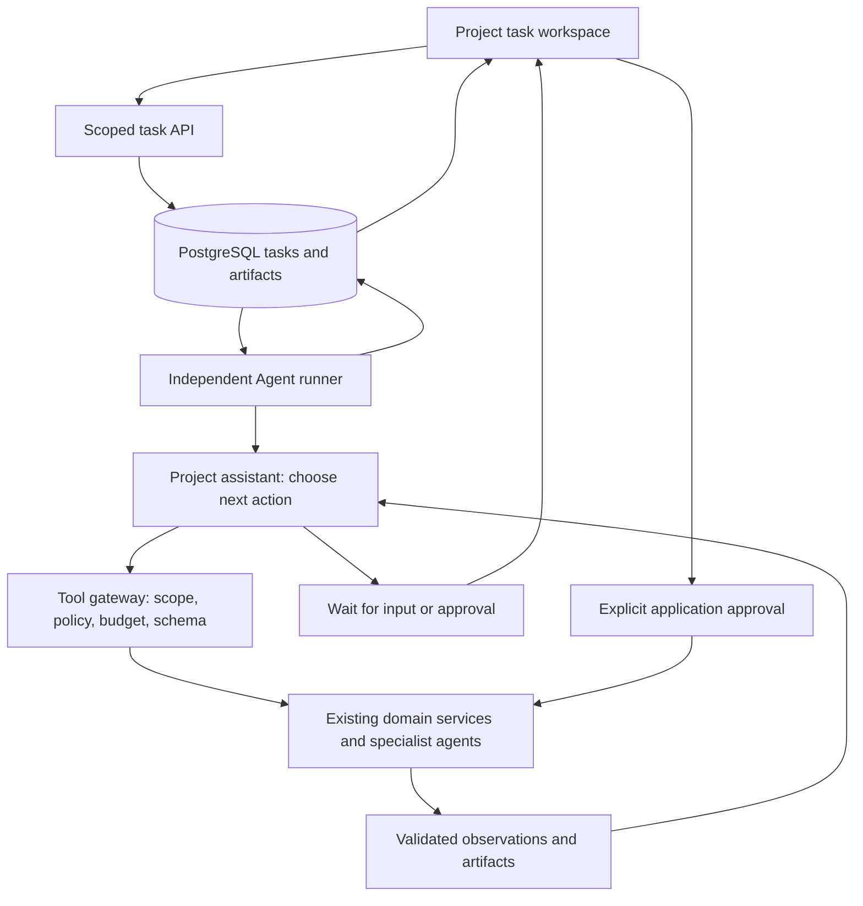

# Knowledge Atlas Project Agent Development Plan

[简体中文](PROJECT_AGENT_PLAN.zh-CN.md)

- Document version: `project-agent-plan-v1`
- Date: 2026-10-31
- Status: **M1–M2 implemented and locally verified with substitutes; M3–M5 remain planned.**
- Development branch: `feat/project-agent`
- Starting commit: `c0eaa06` (CI portability fixes included)
- Baseline database head: `20261029_0019`; M1 introduced0020; M2 now has verified source/business head `20261031_0021` after backup/recovery.

M1 implements the five-tool read-only subset, separate task/report contracts, synchronous durable replay and unified goal UI. See [ADR0076](adr/0076-read-only-project-assistant.md) and [verification results](PROJECT_ASSISTANT_M1.md). Later capabilities described below remain design targets; M1 does not implement the asynchronous API examples or write tools.

M2 now adds the explicit queue/runner, attempted-call and checkpoint/artifact/control receipts, cancellation and explicit continuation; see [ADR0077](adr/0077-durable-assistant-execution.md) and [current acceptance](PROJECT_ASSISTANT_M2.md). Thread/input/approval APIs, notes and write tools remain planned.

## 1. Product objective and scope

Make a project-scoped Agent the primary way to operate Knowledge Atlas. Users describe an outcome; the Agent selects bounded tools, gathers evidence, produces artifacts and requests input or approval when needed. Source, note, review, code and graph workspaces remain available for inspecting and editing the resulting business objects.

The target covers the whole application: projects, sources, development notes, code analysis, evidence questions, knowledge extraction, reviewed graph changes and project reports. Natural-language tasks orchestrate existing domain services; those services retain ownership of authorization, validation, transactions, versions and formal knowledge writes.

Example goals:

- Explain a project's modules using its documentation, source code and confirmed knowledge, with exact provenance.
- Import a selected repository snapshot, parse supported files and propose knowledge for review.
- Turn a debugging record into a note, find related incidents and associate the supplied fix commit.
- Compare a new technical decision with earlier records and propose a supersession for human review.
- Prepare a project summary or interview explanation with evidence and unresolved questions.

All cross-domain abilities must be reachable from one task entry. Ordinary note editing, autosave, navigation and deterministic parsing remain normal application operations and do not require a model call.

## 2. Verified starting point and gaps

| Area | Existing capability at the starting commit | Planned extension |
| --- | --- | --- |
| Agent roles | `code_analysis`, `knowledge_extraction`, `evidence_qa` | A `project_assistant` coordinates permitted capabilities |
| Orchestration | Two explicit LangGraph pipelines and bounded model/tool loops | Goal-driven next-action selection across domains |
| Persistence | `agent_runs`, attempt reservations, events, validated partial results, lease fencing | Durable queued tasks, artifact/operation records and controlled continuation |
| Execution | Synchronous POST; GET and same-UUID replay do not run models | Separate asynchronous Agent runner; read-only polling/event replay |
| Sources | Markdown/code uploads, folders, pinned GitHub imports, chunks and exact lines | Scoped source discovery and task-callable import/parse operations |
| Notes | Local Markdown can be imported as a source | Editable notes, autosave, immutable revisions and raw-note search |
| Knowledge | Candidate review, promotion, identity/evolution and historical evidence | Agent-generated proposals executed through existing human-review services |
| UI | Existing source/review/graph/conversation pages and a two-workflow Agent page | Unified goal input, task progress, artifacts and contextual approval |

Current local reference results are 995 backend tests passed, 11 skipped, coverage 95.45%. They establish the starting engineering baseline, not new Agent capability or quality. The answer protocol is `evidence-claims-v3`; its live quality remains unmeasured. Frozen v2 experiments and all historical ledgers remain unchanged.

The original baseline had no queued model execution or crash-node continuation. M2 adds an explicit queue and checkpoint continuation (ADR0077), with no automatic replay of unknown paid requests. Existing legacy `resume` still only completes reviewed workflows.

## 3. Task experience

1. Select a project and provide a goal plus optional authorized sources, note revisions, code snapshot and knowledge time.
2. The server fixes scope, allowed capabilities and budgets. The Agent produces a short action summary and chooses the next permitted action.
3. Tools return bounded structured observations. The Agent may refine a search, invoke a specialist, ask a necessary question or finish.
4. Results appear as typed artifacts: cited answer, note draft, source summary, code findings or change proposal.
5. Approved writes execute through domain services. The task records the concrete outcome and links to saved objects.
6. Reloading a page restores state and artifacts using reads. It never resubmits a paid task.

Users see action summaries, evidence, progress and usage, not private chain-of-thought. Missing evidence and unverified hypotheses remain explicit.

## 4. Target architecture

Retain Vue 3, FastAPI, PostgreSQL/pgvector, the existing provider adapter and pinned LangGraph dependency. Extend canonical `agents/`, `tools/`, `workflows/`, `services/` and `llm/` modules. Start with one coordinator and the existing specialists. Additional roles require a measured context or responsibility need.

The parsing Worker retains its existing responsibility. A new Agent runner consumes only explicitly submitted Agent tasks; it must not begin consuming old processing tasks or historical `agent_runs`. Redis, another graph database, arbitrary shell access and framework replacement are outside the initial scope.

## 5. Decision loop and execution policy

The coordinator emits a strict decision union: `call_tool`, `ask_user`, `propose_change` or `finish`. Unknown actions and malformed arguments fail validation. Tool results, document contents and retrieved instructions are untrusted observations, not authorization.

The gateway binds user/project identity and permitted versions outside model-controlled arguments. Before each model, tool or embedding attempt it checks ownership, remaining budget, cancellation and time limits. Nested specialists share the task budget; an actual provider attempt is counted once with parent/child lineage, not once per wrapper.

Use the existing initial ceilings as a starting policy: 8 model attempts, 16 tools, 4 embedding attempts per task; existing per-role ceilings remain 4 model attempts and 8 tools. Runtime, input/output, scan and artifact limits must also be explicit. Revisit these ceilings only through configuration/version review and measured need. A different semantic search is a planned action within budget; a transport failure is not permission to retry a paid request.

Read-only actions and user-requested draft creation can proceed within the submitted goal. Replacing an existing revision requires a concrete version-bound proposal. Formal knowledge confirmation, merge, supersession and retirement remain human decisions through existing reviewed services. External publication, repository writes, destructive deletion and open-ended command execution are excluded initially.

## 6. Capability and tool coverage

Tool names below are **proposed contracts**, not a list of currently callable model tools. Every tool declares input/output schemas, capability group, effect class, scope rules, result limits and idempotency behavior.

| Domain | Proposed tools / adapters | Effect and boundary |
| --- | --- | --- |
| Project | `get_project_overview`, `list_project_sources` | Read the selected project only |
| Source discovery | `search_sources`, `read_source_chunk`, `get_parse_status` | Bounded raw-source search; exact immutable source/chunk provenance |
| Confirmed knowledge | `search_knowledge`, `read_evidence` | Reuse existing project/time-scoped retrieval and validated evidence |
| Code | `search_symbols`, `read_source_range`, `analyze_code` | Authorized snapshot; static/derived findings, no user-code execution |
| Import and parsing | `import_repository_snapshot`, `request_source_parse` | Explicitly selected repository/ref; existing bounded import and parser jobs |
| Notes | `search_notes`, `read_note_revision`, `create_note_draft`, `propose_note_revision` | New note services; immutable revisions and conflict detection |
| Extraction | `propose_knowledge` | Existing extraction/strict exact-quote validation; candidates only |
| Governance | `inspect_knowledge_conflicts`, `propose_knowledge_change` | Read checks or proposals; existing human operations perform formal writes |
| Reports | `create_report_draft` | Versioned artifact with provenance and uncertainty |

The existing confirmed-knowledge search does not search every uploaded document or unreviewed note. `search_sources` and `search_notes` need explicit scoped implementations and independent indexes or bounded lexical scans. Agent-produced tags do not bypass these boundaries. Importing or parsing a source does not automatically confirm knowledge or trigger embedding/model work.

## 7. Proposed data model and compatibility

Use additive models for the general assistant rather than silently changing the legacy `AgentRun` status constraint or API semantics. Names are provisional until implementation ADRs and migrations are accepted.

| Proposed record | Purpose |
| --- | --- |
| `assistant_threads`, `assistant_messages` | Project-scoped conversation, task links and explicit user constraints |
| `assistant_tasks` | Versioned goal/scope, state, limits, execution ownership and lease |
| `assistant_steps`, `assistant_attempts` | Step results, call reservations, outcome/unknown state and provider metadata |
| `assistant_artifacts` | Typed draft/report/result payloads with provenance, status and task linkage |
| `assistant_operations`, `assistant_approvals` | Immutable write proposal, expected versions, decision and execution receipt |
| `notes`, `note_revisions` | Stable note identity, current revision pointer and immutable Markdown revisions |

All records keep business UUIDs and user/project scope. Approved artifacts and messages follow an explicit retention policy; operational events contain allowlisted metadata, not credentials, raw prompts or tool bodies. Preserve user-provided content in its scoped business record when required for the feature.

Each note revision records parent revision, content hash, human/Agent origin and task provenance. Human autosave creates a new revision through optimistic concurrency. Agent edits produce a proposed revision against a known parent. Accepted notes may create an immutable `SourceDocument` snapshot for the existing extraction pipeline; editing a note never overwrites imported evidence or changes already-reviewed quotes.

Keep existing source, review, conversation and `/agent-runs` contracts working. New records can link to existing runs/candidates, but must not reinterpret old statuses, replay old requests or mark old model labels as human grades. M1–M2 migrations are implemented/tested and business head is20261031_0021; remaining proposed models are deferred.

## 8. Evidence, artifacts and memory

Maintain three separate stores of meaning: conversation/task context, raw project material and confirmed knowledge. Retrieve only task-relevant bounded context. A model-generated summary is a derived record with provenance and does not automatically become trusted knowledge.

Formal knowledge answers continue to use `evidence-claims-v3` and its scoped formal evidence IDs. Assistant reports that combine unreviewed notes, raw source chunks or code findings need a separate versioned artifact schema with typed references: source/chunk/version/lines, note/revision, confirmed evidence ID or pinned repository commit. Validate ownership and quoted text for each reference. Never pass a note UUID as a formal evidence UUID or silently broaden `QuestionRead`.

Display whether a claim comes from confirmed knowledge, an unreviewed note, original code or derived static analysis. A supplied fix commit is an association; it does not prove tests passed. Distinguish verified outcomes, user-reported outcomes, hypotheses and missing validation. Historical knowledge time cannot silently use current code; preserve the existing restriction unless a new explicit contract defines separate time domains.

## 9. Durable execution and write approval

Proposed task states: `queued`, `running`, `waiting_input`, `waiting_approval`, `succeeded`, `failed`, `interrupted`, `cancelled`. These belong to the new task API, not the old `/agent-runs` response.

- Claim queued work transactionally with a lease and execution token; fence every checkpoint and write against the current owner. Start with one runner and one active execution per task.
- Persist call reservations before transport and persist validated tool/artifact results at explicit transaction boundaries. Save partial results without committing unrelated pending ORM writes.
- Reuse completed step receipts on deliberate continuation. Same request UUID is a read/replay operation, not a new execution authorization.
- If a process dies after a request may have been sent but before its result is saved, mark that attempt `unknown`. Do not automatically repeat it or promise exactly-once remote execution. Further paid attempts require explicit continuation and a checked remaining budget.
- Cancellation stops subsequent steps; an in-flight provider request can still complete and remains counted. Late executors cannot publish new writes after losing ownership.
- Approval binds user/project/task, operation type, exact object IDs, expected versions and proposal hash. A changed plan or stale object invalidates approval and produces a conflict for review.
- The approved application service executes an idempotent operation ID and stores the business result/receipt atomically where possible. Recover through that receipt, not by asking the model to reconstruct whether a write happened.

Ordinary writes and destructive/formal operations have separate capability policies. Human approval applies to the concrete change; it is not unrestricted approval for later model decisions. Rejecting a proposal is a valid task outcome.

## 10. Proposed API surface

These are design examples. Implemented v1/v2 task, events/artifacts, cancel/continue routes are defined in API_CONTRACT.md and PROJECT_ASSISTANT_M2.md; thread/input/approval routes remain planned.

| Method and route, under `/api/v1` | Proposed semantics |
| --- | --- |
| `POST /projects/{project_id}/assistant/threads` | Create a scoped conversation |
| `POST /projects/{project_id}/assistant/tasks` | Submit `request_id`, goal, attachments/scope and limits; async phase returns 202 with task ID |
| `GET /projects/{project_id}/assistant/tasks/{task_id}` | Read saved state, usage and artifact summaries |
| `GET /projects/{project_id}/assistant/tasks/{task_id}/events?after=sequence` | Read bounded committed events; SSE can be added after polling works |
| `GET /projects/{project_id}/assistant/tasks/{task_id}/artifacts/{artifact_id}` | Read a typed, scoped artifact |
| `POST /projects/{project_id}/assistant/tasks/{task_id}/input` | Supply requested clarification, without an implicit new budget |
| `POST /projects/{project_id}/assistant/tasks/{task_id}/approvals` | Accept/reject an exact proposal; no model is needed to execute its authorized deterministic write |
| `POST /projects/{project_id}/assistant/tasks/{task_id}/continue` | Explicitly continue eligible work with ownership/budget/attempt checks |
| `POST /projects/{project_id}/assistant/tasks/{task_id}/cancel` | Idempotently stop future steps |

Use a new versioned request schema such as `assistant-task-v1`; do not overload the old 200-character question field with arbitrary logs. Define bounded goal, attachment, tool-output and artifact sizes. Attachments are server-owned references to already-authorized objects, not arbitrary local paths or credential-bearing URLs. GET, page restoration and event reconnection must never execute tools or reserve calls.

## 11. Frontend task workspace

Evolve the existing Agent page into a project task workspace: goal/composer and attachments, fixed scope preview, task history/progress, artifact panel and contextual approval/diff panel. Reuse source/evidence navigation and existing graph/editor pages. Provide visible citations and links to persisted objects instead of text claiming that an action was completed.

Show actionable empty/error/interrupted/waiting states, remaining call limits and confirmed outcomes. Preserve project/request fencing, unknown-submit read-before-retry, URL restoration, keyboard focus, wrapped content and panel scrolling. Read-only polling is the initial transport; SSE is optional. A page reload restores tasks; it does not submit them. Desktop real-browser acceptance remains required for visible UI changes.

## 12. Delivery phases and exit criteria

| Phase | Deliverables | Exit criteria |
| --- | --- | --- |
| M0: contracts and baseline | This bilingual plan, domain/tool inventory, artifact/scope contracts and implementation ADR proposals | Scope, acceptance tasks and compatibility boundaries are reviewable; no capability is claimed implemented |
| M1: unified read-only assistant | New goal input/API, coordinator, gateway and adapters for sources, confirmed knowledge and code; bounded synchronous execution is acceptable initially | One goal uses at least two relevant domains, cites exact inputs, asks when needed and stops within budget; legacy routes and tenant/version boundaries pass |
| M2: reliable task execution | Additive task/attempt/artifact records, dedicated runner, task progress UI, cancellation and explicit continuation | Queued execution, crash windows, stale owners, unknown transport results and same-UUID replay have deterministic tests; GET/reload reserve zero calls |
| M3: notes and editable artifacts | Note editor/autosave, revision services, raw-note search, Agent drafts and reviewable revision proposals | Human and Agent edits preserve history; concurrent/stale edits conflict; saved notes can later be retrieved and cited without automatic formal promotion |
| M4: whole-project actions | Scoped imports/parsing, extraction candidates, report drafts and governed knowledge-change proposals | Import → parse → propose → human review → inspect results works through one task; formal changes are human-approved, version-bound and idempotent |
| M5: acceptance and release | Cross-domain regression pack, separately authorized live development evaluation, documentation, recorded demo and release preparation | Functional/permission/recovery tests and CI pass; live evidence/limits are reported honestly; historical frozen experiments remain unchanged |

M1–M2 are implemented and locally verified under ADR0076–0077; M3–M5 remain planned. Each phase produces a focused reviewable change with tests and paired documentation. Changes to synchronous execution, write-tool policy or data semantics require new accepted ADRs before crossing ADR0064–0068 boundaries. Implementing one phase does not authorize the next phase or a provider experiment.

## 13. Verification and measurement

### Engineering gates

- Cover tool allowlists, argument validation, cross-user/project/version/time denial, malicious document instructions, scan limits and truncation.
- Verify no-evidence behavior, exact citations and explicit raw/confirmed provenance; keep v2/flat history readable.
- Verify one budget reservation per actual attempt, no call after progress failure, unknown-attempt non-replay, cancellation and stale lease fencing.
- Verify approval tampering, wrong actor, changed object versions, concurrent edits, repeated approval and operation replay without duplicate writes.
- Verify note autosave and task GET/reload/event reads never invoke a model. Test nested specialists without double-counted calls.
- Run focused tests, one appropriate full backend coverage run (existing 90% gate), frontend checks/build and desktop browser checks when the UI changes. For migrations, rehearse native PostgreSQL upgrade/downgrade and recovery in physically owned temporary schemas.

Use the existing `.venv` and `node_modules`. On this Windows host, use a fresh ignored `output` pytest base directory and the already-documented execution environment workaround when required. Keep Linux CI/Docker results distinct from local checks; a fixed local test suite does not establish hosted container success.

### Task-quality evaluation

Create an independent development pack of 20 tasks: four each for evidence Q&A, source/project organization, code understanding, note maintenance and cross-domain governed changes. Include ambiguous requests, missing evidence, stale revisions and user rejection. Freeze inputs, expected artifacts, permitted actions and scoring rules before real calls. Synthetic protocol tests validate execution, not model task quality.

Report task completion over **all attempted tasks**, structural failures, factual correctness/completeness, exact citation support, inappropriate actions/approval bypasses, unnecessary tool calls, latency and attempted/reported usage. Also report valid/gradable subset denominators and judge uncertainty. Human labels and model-only labels remain separate; human coverage may remain 0% and must be disclosed. Quality thresholds must be set before a run rather than selected after seeing scores; 20 tasks provide pilot evidence, not broad reliability proof.

Use new versioned outputs and an adapted task/artifact grading packet. Existing answer judges do not automatically grade writes, recovery or general task success. Real provider calls require a concrete zero-call preflight and separately authorized caps. Preserve old grants, raw outputs, exclusions, denominators and frozen holdout-v3. Do not use these results to rewrite historical v2 experiments. After development changes, use new unseen tasks for a final quality assessment if one is undertaken.

## 14. Rollout and graduation baseline

Continue on `feat/project-agent`; retain `c0eaa06` as the branch starting point. Do not move an existing graduation tag or describe an unpublished tag as a release. Add migrations only in the implementation phase, back up existing data and verify restoration before application upgrade. Preserve old modules/API aliases until their compatibility tests and an explicit migration plan justify removal.

The first target is local single-user use. Before offering a public hosted product, add real authentication and authorization, deployment/secret configuration, backups and operating limits; the development-user boundary is not production authentication. Publishing, deployment, external writes and new paid evaluation each remain separate actions from writing this plan.

Resume and README claims follow measured delivered behavior: distinguish task completion from unit-test counts, citation membership from semantic support, and checkpoint persistence from recovery guarantees. Record a deterministic demo and retain task evidence for every claimed action.

## 15. First implementation slice

Start with this whole-project read-only task:

> Using the selected project's documentation, confirmed knowledge and a fixed code snapshot, explain its main modules, identify recorded unresolved issues, and cite the source for each statement. Mark gaps instead of inventing conclusions.

Implement goal submission, scope binding, the coordinator and the minimal source/knowledge/code tool subset. Return a typed cited report and inspectable tool/usage records. Test a successful multi-domain task, missing information, foreign IDs, budget exhaustion and refresh/replay. This first slice makes the global Agent entry useful before expanding writes; it does not require starting with a note-only assistant.

## 16. Planning defaults and decisions to revisit

| Topic | Proposed default / decision gate |
| --- | --- |
| Runtime/provider | Reuse pinned LangGraph and the existing DeepSeek adapter; no framework/model migration bundled into M1 |
| Concurrency | One runner initially; one active execution per task; review throughput evidence before parallel writes |
| Search | Keep existing retrieval defaults; add bounded raw-source/note lexical search separately; embeddings require an explicit task capability and budget |
| Write autonomy | Explicitly requested new drafts allowed; edits use expected revision; formal graph actions use human review |
| Recovery | Reuse persisted outcomes; no automatic replay of unknown paid attempts |
| External scope | No shell, arbitrary SQL, autonomous publication, remote repository writes or periodic model execution in the first release |
| Memory | Scoped project records with provenance; explicit preferences, not self-confirmed model facts |
| Live quality | Prepare first, authorize a concrete run separately; no new calls authorized by this plan |

## 17. References

- [Current scoped agents and workflow contracts](MULTI_AGENT.md)
- [Current API contract](API_CONTRACT.md), [architecture](ARCHITECTURE.md), [knowledge model](KNOWLEDGE_MODEL.md)
- ADR [0064](adr/0064-scoped-agent-modules.md), [0065](adr/0065-durable-reviewed-workflows.md), [0067](adr/0067-durable-agent-progress.md), [0068](adr/0068-explicit-workflow-scope.md), [0075](adr/0075-server-derived-answer-support.md)
- LangGraph: [workflows and agents](https://docs.langchain.com/oss/python/langgraph/workflows-agents), [persistence](https://docs.langchain.com/oss/python/langgraph/persistence), [interrupts](https://docs.langchain.com/oss/python/langgraph/interrupts)

External documentation describes general patterns and can evolve beyond the installed version. Confirm APIs against the repository's pinned dependency and tests before implementation; this proposal does not claim that a checkpointer or automatic recovery is already configured.
