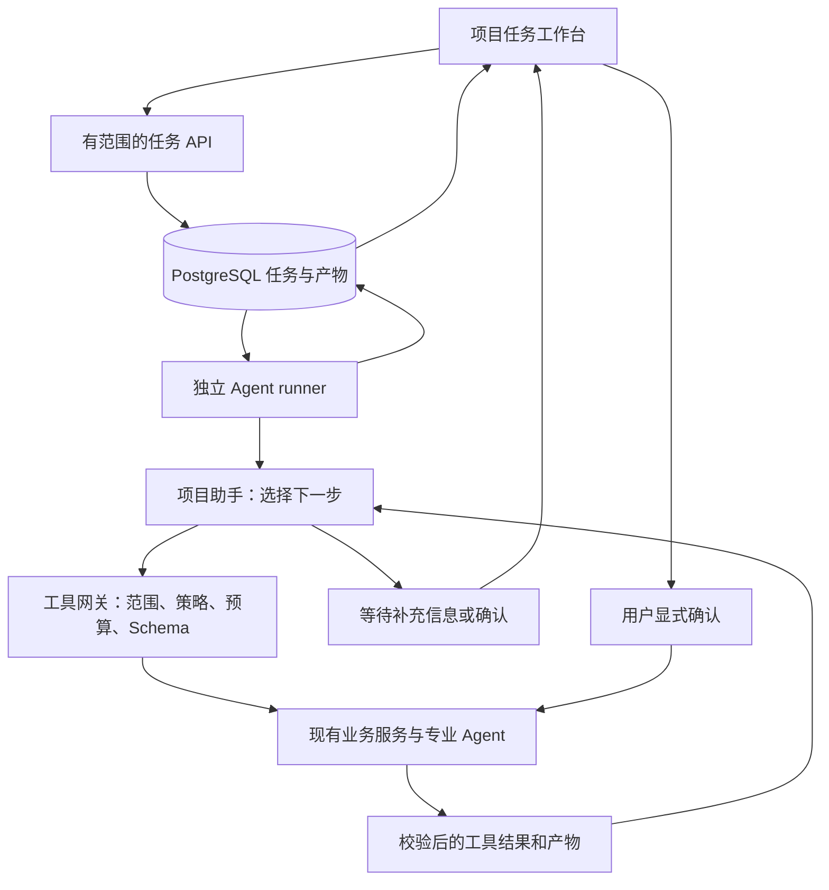

# Knowledge Atlas 项目 Agent 开发方案

[English](PROJECT_AGENT_PLAN.md)

- 文档版本：`project-agent-plan-v1`
- 日期：2026-10-31
- 状态：**M1 已实现并通过本地替身验收；M2–M5 仍为规划。**
- 开发分支：`feat/project-agent`
- 起始提交：`c0eaa06`，包含 CI 环境适配修复。
- 基线数据库 head：`20261029_0019`；M1 新增源码迁移 `20261031_0020`，未自动升级业务库。

M1 实现五项只读工具、独立任务/报告协议、同步持久化重放和统一目标界面，见 [ADR0076](adr/0076-read-only-project-assistant.zh-CN.md)及[验收记录](PROJECT_ASSISTANT_M1.zh-CN.md)。下文后续能力仍为设计目标；异步 API 示例和写入工具未实现。

## 1. 产品目标与范围

让项目范围内的 Agent 成为 Knowledge Atlas 的主要操作入口。用户描述目标，Agent 选择有界工具、收集证据、生成产物，并在需要时请求补充信息或确认。资料、笔记、审核、代码和图谱工作区继续用于查看、核对和编辑具体业务对象。

改造覆盖整个应用：项目、资料、开发笔记、代码分析、证据问答、知识抽取、经过审核的图谱变更和项目报告。自然语言任务编排现有业务服务；权限、校验、事务、版本和正式知识写入继续由业务服务负责。

典型目标：

- 结合文档、源码和已确认知识解释项目模块，并提供精确来源。
- 导入选定的仓库快照，解析支持的文件，提出待审核知识。
- 把开发排错记录整理成笔记，寻找相似问题，关联用户提供的修复提交。
- 将新技术决策与历史记录对比，提出待人工审核的知识替代建议。
- 生成带依据和未决问题的项目总结或面试讲解草稿。

所有跨模块能力最终都应能从统一任务入口访问。普通笔记编辑、自动保存、导航和确定性解析继续走正常应用操作，无需调用模型。

## 2. 已有基础与差距

| 领域 | 起始提交已经具备 | 计划扩展 |
| --- | --- | --- |
| Agent 角色 | `code_analysis`、`knowledge_extraction`、`evidence_qa` | 由 `project_assistant` 协调允许使用的能力 |
| 编排 | 两条显式 LangGraph 流程、有界模型/工具循环 | 根据目标跨模块选择下一步动作 |
| 持久化 | `agent_runs`、调用预留、事件、校验后的部分结果和租约 fencing | 持久化排队任务、产物/操作记录和受控继续执行 |
| 执行 | 同步 POST；GET 和同 UUID 重放不调用模型 | 独立异步 Agent runner，只读轮询/事件回放 |
| 资料 | Markdown/代码上传、文件夹、固定 GitHub 快照、原文块和精确行号 | 有范围的资料发现及任务可调用的导入/解析操作 |
| 笔记 | 本地 Markdown 可以作为资料导入 | 网页编辑、自动保存、不可变修订和原始笔记搜索 |
| 知识 | 候选审核、提升、身份/演化治理和历史证据 | Agent 生成提案，现有人工审核服务执行正式变更 |
| 界面 | 资料/审核/图谱/会话页面和两类流程的 Agent 页面 | 统一目标输入、任务进度、产物和上下文确认 |

当前本地工程参考结果为后端 995 项通过、11 项跳过、覆盖率 95.45%。这是起始工程基线，不代表新增 Agent 能力或质量。回答协议为 `evidence-claims-v3`，其真实质量尚未重新测量。冻结 v2 实验及所有历史账本保持不变。

当前运行时**尚不提供**通用自主规划、排队模型执行或崩溃后自动逐节点续跑。现有 `resume` 仅完成已审核工作流，不是通用 Agent 恢复接口。

## 3. 任务使用流程

1. 选择项目，输入目标，可附带已授权资料、笔记修订、代码快照和知识时间。
2. 后端固定范围、允许能力和预算。Agent 给出简短操作摘要，选择下一项允许的动作。
3. 工具返回有界结构化结果。Agent 可以调整检索、调用专业能力、提出必要问题或结束任务。
4. 结果以类型化产物展示：引用回答、笔记草稿、资料总结、代码发现或变更提案。
5. 已批准写入通过业务服务执行。任务记录具体结果，并链接到已保存对象。
6. 刷新页面仅通过读取恢复状态和产物，不重新提交付费任务。

用户看到操作摘要、证据、进度和用量，不展示模型私有思维链。缺失证据和未验证推测必须明确标注。

## 4. 目标架构

继续使用 Vue 3、FastAPI、PostgreSQL/pgvector、现有供应商适配器和固定版本 LangGraph。在规范目录 `agents/`、`tools/`、`workflows/`、`services/`、`llm/` 内扩展。初始使用一个协调 Agent 和已有专业角色；新增角色应有实际上下文或职责需求作为依据。

现有解析 Worker 保持原职责。新增 Agent runner 仅消费用户显式提交的 Agent 任务，不能自动消费旧解析任务或历史 `agent_runs`。首期不增加 Redis、另一种图数据库、任意 shell 权限或框架替换。

## 5. 决策循环与执行策略

协调 Agent 输出严格的动作联合类型：`call_tool`、`ask_user`、`propose_change`、`finish`。未知动作和非法参数必须被拒绝。工具结果、文档内容和检索到的指令均为不可信输入，不能充当授权。

工具网关在模型参数之外绑定用户/项目身份及允许的版本。每次模型、工具或嵌入尝试前，检查执行归属、剩余预算、取消标记和时间限制。专业 Agent 共享任务预算；一次真实供应商请求只计数一次，并记录父子调用关系，不能因多层包装重复计数。

初始策略沿用现有任务上限：8 次模型尝试、16 次工具、4 次嵌入尝试；现有单角色上限仍为 4 次模型、8 次工具。还需明确运行时间、输入输出、扫描和产物大小限制。只有经过配置/版本审阅并有测量依据时才调整上限。更换语义检索条件属于预算内规划动作；传输失败不意味着可以自动重试付费请求。

只读动作及用户要求的新草稿可以在提交目标的范围内连续执行。替换已有内容需要绑定具体版本的提案。正式知识确认、合并、替代、停用继续由人工通过现有审核服务决定。首期不开放外部发布、远程仓库写入、破坏性删除或无边界命令执行。

## 6. 全项目能力与工具矩阵

下列工具名是**拟议契约**，不代表现在都已可被模型调用。每个工具须声明输入/输出 Schema、能力组、操作效果类别、范围规则、结果上限和幂等行为。

| 领域 | 拟议工具 / 适配器 | 效果与边界 |
| --- | --- | --- |
| 项目 | `get_project_overview`、`list_project_sources` | 仅读取当前选定项目 |
| 资料发现 | `search_sources`、`read_source_chunk`、`get_parse_status` | 有界原始资料检索；精确不可变资料/分块来源 |
| 已确认知识 | `search_knowledge`、`read_evidence` | 复用项目/时间隔离的检索和合法证据 |
| 代码 | `search_symbols`、`read_source_range`、`analyze_code` | 已授权快照；静态/派生结果，不执行用户代码 |
| 导入与解析 | `import_repository_snapshot`、`request_source_parse` | 显式选择仓库/ref；沿用有界导入与解析任务 |
| 笔记 | `search_notes`、`read_note_revision`、`create_note_draft`、`propose_note_revision` | 新笔记服务；不可变修订和冲突检测 |
| 抽取 | `propose_knowledge` | 现有抽取/严格原文校验，仅生成候选 |
| 知识治理 | `inspect_knowledge_conflicts`、`propose_knowledge_change` | 只读检查或提案；现有人工操作执行正式写入 |
| 报告 | `create_report_draft` | 带来源与不确定说明的版本化产物 |

现有已确认知识检索不会搜索全部上传文档或未审核笔记。`search_sources` 和 `search_notes` 须新增明确作用域的实现，并使用独立索引或有界词法扫描。Agent 生成标签不能绕过这些边界。导入/解析资料不等于确认知识，也不自动触发嵌入或模型调用。

## 7. 拟议数据模型与兼容

为通用助手新增模型，避免静默改变旧 `AgentRun` 状态约束或 API 语义。下列名称在实现 ADR 和迁移接受前均为暂定。

| 拟议记录 | 用途 |
| --- | --- |
| `assistant_threads`、`assistant_messages` | 项目隔离的会话、任务链接及用户明确约束 |
| `assistant_tasks` | 版本化目标/范围、状态、上限、执行归属和租约 |
| `assistant_steps`、`assistant_attempts` | 步骤结果、调用预留、结果/未知状态和供应商元数据 |
| `assistant_artifacts` | 带来源、状态、任务关联的类型化草稿/报告/结果 |
| `assistant_operations`、`assistant_approvals` | 不可变写入提案、预期版本、用户决定及执行回执 |
| `notes`、`note_revisions` | 稳定笔记身份、当前修订指针和不可变 Markdown 修订 |

记录统一使用业务 UUID，保留用户/项目范围。已接受产物和消息遵守明确的保留策略；运维事件只保存白名单元数据，不保存凭据、原始提示词或工具正文。功能需要的用户内容保存在其作用域内的业务记录中。

笔记每个修订记录父修订、内容哈希、人工/Agent 来源和任务关联。人工自动保存通过乐观并发控制创建新修订；Agent 编辑基于明确父版本生成提案。接受后的笔记可生成不可变 `SourceDocument` 快照，进入现有抽取流程；编辑笔记不能覆盖已导入证据或改变已审核引文。

现有资料、审核、会话及 `/agent-runs` 契约保持可用。新记录可关联旧执行或候选，但不能重新解释旧状态、重放旧请求或把历史模型标签写成人工分数。实际迁移实现并通过验证前，数据库 head 继续为 `20261029_0019`。

## 8. 证据、产物与记忆

区分会话/任务上下文、原始项目材料、已确认知识三类语义。每次按任务需要读取有界相关内容。模型总结是带来源的派生记录，不自动成为可信知识。

正式知识回答继续使用 `evidence-claims-v3` 及当前范围内的正式证据 ID。混合未审核笔记、原始分块或代码发现的助手报告，需要独立版本化产物 Schema，并使用类型化引用：资料/分块/版本/行号、笔记/修订、正式证据 ID 或固定仓库提交。逐项校验归属和引用文本，不能把笔记 UUID 当作正式证据 UUID，也不能静默扩大 `QuestionRead` 的证据范围。

界面应区分结论来自已确认知识、未审核笔记、源码还是派生静态分析。关联用户提供的修复提交不等于验证测试已经通过。区分已验证结果、用户报告结果、推测和待验证信息。历史知识时间不能静默使用当前代码；除非新契约显式定义不同时间域，否则保留现有约束。

## 9. 持久化执行与写入确认

拟议任务状态：`queued`、`running`、`waiting_input`、`waiting_approval`、`succeeded`、`failed`、`interrupted`、`cancelled`。这些属于新任务 API，不能直接套入旧 `/agent-runs` 响应。

- 事务认领排队任务，使用租约和执行令牌；每次检查点与写入均验证当前执行归属。初期一个 runner，每任务同一时刻只有一个执行者。
- 传输前持久化调用预留，在明确事务边界保存校验后的工具/产物结果。部分结果保存不能顺带提交其他待提交 ORM 写入。
- 显式继续执行时复用已完成步骤回执。同一请求 UUID 的再次提交只读取/重放结果，不构成新执行授权。
- 进程若在可能发出请求后、保存结果前退出，将该尝试标为 `unknown`。不得自动重复，也不承诺远程调用 exactly-once。后续付费尝试须显式继续，并核对剩余预算。
- 取消阻止后续步骤；在途供应商请求仍可能完成且保留计数。失去执行归属的旧执行者不能再发布写入。
- 确认绑定用户/项目/任务、操作类型、精确对象 ID、预期版本和提案哈希。计划变化或对象过期使确认失效，返回待审核冲突。
- 应用服务执行已批准且幂等的操作 ID，尽可能原子保存业务结果和回执。通过回执恢复，不能让模型猜测写入是否发生。

普通写入与破坏性/正式知识操作使用不同能力策略。人工确认只批准具体变更，不无限授权模型后续决定。用户拒绝提案也是合法任务结果。

## 10. 拟议 API

以下是设计示例，尚未实现。正式请求、错误码和上限在实现时更新 API 契约。

| 方法与路径，统一前缀 `/api/v1` | 拟议语义 |
| --- | --- |
| `POST /projects/{project_id}/assistant/threads` | 创建有范围的会话 |
| `POST /projects/{project_id}/assistant/tasks` | 提交 `request_id`、目标、附件/范围和上限；异步阶段返回 202 与任务 ID |
| `GET /projects/{project_id}/assistant/tasks/{task_id}` | 读取已保存状态、用量和产物摘要 |
| `GET /projects/{project_id}/assistant/tasks/{task_id}/events?after=sequence` | 有界读取已提交事件；先实现轮询，再按需补 SSE |
| `GET /projects/{project_id}/assistant/tasks/{task_id}/artifacts/{artifact_id}` | 读取有类型、带范围的产物 |
| `POST /projects/{project_id}/assistant/tasks/{task_id}/input` | 补充被请求的信息，不隐式新增预算 |
| `POST /projects/{project_id}/assistant/tasks/{task_id}/approvals` | 接受/拒绝精确提案；执行已授权确定性写入无需再调用模型 |
| `POST /projects/{project_id}/assistant/tasks/{task_id}/continue` | 核对执行归属、预算和尝试状态后显式继续合适任务 |
| `POST /projects/{project_id}/assistant/tasks/{task_id}/cancel` | 幂等阻止后续步骤 |

使用独立版本化请求 Schema，如 `assistant-task-v1`；不能把任意日志塞进旧的 200 字符问题字段。目标、附件、工具输出和产物均须有明确大小限制。附件使用后端已授权对象引用，不接受任意本机路径或携带凭据的 URL。GET、页面恢复、事件重连不得执行工具或预留调用。

## 11. 前端任务工作台

将现有 Agent 页逐步改造成项目任务工作台：目标/附件输入、固定范围预览、任务历史/进度、产物区域和上下文确认/差异区域。复用原文/证据导航与现有图谱/编辑页面。以可见引用和已保存对象链接证明结果，不能只用文本声称操作完成。

展示可操作的空态、失败、中断、等待状态、剩余调用上限和确认后的结果。保留项目/请求 fencing、提交结果未知时先读后重试、URL 恢复、键盘焦点、长内容换行和面板滚动。初期只读轮询即可，SSE 为可选扩展。刷新只恢复任务，不提交任务。可见界面变化仍须进行桌面真实浏览器验收。

## 12. 开发阶段与退出标准

| 阶段 | 交付物 | 退出标准 |
| --- | --- | --- |
| M0：契约与基线 | 本中英文方案、领域/工具清单、产物/范围契约及实现 ADR 提案 | 范围、验收任务和兼容边界可审阅，不把规划能力写成已实现 |
| M1：统一只读助手 | 新目标输入/API、协调 Agent、网关、资料/已确认知识/代码适配器；初期允许有界同步执行 | 一个目标使用至少两个相关领域，引用精确输入，必要时补问，预算内停止；旧接口与用户/版本边界回归通过 |
| M2：可靠任务执行 | 新任务/尝试/产物记录、独立 runner、任务进度界面、取消和显式继续 | 排队、崩溃窗口、过期执行者、未知传输结果及同 UUID 重放有确定性测试；GET/刷新预留调用为零 |
| M3：笔记与可编辑产物 | 笔记编辑/自动保存、修订服务、原始笔记搜索、Agent 草稿和可审阅修改提案 | 人工与 Agent 编辑保留历史；并发/过期编辑返回冲突；保存笔记可被检索和引用，不自动成为正式知识 |
| M4：全项目动作 | 有范围的导入/解析、抽取候选、报告草稿及受治理的知识变更提案 | 导入→解析→提案→人工审核→查看结果可通过一个任务完成；正式变更具备人工确认、版本绑定和幂等 |
| M5：验收与发布 | 跨模块回归包、另行授权的真实开发评估、文档、录制演示及发布准备 | 功能/权限/恢复测试和 CI 通过；真实证据与局限如实记录；历史冻结实验保持不变 |

M1 按 ADR0076 已实现并通过本地替身验收；M2–M5 仍为规划。每阶段形成有明确范围、测试和双语文档的可审阅变更。跨越 ADR0064–0068 的同步执行、写工具策略或数据语义边界前，须通过新的已接受 ADR 记录决策。完成某阶段不自动授权下一阶段或真实供应商实验。

## 13. 验证与质量测量

### 工程验收

- 覆盖工具白名单、参数校验、跨用户/项目/版本/时间拒绝、资料中的恶意指令、扫描上限和截断。
- 验证无证据行为、精确引用及原始/已确认来源区分；保持 v2/平铺历史可读。
- 验证每次真实尝试只预留一次、进度保存失败后不继续调用、未知尝试不自动重放、取消和过期租约 fencing。
- 验证确认篡改、错误操作者、对象版本变化、并发编辑、重复确认与操作重放不产生重复写入。
- 验证笔记自动保存及任务 GET/刷新/事件读取不调用模型；专业 Agent 嵌套不重复记费。
- 运行聚焦测试、一次与变更相称的完整后端覆盖率检查（沿用 90% 门槛）；前端变化执行检查/构建及桌面浏览器验收。迁移使用物理隔离的临时 schema 验证原生 PostgreSQL 升/降级与恢复。

使用现有 `.venv` 和 `node_modules`。本 Windows 环境使用忽略的 `output` 下全新 pytest 临时目录，并按既有文档处理必要的执行环境限制。区分 Linux CI/Docker 与本地结果；本地修复通过不等于远程容器已通过。

### 任务质量评估

新建独立 20 项开发任务包：证据问答、资料/项目整理、代码理解、笔记维护、跨模块受治理变更各 4 项。覆盖模糊请求、证据缺失、旧修订和用户拒绝。真实调用前冻结输入、预期产物、允许动作与评分规则。合成协议测试只验证执行行为，不代表模型任务质量。

以**全部尝试任务**为分母报告完成率，同时报告结构失败、事实正确性/完整性、精确引用支持、不当操作/绕过确认、无效工具调用、时延和尝试/供应商上报用量。另列有效/可评子集分母及裁判不确定性。人工与模型评分分开；人工覆盖率可保持 0%，必须披露。质量阈值在运行前制定，不根据结果挑选；20 项只能提供试验性证据，不能证明普遍可靠性。

使用新版本输出目录和适配任务/产物的评分包。现有回答裁判不能自动评价写入、恢复或一般任务完成情况。真实供应商调用须先生成具体零调用预演并另行明确授权上限。保留旧授权、原始输出、排除清单、分母和冻结 holdout-v3，不用本轮结果改写历史 v2 实验。开发修改完成后，若进行最终质量验收，应使用另一组未参与调试的新任务。

## 14. 发布与毕业基线

继续在 `feat/project-agent` 开发，保留 `c0eaa06` 为分支起点。不移动已有毕业标签，也不把未发布标签说成已发布版本。实际开发阶段才新增迁移，应用库升级前先备份并验证恢复。在兼容测试和明确迁移方案允许移除前，保留旧模块/API 别名。

首个目标是本地单用户使用。公开部署前须补齐真实认证与授权、部署/密钥配置、备份和运行限制；开发用户边界不等于生产认证。发布、部署、外部写入及新增付费评估均与本轮写方案分开处理。

简历和 README 的能力描述以测量和交付结果为依据：区分任务完成率与单元测试数量、引用归属与语义支撑、检查点保存与恢复保证。录制确定性演示，并为每项宣称完成的动作保存任务依据。

## 15. 首个实现切片

先实现这个全项目只读任务：

> 结合所选项目的文档、已确认知识和固定代码快照，解释主要模块，列出已有记录中的未决问题，并为每项结论标明来源。信息缺失时明确指出，不补造结论。

实现目标提交、范围绑定、协调 Agent，以及最少必要的资料/知识/代码工具。返回类型化引用报告和可核对的工具/用量记录。验证跨模块成功、信息缺失、外部 ID、预算耗尽及刷新/重放。第一步就建立有价值的全局 Agent 入口，再扩展写入，无需先做成仅限笔记的助手。

## 16. 默认方案与后续决策点

| 项目 | 建议默认值 / 决策门槛 |
| --- | --- |
| 运行时/供应商 | 复用固定版本 LangGraph 和现有 DeepSeek 适配器；M1 不捆绑框架/模型迁移 |
| 并发 | 初期一个 runner、每任务一个活跃执行者；并行写入前先审阅吞吐依据 |
| 搜索 | 保留已有检索默认值；原始资料/笔记独立有界词法搜索；嵌入需要明确任务能力与预算 |
| 写入自主性 | 明确要求的新草稿可直接生成保存；编辑绑定预期修订；正式图谱动作经过人工审核 |
| 恢复 | 复用已保存结果，不自动重放未知付费尝试 |
| 外部范围 | 首个版本不开放 shell、任意 SQL、自主发布、远程仓库写入或周期性模型执行 |
| 记忆 | 带来源的项目范围记录；保存明确偏好，不把模型自我确认当事实 |
| 真实质量 | 先准备，再单独授权具体运行；本方案不授权新增调用 |

## 17. 参考资料

- [当前受限 Agent 与工作流契约](MULTI_AGENT.zh-CN.md)
- [现有 API 契约](API_CONTRACT.md)、[系统架构](ARCHITECTURE.md)、[知识模型](KNOWLEDGE_MODEL.md)
- ADR [0064](adr/0064-scoped-agent-modules.zh-CN.md)、[0065](adr/0065-durable-reviewed-workflows.zh-CN.md)、[0067](adr/0067-durable-agent-progress.zh-CN.md)、[0068](adr/0068-explicit-workflow-scope.zh-CN.md)、[0075](adr/0075-server-derived-answer-support.zh-CN.md)
- LangGraph：[工作流与 Agent](https://docs.langchain.com/oss/python/langgraph/workflows-agents)、[持久化](https://docs.langchain.com/oss/python/langgraph/persistence)、[中断](https://docs.langchain.com/oss/python/langgraph/interrupts)

外部文档描述通用模式，版本可能领先于当前依赖。实现前按仓库固定版本和测试核对 API；本提案不表示已经配置 checkpointer 或自动恢复。
