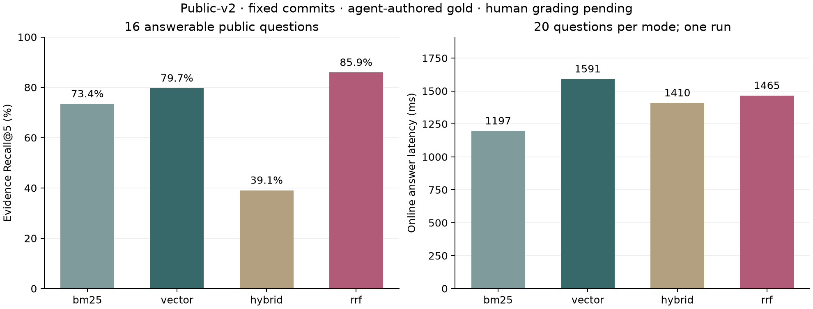

# Public-v2 online acceptance

[简体中文](REPORT.zh-CN.md)

Protocol, corpus and source-derived gold were frozen before this run in [`public-v2`](../../public-v2). Ten full public files from pinned FastAPI and Spring PetClinic commits cover 20 Chinese questions (8 direct, 4 code, 4 cross-document, 4 unanswerable), with separate licenses/provenance. This is separate from the older synthetic development corpus. Gold was authored by the coding agent; it is neither independent human annotation nor a representative repository sample. There are no temporal questions here.

Fingerprint: `0341a422f40d91e9d8f18e40d74ffd5d90cf225994fbbfc5eef6bcfe2a2bd606`. See `preparation.json` and `run.json` for graph/index fingerprints, protocol, actual provider usage and schema cleanup. Ordinary parsing/review services built the fixed graph; separate extraction samples did not feed that graph. Each answer used the real online question service, with unchanged retrieval weights and prompt across modes. Literal keyword is retrieval-only and retrieved no gold evidence for these Chinese questions over English code.

| Mode | Evidence Recall@5 | Citation F1 | Automatic support/refusal | Mean online latency |
| --- | ---: | ---: | ---: | ---: |
| BM25 | 73.44% | 80.00% | 95% | 1196.8 ms |
| Vector | 79.69% | 76.92% | 95% | 1591.2 ms |
| Hybrid | 39.06% | 70.00% | 85% | 1410.0 ms |
| RRF | 85.94% | 77.61% | 100% | 1465.4 ms |

Recall is the mean over 16 answerable questions, matching exact source/line evidence under `line-evidence-v2`. Automatic support/refusal is a status metric, not human semantic correctness. Citation overlap and required-fact matching likewise do not establish answer quality. **Human correctness, explainability and cross-document semantic accuracy remain unscored (0% human coverage).** Latency is a single-run local/network observation.

The predeclared primary metric selects RRF as the new question default while retaining explicit mode choice and the keyword API default. RRF minus vector Recall@5 is +6.25 percentage points, paired question bootstrap 95% interval **[−6.25, +18.75]**, n=16, 2,000 samples. This includes zero and does not establish general superiority. Hybrid was lower on this set; no weights were fitted to these questions. Now that the set informed a default, it must not be described as held out for future tuning. Later identity/vector regressions do not alter this no-merge corpus and were not represented as new paid runs.

Two separate real extraction samples succeeded: `first_steps.py` produced 5 candidates, `dependencies.py` 12. Their exact source evidence passed the normal structural checks; semantic precision still needs human assessment. A separate [public code-call check](../2026-10-26-public-calls) found the known `Owner.addVisit → Pet.addVisit` target using single_step (1 model request), tools (2) and native Java static analysis (0). This is a positive functional check with incomplete Spring/JPA dependencies, not full-call-graph accuracy.

This run made 79 answer + 2 extraction attempts and 61 embedding attempts; one evidence-empty hybrid case refused locally. The code-call check adds 3 model attempts: **84 model / 61 embedding cumulative**, under the authorized 120/160 caps. Usage-reported tokens for this run are 124,689 prompt / 11,245 completion; provider billing cost is unverified. No private inputs were sent. The preceding `2026-10-26-public-v2` directory records a zero-provider preflight failure; it was preserved, not overwritten. Disposable schemas were removed.



Open [`blind-review.html`](blind-review.html) in a local browser for the 80 randomized, mode-hidden answer rows. Use a real reviewer alias, boolean correctness, 1–5 explainability and optional notes. The page stores progress locally and downloads a CSV; it never submits to a server. Keep `grading-key.json` away from reviewers. Blank scores must remain missing.

From `backend/`, import actual reviewer CSV into a new result directory:

```powershell
.\.venv\Scripts\python.exe -m scripts.review_public score --dataset ../evaluation/public-v2 --acceptance-dir ../evaluation/results/2026-10-26-public-v2-run1 --review-csv <actual-review.csv> --output-dir <new-human-result-directory>
```

The importer rejects incomplete scores unless explicitly passed `--allow-partial`, duplicate/unknown IDs, missing reviewers or invalid values. Export/score/chart commands are offline; rerunning the provider runner requires a fresh result directory and the persistent cumulative ledger. Do not reset the ledger, replace missing grades with automatic scores, or infer full-repository/private-repository acceptance from this report.
