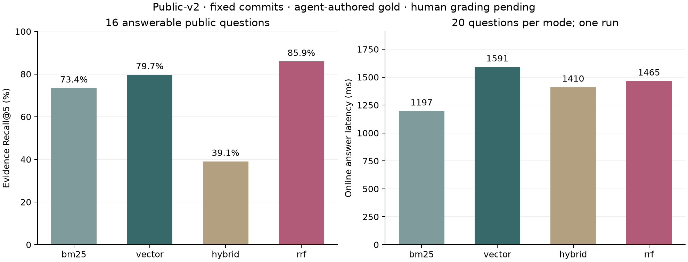

# Public-v2 真实在线验收


协议、语料和原文金标于调用前冻结在 [`public-v2`](../../public-v2)。10 份固定 FastAPI / Spring PetClinic 提交的完整公开文件，包含 20 道中文题（8 直接、4 代码、4 跨文档、4 无答案），附许可证和出处；与旧合成开发语料分离。金标由编码 Agent 编制，不是独立人工标注，也不代表完整仓库。本集不含历史问题。

指纹：`0341a422f40d91e9d8f18e40d74ffd5d90cf225994fbbfc5eef6bcfe2a2bd606`。图谱/索引指纹、协议、实际供应商请求及 schema 清理见 `preparation.json`、`run.json`。固定图谱通过普通解析/审核服务建立；独立抽取样本未参与该图谱。各模式均使用真实在线问答服务，相同权重和提示词。字面 keyword 只测检索，这些中文题未命中英文代码金标。

| 模式 | 证据 Recall@5 | 引用 F1 | 自动支持/拒答状态 | 在线平均耗时 |
| --- | ---: | ---: | ---: | ---: |
| BM25 | 73.44% | 80.00% | 95% | 1196.8 ms |
| Vector | 79.69% | 76.92% | 95% | 1591.2 ms |
| Hybrid | 39.06% | 70.00% | 85% | 1410.0 ms |
| RRF | 85.94% | 77.61% | 100% | 1465.4 ms |

Recall 按 `line-evidence-v2` 精确来源/行区间，在 16 道可回答题上求均值。自动支持/拒答只衡量状态，不是人工语义正确性；引用重叠和必要事实匹配同样不能证明答案质量。**人工正确率、解释性、跨文档语义正确率仍缺失，人工覆盖率 0%。** 耗时仅为本机/网络单轮观测。

按预先指定的主指标，将问答默认值改为 RRF，保留显式模式选择及 keyword 搜索 API 默认值。RRF 相对向量 Recall@5 +6.25 个百分点，按题配对 bootstrap 95% 区间 **[−6.25, +18.75]**，n=16，2,000 次采样。区间包含零，不能证明普遍更优。Hybrid 在本集较弱，未据本集拟合权重。本集既已影响默认策略，未来调参不能再称独立测试集。后续身份/向量修复不改变无合并的本语料，也没有冒充新付费实验。

两份独立真实抽取均成功：`first_steps.py` 产生 5 个候选，`dependencies.py` 产生 12 个，逐字证据通过普通结构校验；语义精确率仍待人工评审。另行[公开代码调用验收](../2026-10-26-public-calls)中，single_step（1 次模型）、tools（2 次）、Java 原生静态分析（0 次）均找到已知 `Owner.addVisit → Pet.addVisit` 目标。它是 Spring/JPA 依赖不完整条件下的功能正例，不是完整调用图准确率。

本次 79 次回答 + 2 次抽取、61 次嵌入尝试；一题 hybrid 无证据，在本地拒答。代码验收另加 3 次模型：累计 **84 次模型 / 61 次嵌入**，低于授权 120/160 上限。本次供应商上报输入 124,689 / 输出 11,245 tokens，账单金额未核验。没有私有输入。前一目录 `2026-10-26-public-v2` 记录零供应商请求的预检失败，保留而未覆盖。临时 schema 已清理。



用本地浏览器打开 [`blind-review.html`](blind-review.html)，共有 80 行随机排序、隐藏模式的答案。由真实评审填写署名、正确与否、1–5 解释性和可选说明。页面本地保存进度并下载 CSV，不上传服务器。评审不能读取 `grading-key.json`。空白评分必须保持缺失。

在 `backend/` 导入真实评审 CSV 至新目录：

```powershell
.\.venv\Scripts\python.exe -m scripts.review_public score --dataset ../evaluation/public-v2 --acceptance-dir ../evaluation/results/2026-10-26-public-v2-run1 --review-csv <actual-review.csv> --output-dir <new-human-result-directory>
```

默认拒绝未完成的评分；`--allow-partial` 才可导入部分实际评分。重复/未知 ID、无评审署名和非法值均拒绝。导出/评分/画图都是离线命令；付费重跑需新结果目录并继续使用累计账本。不能重置账本、用自动分数冒充人工分数，或由此推断完整/私有仓库已验收。
