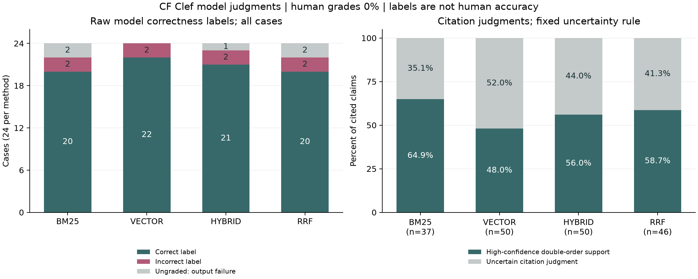

# Holdout-v3: anonymous Cloudflare Clef model judging

[简体中文](REPORT.zh-CN.md)

On2026-10-31 the user's explicit authorization completed **457 planned/reserved/completed requests** for91 valid answers and183 cited supported claims, without retries/fallback/resume. Inputs are from the [complete QA retry](../2026-10-31-holdout-v3-run2/REPORT.md). Five invalid outputs among96 execution records remain separate; no answers/grades are fabricated. Human grading coverage: **0%**.

## Results

These are raw model labels, not human accuracy. Every method has24 total cases but different gradable subsets, so both denominators are shown.

| Method | Graded / all | Correct label / all | Correct label / graded | Complete / graded | High-confidence double-order citation support | Uncertain citations |
| --- | ---: | ---: | ---: | ---: | ---: | ---: |
| BM25 | 22/24 | 20/24 (83.33%) | 20/22 (90.91%) | 18/22 | 24/37 | 13/37 |
| Vector | 24/24 | 22/24 (91.67%) | 22/24 (91.67%) | 22/24 | 24/50 | 26/50 |
| Hybrid | 23/24 | 21/24 (87.50%) | 21/23 (91.30%) | 21/23 | 28/50 | 22/50 |
| RRF | 22/24 | 20/24 (83.33%) | 20/22 (90.91%) | 19/22 | 27/46 | 19/46 |

In total83/91 valid answers are labeled correct; relative to all96 execution records the correct-label fraction is83/96. Eight answers are labeled incorrect and5 invalid outputs remain ungraded, not model-incorrect labels. Completeness labels:80 complete,9 partial,2 missing.

All183 cited claims received both option orders:103 high-confidence double-order supports,80 uncertain (43.72%), zero order disagreements. All80 uncertainties have at least one confidence below the fixed0.8 threshold; never relabel them supported/unsupported. Fourteen valid answers have no cited supported claim and are outside this denominator.

Citation jobs see only one claim and its actual cited text with at most3 surrounding lines on each side, without reference answers. Support within that context does not prove the cited lines alone suffice.



## Uncertainty and comparisons

Correctness47/91, completeness50/91 and abstention91/91 judgments have confidence below0.8. These quality-dimension counts are descriptive and do not alter raw labels/protocol. Probabilities/confidence lack project-specific human calibration. In particular,66 raw appropriate-abstention labels cannot establish refusal quality.

On the22 cases where every method has a valid graded answer, each method receives20/22 correct labels; see [supplementary analysis](supplementary-comparison.json). The intersection does not filter by correctness but may still have validity-selection bias. It neither replaces all24-case results nor proves equivalence. Vector's higher all-case count accompanies no invalid outputs and does not establish general quality superiority. Citation denominators/content also differ; do not select defaults from these ratios.

Observed model-incorrect cases include temporal19 in all methods, cross-document14 in Vector/Hybrid/RRF, and BM25 case5, whose diagnostic answer passed Schema but was labeled incorrect. All these incorrect labels except BM25 case5 have low confidence. They do not establish root causes. Reproduce version/cross-document issues on separate development fixtures; do not tune test cases, prompts, ranking or thresholds here.

## Scope

Inputs are7 pinned public FastAPI documents and24 Agent-authored cases/reference facts, sharing graph/index and answer configuration across methods. They are not private notes, an unseen framework/repository, or extraction-quality evidence. The graph uses normal-service curated review replay. QA execution was revised after the first failure and reuses one input-verified diagnostic answer; disclose this rather than calling it the original preregistered single blind test.

Judge `@cf/cloudflare/clef` keeps the frozen configuration and returns short name clef, without a verified immutable weight revision. A single judge, Agent references and small related cases limit inference. Model grades never fill human `answer_correct` / `explainability_score`, establish human agreement or prove entailment.

Historical public-v2 citation review used whole answers; this run uses claims. Its45/67 versus current80/183 uncertainty ratios are not a direct quality-improvement comparison.

## Requests, usage and reproduction

457 requests=91 whole-answer quality jobs+183×2 citation jobs, all reserved before transport. No additional requests after completion. Reported usage:188615 input/0 output tokens; actual billed cost unknown and zero output is not free billing. Prior model/embedding, failed/retry and historical214-request Clef ledgers are unchanged. This turn adds457 judge requests and no answer/embedding requests.

[run.json](run.json) preserves validated raw results; [authorization.json](authorization.json) records the user grant/frozen input hashes. [summary.json](summary.json), [per-answer.jsonl](per-answer.jsonl) preserve all96 rows, including5 ungraded failures; [artifact-sha256.json](artifact-sha256.json) records hashes. Offline reproduction from `backend`, with a fresh output:

```powershell
.\.venv\Scripts\python.exe -m scripts.summarize_judging --dataset ../evaluation/holdout-v3 --answers ../evaluation/results/2026-10-31-holdout-v3-run2 --packet ../evaluation/results/2026-10-31-holdout-v3-run2/judge-packet --source-run ../evaluation/results/2026-10-31-holdout-v3-clef-run1/run.json --output ../output/holdout-judge-summary-new
```

Focused tests:76 passed; full backend:960 passed/11 skipped. Summary checks cover mappings, exact citations, request coverage, confidence rules, denominators and fingerprints without editing raw inputs. Reports/figures/demo preparation are offline with no additional judge calls. See the [thesis discussion draft and demo script](../../../docs/HOLDOUT_DISCUSSION_AND_DEMO.md).
