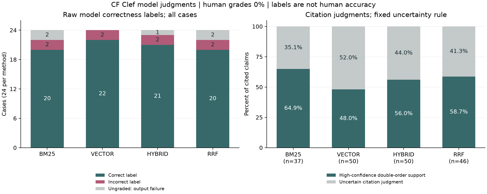

# Holdout-v3：Cloudflare Clef 匿名模型评审


2026-10-31，按用户明确授权完成 **457次计划/预留/完成请求**，评审91条有效答案及其183个带引用支持结论，无重试、回退或续跑。输入来自[完整问答重试](../2026-10-31-holdout-v3-run2/REPORT.zh-CN.md)；原96条执行记录中的5条格式失败仍单列，不补造回答或评分。人工评分覆盖率 **0%**。

## 主要结果

表中均为裁判原始标签，不是人工正确率。每种方法总题数24，裁判可评子集大小不同，所以同时报告两个分母。

| 方法 | 可评 / 全题 | 判正确 / 全题 | 判正确 / 可评 | 判完整 / 可评 | 引用高置信双序支持 | 引用不确定 |
| --- | ---: | ---: | ---: | ---: | ---: | ---: |
| BM25 | 22/24 | 20/24 (83.33%) | 20/22 (90.91%) | 18/22 | 24/37 | 13/37 |
| Vector | 24/24 | 22/24 (91.67%) | 22/24 (91.67%) | 22/24 | 24/50 | 26/50 |
| Hybrid | 23/24 | 21/24 (87.50%) | 21/23 (91.30%) | 21/23 | 28/50 | 22/50 |
| RRF | 22/24 | 20/24 (83.33%) | 20/22 (90.91%) | 19/22 | 27/46 | 19/46 |

合计83/91条有效答案被标为正确；相对于全部96条执行记录，判正确标签占83/96。另有8条被判错误、5条输出格式失败；后者保持未评审，不等同于裁判“错误”标签。完整性标签为80完整、9部分、2缺失。

183个引用结论均完成两次选项顺序判断：103个高置信且双序支持，80个不确定（43.72%），选项顺序分歧0。80个不确定均因至少一次置信度低于固定0.8阈值；不能把不确定改判为支持或不支持。14条有效答案没有带引用支持结论，不进入183这个分母。

引用判断只看单条结论及其实际引用的原文范围、前后最多3行上下文，不传参考答案。它衡量给定上下文的支撑，不能证明只凭引文行本身就足够。



## 不确定性与方法比较

正确性47/91、完整性50/91、拒答合理性91/91的判断置信度低于0.8。质量维度的低置信统计只作补充说明，不改变原始标签或协议；概率/置信度未经本项目人工校准。尤其不能用拒答维度原始66个“合理”标签证明拒答质量。

在四种方法共同有有效输出且已评分的22题上，各方法均20/22个“正确”标签，见[补充统计](supplementary-comparison.json)。该交集没有按正确性筛选，但有效输出筛选仍可能有偏差；它不能替代全24题结果，也不能证明方法等效。原始Vector较高的全题判正确标签数部分伴随其没有格式失败，不足以证明普遍质量优势。引用支持比例的结论数/内容也不同，不据此直接选默认策略。

模型判错的观察包括：历史题19在四种方法中均被判错；跨文档题14在Vector/Hybrid/RRF被判错；BM25题5虽然通过Schema并在诊断重试中成功返回，却被裁判判错。除BM25题5外，这些错误标签本身也低置信，不能直接认定真实根因。后续须在独立开发夹具重现版本/跨文档证据问题；本次不调测试题、提示词、排序或阈值。

## 实验边界

输入为固定提交的7份公开FastAPI文档、24道Agent编制题/参考事实，每种方法相同图谱/索引和回答配置。它不代表用户私人笔记、未见框架/仓库或自动抽取质量；图谱由普通服务回放已审核研究夹具。源问答执行协议在第一次失败后修订，含一条严格核对输入后的诊断答案复用，详见原问答报告；不能称原始预注册的一次盲测。

裁判为 `@cf/cloudflare/clef`，配置指纹保持不变；返回短名称clef，但没有可核验的不可变权重版本。单裁判、Agent参考事实和相关小样本均限制结论。模型分数不填人工 `answer_correct` / `explainability_score`，不代表人工一致性或语义蕴含证明。

历史public-v2引用评审是整答粒度，本次为逐条结论；不将旧45/67与本次80/183的不确定比例当作可直接比较的质量提升。

## 请求、用量与复现

457请求由91次整答质量请求和183×2次引用判断构成。全部使用调用前落盘预留，完成后无额外请求。供应商上报输入188615、输出0 tokens；实际账单金额未知，输出0不代表免费。旧模型/嵌入账本、首次失败/完整重试和历史214次Clef记录均未修改；此处只新增457次裁判，不新增问答/嵌入调用。

[run.json](run.json)为原始已校验结果，[authorization.json](authorization.json)保留用户授权与冻结输入指纹；[summary.json](summary.json)、[per-answer.jsonl](per-answer.jsonl)保留全部96条的覆盖/标签/置信度/不确定性（含5条未评审行），[artifact-sha256.json](artifact-sha256.json)保存归档指纹。离线汇总命令如下，必须换新输出目录：

```powershell
.\.venv\Scripts\python.exe -m scripts.summarize_judging --dataset ../evaluation/holdout-v3 --answers ../evaluation/results/2026-10-31-holdout-v3-run2 --packet ../evaluation/results/2026-10-31-holdout-v3-run2/judge-packet --source-run ../evaluation/results/2026-10-31-holdout-v3-clef-run1/run.json --output ../output/holdout-judge-summary-new
```

聚焦测试76项通过，完整后端960项通过/11跳过；汇总校验匿名映射、原文引用、请求覆盖、置信规则、分母和输入指纹，不改原始结果。报告、图表和演示材料均离线生成，不新增裁判请求。论文小节草稿及固定演示脚本见[讨论与演示](../../../docs/HOLDOUT_DISCUSSION_AND_DEMO.zh-CN.md)。
