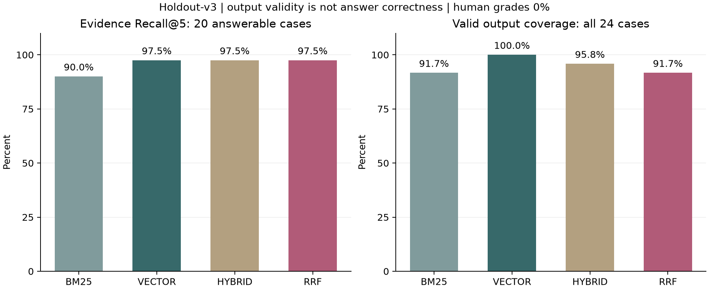

# Full holdout-v3 retry after execution repair

[简体中文](REPORT.zh-CN.md)

On2026-10-31, under the user's explicit fix-and-retry request, all four methods completed24 cases each: **96 execution records,91 valid answer exports and5 invalid outputs**. Status is `completed_with_case_errors`, not all answers passed. One diagnostic+95 main answer requests and73 embeddings remain within the96/73 retry ceiling. No automatic same-case retries, no judge calls, human grading0%.

## Repair

The original failed response for case5 was not retained, so its exact field cause remains unknown. One bounded diagnostic retry passed the original strict checks. The engineering repair prevents a single invalid-output sample from aborting the experiment: [ADR0074](../../../docs/adr/0074-evaluation-output-error-isolation.md) explicitly isolates `QUESTION_OUTPUT_INVALID`, preserves a null answer/failure and continues independent cases. Online Schema/citation validation, prompts, ranking, data and thresholds are unchanged; transport/authentication/budget/unknown errors still stop.

All5 observed failures have `overall_support_mismatch`: top-level `supported` contradicts claim statuses. No flag was silently corrected and no answer fabricated/retried. JSON mode guarantees JSON, not business-Schema adherence; see the [official guide](https://api-docs.deepseek.com/guides/json_mode/). The reported constraint codes come from actual validation chains.

## Results and denominators

| Method | Valid / all cases | Invalid outputs | Evidence Recall@5 | Citation-overlap F1* | Mean per-case ms** |
| --- | ---: | ---: | ---: | ---: | ---: |
| BM25 | 22 / 24 | 2 | 90.00% | 67.69% | 1553.3 |
| Vector | 24 / 24 | 0 | 97.50% | 74.36% | 1817.8 |
| Hybrid | 23 / 24 | 1 | 97.50% | 75.32% | 1740.5 |
| RRF | 22 / 24 | 2 | 97.50% | 70.42% | 2344.5 |

Recall uses original `line-evidence-v2` across all20 answerable cases, including actual retrieval for failed outputs. K counts the first five exported evidence records, not entities. *Citation F1 measures exact source/line/text overlap on valid-answer subsets, whose coverage differs; it is not semantic correctness. The frozen scorer leaves null answers ungraded; failure counts/coverage remain explicit. See [summary.json](summary.json) and method exports for category metrics and raw records.

**Latency includes retrieval/requests and failed cases. BM25 case5 retains the diagnostic generation measurement, not cache-read time. These are not a single continuous-run performance comparison or a production SLA. Small related cases, Agent-authored references and curated reviewed graphs limit inference; do not select defaults or claim answer-quality superiority from these results.



Invalid cases are BM25 cases13/20, Hybrid20 and RRF13/20. [run.json](run.json) preserves sanitized `case_failures`, without failed model text. Valid exports have no semantic judge or human scores yet: validity means engineering checks passed.

## Reuse, budget and limits

BM25 case5 reuses the validated diagnostic answer. Before paid indexing, the new isolated project checks dataset/fixture/application/model-name/protocol plus complete ordered retrieval and actual input evidence. Only unique exact source/line/text matches permit temporary-UUID remapping. [reuse-answer.json](reuse-answer.json) and the export retain provenance/original latency. No legacy answer was split into inferred claims.

The execution protocol changed after the first failure and one diagnostic answer is reused. Disclose both; this is not entirely unseen or the original preregistered single run. Configured models are `deepseek-flash` / `qwen3.7-text-embedding-flash`; matching names do not establish immutable weights. No corpus/reference/answer strategy was tuned on holdout.

Main command, for this attempt's record only; its output/grant is claimed and cannot be replayed:

```powershell
.\.venv\Scripts\python.exe -m scripts.run_public_acceptance --dataset ../evaluation/holdout-v3 --output-dir ../output/holdout-v3-repair-20261031/benchmark-01/live --approved-plan ../output/holdout-v3-repair-20261031/benchmark-01/preflight.json --authorization-ledger ../output/holdout-v3-repair-20261031/benchmark-01/authorization.json --reuse-answer ../output/holdout-v3-repair-20261031/reuse-answer.json --isolate-output-errors --model-limit 95 --embedding-limit 73 --allow-model-calls --allow-embedding-calls
```

All96 answer requests reported111078 input and18562 output tokens. Embedding usage and actual billing are unknown. Historical84/61 and the first failed5/1 ledgers are unchanged; adding this retry gives185 model/135 embedding attempts across these recorded business ledgers, excluding separate judge ledgers. Main ledger95/73 plus diagnostic1 respects96/73; its nominal unused1 model reservation is not an extra grant.

## Judge preparation only

[judge-packet/packet-manifest.json](judge-packet/packet-manifest.json) records96 complete exports,91 gradable answers and5 invalid outputs. Only explicit `--exclude-output-errors` separates these failures into a hashed exclusions list; no substitute answers/human grades were generated. Quality reports must retain total-case and valid-subset denominators.

The fixed CF `@cf/cloudflare/clef` decision protocol with0.8 uncertainty threshold has a [zero-call preflight](judge-preflight/run.json) of **457 requests**:91 whole-answer quality requests plus two option orders for183 cited supported claims. Reservations/completions/model grades remain0; live judging needs separate user authorization. Provider states exclude method/case IDs; citation checks exclude reference answers. CF weights have no verified immutable revision.

## Verification and artifacts

Focused checks: **129 passed**; full backend: **951 passed / 11 skipped**. Every method covers24 cases. [cleanup-verification.json](cleanup-verification.json) confirms no temporary schema/experimental public project and migration head `20261029_0019`. Prior ledgers and frozen inputs are unchanged.

[preflight.json](preflight.json), [authorization-receipt.json](authorization-receipt.json), [authorization.json](authorization.json) preserve configuration/budgets. [diagnostic-run.json](diagnostic-run.json), [diagnostic-prediction.json](diagnostic-prediction.json) preserve the bounded diagnostic. [executed-code.json](executed-code.json) contains the implementation patch against `da6ad65`; [artifact-sha256.json](artifact-sha256.json) records hashes. Figures are available asPNG/SVG; no unmeasured answer-accuracy figure is supplied.
