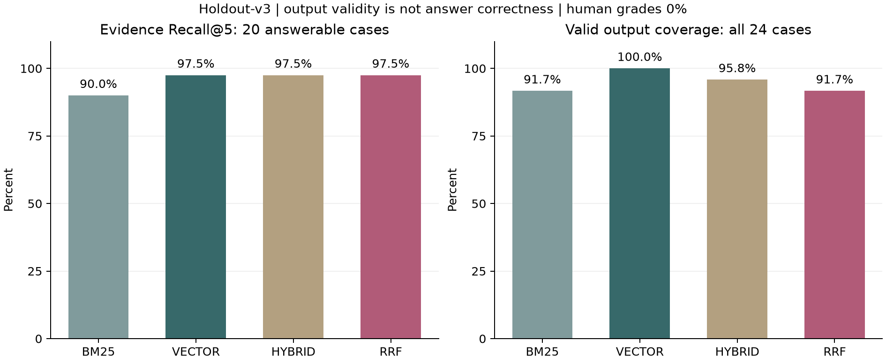

# Holdout-v3 修复后完整重试

[English](REPORT.md)

2026-10-31，按用户“错误修复后重试”的授权完成四种方法各24题，共96条执行记录：**91条有效答案，5条输出格式失败**。状态为 `completed_with_case_errors`，不表示所有回答合格。诊断1次问答、主跑95次问答与73次嵌入，合计仍在本轮96/73上限内；无同题自动重试、无裁判调用，人工评分覆盖率0%。

## 修复了什么

上次第5题的原始失败响应没有保留，不能认定具体字段原因。一次有上限的诊断重试通过原严格校验，未复现该失败。本轮修复的是执行器将单题格式错误升级成整轮中止的问题：[ADR0074](../../../docs/adr/0074-evaluation-output-error-isolation.zh-CN.md)允许显式隔离 `QUESTION_OUTPUT_INVALID`，保留空答案与失败记录、继续其他独立题。线上Schema、引用校验、提示词、排序、数据和阈值不变；网络、认证、预算及其他未知异常仍停止。

本轮明确定位的5条失败均为 `overall_support_mismatch`：模型顶层 `supported` 与逐条结论状态矛盾。没有自动修改这个布尔值、补造答案或重试这些题。JSON模式保证合法JSON，不保证满足业务Schema，参见[官方JSON说明](https://api-docs.deepseek.com/guides/json_mode/)；本次失败分类来自实际校验链，而非推测。

## 结果与分母

| 方法 | 有效答案 / 全部题 | 格式失败 | Evidence Recall@5 | 引用重叠F1* | 每题平均耗时ms** |
| --- | ---: | ---: | ---: | ---: | ---: |
| BM25 | 22 / 24 | 2 | 90.00% | 67.69% | 1553.3 |
| Vector | 24 / 24 | 0 | 97.50% | 74.36% | 1817.8 |
| Hybrid | 23 / 24 | 1 | 97.50% | 75.32% | 1740.5 |
| RRF | 22 / 24 | 2 | 97.50% | 70.42% | 2344.5 |

Recall按原 `line-evidence-v2` 在全部20道可回答题上计算，包括输出失败题的真实检索；K是导出顺序前五条证据，不是实体数。*引用F1是在有效答案子集上的原文位置/文本重叠指标，分母随可评覆盖变化，不是语义正确率。空答案在冻结评分器中保持未评测；失败数量/覆盖率单独报告，不能从全题分母悄悄删除。分类指标及全部原始数据在 [summary.json](summary.json) 和各方法文件中。

**耗时包含请求与检索，失败题也保留实测值；BM25第5题使用诊断阶段原始生成耗时，而非本次缓存读取耗时。它们不是同次连续运行的纯性能对照，也不是生产SLA。小样本、相关题目、Agent编制参考及已审核夹具均限制结论；不据此更改默认策略或宣称答案质量优势。



格式失败题为BM25的13/20、Hybrid的20、RRF的13/20。原始脱敏错误在 [run.json](run.json) 的 `case_failures`，没有失败模型正文。有效答案仍未经过语义裁判或人工评分；“有效”只表示通过工程校验。

## 复用、预算与实验边界

BM25第5题复用了成功诊断答案。新的隔离项目在付费建索引前重新核对数据/夹具/应用代码/模型名称/回答协议，以及完整有序检索证据和实际输入池；仅在原文位置与文本唯一、完全相同时映射临时UUID。来源见 [reuse-answer.json](reuse-answer.json)，当前记录保留 `reuse` 标记和原生成耗时。没有将旧平铺答案拆成结论。

执行协议是在首轮失败后修订，且本轮有一条诊断复用，必须披露，不能声称完全未见或原预注册的单次运行。回答模型/嵌入模型名称为 `deepseek-flash` / `qwen3.7-text-embedding-flash`，名称相同不保证权重不可变。语料/金标及回答策略未根据holdout调整。

主跑命令如下，仅作本轮记录；输出及授权已认领，不可重复执行：

```powershell
.\.venv\Scripts\python.exe -m scripts.run_public_acceptance --dataset ../evaluation/holdout-v3 --output-dir ../output/holdout-v3-repair-20261031/benchmark-01/live --approved-plan ../output/holdout-v3-repair-20261031/benchmark-01/preflight.json --authorization-ledger ../output/holdout-v3-repair-20261031/benchmark-01/authorization.json --reuse-answer ../output/holdout-v3-repair-20261031/reuse-answer.json --isolate-output-errors --model-limit 95 --embedding-limit 73 --allow-model-calls --allow-embedding-calls
```

本轮96次问答均上报用量：输入111078、输出18562 tokens；嵌入用量与实际账单金额未知，不据此声称免费。原历史84/61账本和第一次失败轮次5/1均未改动；这些已登记业务账本加本次为185次模型/135次嵌入，旧裁判账本另存。独立主账本预留95次模型、73次嵌入，另加诊断1次，不能把主账本名义剩余1次当作额外授权。

## 裁判准备，尚未执行

[judge-packet/packet-manifest.json](judge-packet/packet-manifest.json) 明确记录96条完整导出、91条可评答案及5条格式失败。只有显式 `--exclude-output-errors` 才可分离无效输出，排除清单另存并校验哈希；没有为其补写回答或人工分数。质量汇总必须同时报告全题数与有效子集分母。

按既定CF `@cf/cloudflare/clef` decision及0.8不确定阈值，[零调用预演](judge-preflight/run.json)计划 **457次请求**：91次整答质量请求、183个有引用支持结论各两次交换选项顺序判断。预留/完成/模型评分均0；真实裁判仍须用户独立授权。请求数据不含方法/题目ID，结论引用检查不传参考答案。CF模型无可验证不可变权重版本，须保留此限制。

## 验证与可追溯文件

聚焦 **129 passed**，完整后端 **951 passed / 11 skipped**。四组均覆盖全部24题；[cleanup-verification.json](cleanup-verification.json)确认临时schema已清理、实验项目未进入public，迁移版本仍 `20261029_0019`。旧账本及冻结资料不变。

[preflight.json](preflight.json)、[authorization-receipt.json](authorization-receipt.json)、[authorization.json](authorization.json)保留配置和预算；[diagnostic-run.json](diagnostic-run.json)、[diagnostic-prediction.json](diagnostic-prediction.json)保留一次诊断；[executed-code.json](executed-code.json)保留相对 `da6ad65` 的执行实现补丁；[artifact-sha256.json](artifact-sha256.json)保存归档指纹。检索/覆盖图提供PNG及SVG，不提供尚未取得的答案正确率图表。
